{
  "title": "长期主义交流打卡搭子 · 2026-10-12 至 2026-10-18",
  "date": "2026-10-12",
  "layout": "weekly",
  "group_id": "group-1",
  "record_dates": [
    "2026-10-12",
    "2026-10-13",
    "2026-10-14",
    "2026-10-15",
    "2026-10-16",
    "2026-10-17",
    "2026-10-18"
  ],
  "generated_by": "checkins-v1",
  "iso_year": 2026,
  "iso_week": 42,
  "date_summary": [
    "📅 周打卡：2026-10-12 至 2026-10-18（第42周）",
    "🏆 季度：2026年第4季度｜已过18天，剩余74天",
    "⏳ 年度：2026年｜已过291天（79.73%），剩余74天（20.27%）"
  ]
}

## 1. 本周打卡概览 {#本周打卡概览}

<span id="打卡天数排行榜"></span>

**成员打卡天数**（按名单顺序展示，左右滑动查看全部成员，柱顶数字为本周打卡天数）

```mermaid
---
config:
  xyChart:
    width: 7200
    height: 400
    showDataLabel: true
    showDataLabelOutsideBar: true
    xAxis:
      labelRotation: -55
      labelFontSize: 13
    yAxis:
      labelFontSize: 13
  themeVariables:
    xyChart:
      plotColorPalette: "#356AC3"
---
xychart-beta
    x-axis ["阿豪-运3学3", "sai-运7学7", "edr-学5运3", "莽莽-学5运3重修韩语备考教资", "海棠-六级考研软赛", "星星-学5运5", "Alice-运3学5", "Clara-运3学5", "丑Mi-学7运7中西医英语考试", "Sss-运7睡足8", "辣-会计学原理", "走走-学3运3", "宁宁-学5运3", "朴美辛-学3运3二建", "桑椹-运5学5", "十六-学7-运3", "灵灵七-学5", "温野-学5运1", "刀刀-学6运5-早睡 阅读", "梅九-学4运3", "嘟嘟-运3学4", "生姜-学5周末出门1", "呗贝-运3学5", "田陌的小雨-学3运2", "叶航宇-学 5 运 3 控 35", "拖拖-运3学3", "lin-学5运2", "二三-学6运3", "Linda-运6学6", "celeste-学5运5 法考#92;阅读", "小圆-学5运2", "枝枝-学3", "葙子-运4学5", "天客-运三学五", "萝卜糕-学5", "AA-学7", "苏苏-运3学5", "杨先生-运6学6", "尔尔-学5", "醒醒-运3学4", "Jane-运5学3", "月下长安-学3考公", "德彪-学4运2", "月-学6运5", "蓝蓝-运7学5", "annie-学5运2", "安安-学2-英语7", "王一-运3学5", "龙樱-学7", "Sarah-運2學5", "阿彬子-学2运3", "菲菲-学7运3", "燃仔-学5运4", "彤-学3运3", "大笑三声鸭-学7", "柚子-学5运5", "脚安纳-运5学5", "宇-学5运5", "白桃-学3运4", "南瓜-学7运3", "龙少-运5学4", "脆芭乐-学7", "歌声-学4运4", "九转自由蛊-运5", "薯条-学5运5", "少微-学6运5", "忆丞-学3运3", "幸运星-学7运4", "坚坚-学6运3", "Charon-学7运4", "Tus-学7", "莫-学3", "盒子-学6运2", "LL-学5运2", "阿明-学3", "方头狮-学1睡7", "李祎媛-学3", "啾啾－学5运3", "该吃饭吃饭该睡觉睡觉-学4运3书7", "清溪-学5运3", "蒙蒙-学3", "冬阳-运5学6", "栗子-运4学5", "橙🍊-运6学8", "童大壮-运3学5", "落落-学3", "敢敢-专注 6", "Skeeter–学5", "光光-运3学5", "小左-运3学5", "alex-学7运7", "舟舟-学6运2", "今天就干啊-学7运3", "茉莉-学6运1", "Ha哈哈-学5运3", "清-学7", "Wing-学7", "澜澜-学5运2", "Kate-学三", "椰子-运2学7", "加加-学5运5", "赴无垠Stellan-运2学5", "Ninna-学6运3", "阿丘-学7运1", "夏夏-运2学5", "一叶舟轻-学3运1", "小小-学7运4", "Frankie-学2运2", "葡萄-学6运1", "菠萝-学5运3"]
    y-axis "打卡天数" 0 --> 7
    bar [5, 7, 0, 7, 2, 7, 0, 0, 6, 1, 0, 1, 3, 2, 0, 2, 1, 0, 4, 1, 4, 0, 5, 1, 0, 2, 0, 0, 0, 3, 2, 6, 1, 0, 0, 4, 0, 2, 7, 2, 0, 1, 1, 2, 1, 1, 3, 3, 1, 4, 3, 0, 1, 7, 0, 1, 6, 0, 3, 0, 0, 0, 1, 4, 2, 3, 0, 0, 5, 7, 0, 1, 0, 6, 0, 0, 1, 0, 0, 1, 0, 0, 0, 0, 0, 4, 0, 3, 4, 2, 7, 0, 0, 6, 3, 0, 0, 0, 1, 7, 0, 1, 0, 3, 0, 5, 2, 0, 0, 0]
```



<span id="每日打卡率"></span>

**每日打卡率**

| 日期 | 10-12 周一 | 10-13 周二 | 10-14 周三 | 10-15 周四 | 10-16 周五 | 10-17 周六 | 10-18 周日 |
| --- | --- | --- | --- | --- | --- | --- | --- |
| 打卡人数/统计总人数（打卡率） | 30/110（27.3%） | 30/110（27.3%） | 32/110（29.1%） | 39/110（35.5%） | 21/110（19.1%） | 24/110（21.8%） | 29/110（26.4%） |

## 2. 打卡内容明细 {#打卡内容明细}

| 名单编号 | 昵称 | 2026-10-12 | 2026-10-13 | 2026-10-14 | 2026-10-15 | 2026-10-16 | 2026-10-17 | 2026-10-18 |
| --- | --- | --- | --- | --- | --- | --- | --- | --- |
| 1 | 阿豪-运3学3 | 腿40min<br>滨江阿豪-运1<br>《人人都是产品经理》p1-p32<br>btrfs代码梳理两篇 | 胸40min<br>《人人都是产品经理》P32-P43 | 背20min+有氧20min<br>下班工作1h | 肩40min<br>学习1h |  | 早起工作3h |  |
| 2 | sai-运7学7 | 走路够1w步<br>《只为了好玩》（完）<br>多邻国-day764 | 走路够1w步<br>《反脆弱》<br>多邻国-day765 | 走路够1w步<br>《反脆弱》<br>多邻国-day766 | 走路够1w步<br>《反脆弱》<br>多邻国-day767 | 走路够1w步<br>《反脆弱》<br>多邻国-day768 | 走路够1w步<br>《反脆弱》<br>多邻国-day769 | 走路够1w步<br>《反脆弱》<br>多邻国-day770 |
| 3 | edr-学5运3 |  |  |  |  |  |  |  |
| 4 | 莽莽-学5运3重修韩语备考教资 | 多邻国1429天 | 多邻国1430天 | 多邻国1431天<br>力量私教<br>步数13000 | 多邻国1432天<br>有氧40分钟 | 多邻国1433天<br>力量私教<br>步数一万八 | 多邻国1434天<br>瑜伽 | 多邻国1435天<br>普拉提 |
| 5 | 海棠-六级考研软赛 |  | 英语学习<br>信号与系统<br>高数 |  | 计组听课<br>比赛文档修改<br>信号与系统听课 |  |  |  |
| 6 | 星星-学5运5 | 单词759 | 单词760 | 单词761 | 单词762 | 单词763 | 单词764 | 单词765 |
| 7 | Alice-运3学5 |  |  |  |  |  |  |  |
| 8 | Clara-运3学5 |  |  |  |  |  |  |  |
| 9 | 丑Mi-学7运7中西医英语考试 | 社交三小时 | 学习三小时 | 学习三小时 | 学习三小时 |  | 社交3小时 | 家务五小时<br>开车两小时 |
| 10 | Sss-运7睡足8 |  |  |  |  |  |  | 引体向上 20&#42;6=120<br>飞鹰5kg  30&#42;3=90<br>俯卧撑   50 |
| 11 | 辣-会计学原理 |  |  |  |  |  |  |  |
| 12 | 走走-学3运3 |  |  |  |  |  |  | 摄影学习 |
| 13 | 宁宁-学5运3 |  | 专业课2h | 专业课1h |  |  | 专业课1h<br>写译1篇 |  |
| 14 | 朴美辛-学3运3二建 |  |  | 听书32min | 听书55min |  |  |  |
| 15 | 桑椹-运5学5 |  |  |  |  |  |  |  |
| 16 | 十六-学7-运3 |  |  |  | 学习2h | 游泳1200 m |  |  |
| 17 | 灵灵七-学5 | 学习2h |  |  |  |  |  |  |
| 18 | 温野-学5运1 |  |  |  |  |  |  |  |
| 19 | 刀刀-学6运5-早睡 阅读 |  | 健康饮食D10<br>做完季度总结<br>10月17个习惯今日完成9 | 10月每日习惯完成✅13 | 完成习惯6<br>读书挑战3/29<br>健康饮食D12 | 完成习惯✅10<br>读书打卡4/29 |  |  |
| 20 | 梅九-学4运3 | 学习2h<br>阅读 45min |  |  |  |  |  |  |
| 21 | 嘟嘟-运3学4 | 运动35min | 听课1h<br>运动30min |  | 数资听课30min<br>运动30min |  |  | 运动35min |
| 22 | 生姜-学5周末出门1 |  |  |  |  |  |  |  |
| 23 | 呗贝-运3学5 | 健身55min<br>逻辑学通识课 阅读进度25%<br>行为金融学讲义 阅读进度35% |  | 健身50min<br>陆蓉行为金融学讲义 阅读进度66% | 陆蓉行为金融学讲义 阅读进度100% | 跑步4km<br>行为金融学讲义 整理 |  | 爬山4h |
| 24 | 田陌的小雨-学3运2 |  |  |  |  |  |  | 自由泳学习（1/5） |
| 25 | 叶航宇-学 5 运 3 控 35 |  |  |  |  |  |  |  |
| 26 | 拖拖-运3学3 |  |  | 运动40min | 运动40min |  |  |  |
| 27 | lin-学5运2 |  |  |  |  |  |  |  |
| 28 | 二三-学6运3 |  |  |  |  |  |  |  |
| 29 | Linda-运6学6 |  |  |  |  |  |  |  |
| 30 | celeste-学5运5 法考&#92;阅读 |  |  |  |  | 学习2h | 学习7.5h | 学习7h |
| 31 | 小圆-学5运2 |  |  |  |  | 修改论文1h |  | 阅读20分钟 |
| 32 | 枝枝-学3 | 阅读64min<br>一套金五 | 阅读30min<br>一套金七 | 一套金五 | 阅读54min | 一套金九<br>阅读31min | 阅读62min，《五脏与情志》完<br>一套金七 |  |
| 33 | 葙子-运4学5 |  | 单词打卡 |  |  |  |  |  |
| 34 | 天客-运三学五 |  |  |  |  |  |  |  |
| 35 | 萝卜糕-学5 |  |  |  |  |  |  |  |
| 36 | AA-学7 |  |  |  | 20世纪思想史 看至2-18 | 20世纪思想史 看至2-21 | 20世纪思想史 看至3-23 | 20世纪思想史 看至3-25 |
| 37 | 苏苏-运3学5 |  |  |  |  |  |  |  |
| 38 | 杨先生-运6学6 |  | 《三命通会》<br>步行 |  | 《六壬大全》<br>步行 |  |  |  |
| 39 | 尔尔-学5 | 阅读一小节（笔记）<br>慢跑 | 阅读一小节（笔记）<br>慢跑  八段锦 | 阅读一小节（笔记）<br>慢跑 | 阅读两小节（笔记）<br>慢跑 八段锦 | 阅读两小节<br>八段锦  慢跑 | 阅读   慢跑 | 慢跑  八段锦 |
| 40 | 醒醒-运3学4 |  |  |  | 英语播客1.5h<br>骑行40min | 游泳1h<br>学习1.5h |  |  |
| 41 | Jane-运5学3 |  |  |  |  |  |  |  |
| 42 | 月下长安-学3考公 | 古法健身操40min |  |  |  |  |  |  |
| 43 | 德彪-学4运2 |  |  |  |  | 游泳1km |  |  |
| 44 | 月-学6运5 | 阅读+2 |  | 阅读+1 |  |  |  |  |
| 45 | 蓝蓝-运7学5 |  | 散步1.5h |  |  |  |  |  |
| 46 | annie-学5运2 |  |  |  | 学习1h |  |  |  |
| 47 | 安安-学2-英语7 |  |  | 英语 30 min<br>游泳 1h | 英语 30 min<br>游泳 1h |  |  | 阅读<br>跳舞 1.5h<br>英语 30 min |
| 48 | 王一-运3学5 |  |  |  | 梳头100下 13/100 | 运动26min |  | 梳头100下 14/100 |
| 49 | 龙樱-学7 |  |  | 单词200+英语跟读练习Day207 |  |  |  |  |
| 50 | Sarah-運2學5 |  | 排練 5hrs | 排練  2hr | 賞秋。 |  | 練琴2hrs |  |
| 51 | 阿彬子-学2运3 |  | 《巴黎绽放的星辰》动画，日本法国梦<br>硬拉，臀推，髋外展，后抬腿，山羊挺身，推肩<br>《白夜》 | 羽毛球2h<br>《寄生虫星球》 |  |  |  | 深蹲，硬拉，髋内收，绳索划船，高位下拉，抬肩，推肩<br>《蒸蒸日上》接地气的大女主律政剧，还可以 |
| 52 | 菲菲-学7运3 |  |  |  |  |  |  |  |
| 53 | 燃仔-学5运4 |  |  |  | 练腿1小时 |  |  |  |
| 54 | 彤-学3运3 | 英语245 | 英语246 | 英语247 | 英语248 | 英语249 | 英语250<br>手工3h | 英语251 |
| 55 | 大笑三声鸭-学7 |  |  |  |  |  |  |  |
| 56 | 柚子-学5运5 |  |  |  |  |  | 健身25min |  |
| 57 | 脚安纳-运5学5 | 码字5小时 | 英语40分钟<br>画画1.5小时 | 英语30分钟<br>画画2.5小时 | 英语25分钟<br>画画2.5小时 |  | 英语45分钟<br>锻炼40分钟 | 爬山3小时 |
| 58 | 宇-学5运5 |  |  |  |  |  |  |  |
| 59 | 白桃-学3运4 |  | 运动1小时 | 运动1小时 | 运动1小时 |  |  |  |
| 60 | 南瓜-学7运3 |  |  |  |  |  |  |  |
| 61 | 龙少-运5学4 |  |  |  |  |  |  |  |
| 62 | 脆芭乐-学7 |  |  |  |  |  |  |  |
| 63 | 歌声-学4运4 |  |  |  |  |  |  | 爬坡1小时 |
| 64 | 九转自由蛊-运5 | 下肢力量训练20min | 下肢训练20min | 下肢力量训练20min | 力量训练20min |  |  |  |
| 65 | 薯条-学5运5 |  |  |  | 校奖答辩 |  |  | 危机筛查访谈7 |
| 66 | 少微-学6运5 | 码字9k<br>扫文三本并总结<br>拆书一个场景<br>阅读80min |  |  |  | 码字10k<br>练文案两个<br>看一本书 | 码字 7K<br>练文案两个<br>15000 步 |  |
| 67 | 忆丞-学3运3 |  |  |  |  |  |  |  |
| 68 | 幸运星-学7运4 |  |  |  |  |  |  |  |
| 69 | 坚坚-学6运3 | 背书5h | 背书2h | 学习4h | 学习2h |  |  | 背书2h |
| 70 | Charon-学7运4 | 218/Xx每天三件事（结果）<br>◾️得到计划（5/5 已完成）<br>◾️NSDR→4/2<br>◾️5分钟复盘<br>◾️备考 1h<br>◾️阅读《河西走廊》<br>◾️无氧20min | 219/Xx每天三件事（结果）<br>◾️得到计划（5/5 已完成）<br>◾️NSDR→4/2<br>◾️5分钟复盘<br>◾️备考 1h<br>◾️阅读《河西走廊》<br>◾️骑行11km | 220/Xx每天三件事（结果）<br>◾️得到计划（5/5 已完成）<br>◾️NSDR→6/2<br>◾️5分钟复盘<br>◾️备考 1h<br>◾️阅读《在漫游中发现艺术》<br>◾️无氧22min | 221/Xx每天三件事（结果）<br>◾️得到计划（5/5 已完成）<br>◾️NSDR→2/2<br>◾️5分钟复盘<br>◾️备考学习 30min<br>◾️阅读《在漫游中发现艺术》 | 222/Xx每天三件事（结果）<br>◾️得到计划（5/5 已完成）<br>◾️NSDR→2/2<br>◾️5分钟复盘<br>◾️备考学习 30min<br>◾️阅读《在漫游中发现艺术》<br>◾️无氧30min | 223/Xx每天三件事（结果）<br>◾️得到计划（5/5 已完成）<br>◾️NSDR→4/2<br>◾️5分钟复盘<br>◾️备考学习 30min<br>◾️阅读《在漫游中发现艺术》<br>◾️无氧30min | 224/Xx每天三件事（结果）<br>◾️得到计划（5/5 已完成）<br>◾️NSDR→5/2<br>◾️5分钟复盘<br>◾️备考学习 30min<br>◾️阅读《在漫游中发现艺术》 |
| 71 | Tus-学7 |  |  |  |  |  |  |  |
| 72 | 莫-学3 |  |  |  |  |  | 试卷2<br>教学设计评价1 |  |
| 73 | 盒子-学6运2 |  |  |  |  |  |  |  |
| 74 | LL-学5运2 | 学习2.5h | 学习2h运动1h | 学习4h | 学习4h | 学习2h |  | 学习5h |
| 75 | 阿明-学3 |  |  |  |  |  |  |  |
| 76 | 方头狮-学1睡7 |  |  |  |  |  |  |  |
| 77 | 李祎媛-学3 |  |  |  |  |  | 学5h |  |
| 78 | 啾啾－学5运3 |  |  |  |  |  |  |  |
| 79 | 该吃饭吃饭该睡觉睡觉-学4运3书7 |  |  |  |  |  |  |  |
| 80 | 清溪-学5运3 |  |  |  | 刷两道算法题<br>锻炼四十分钟 |  |  |  |
| 81 | 蒙蒙-学3 |  |  |  |  |  |  |  |
| 82 | 冬阳-运5学6 |  |  |  |  |  |  |  |
| 83 | 栗子-运4学5 |  |  |  |  |  |  |  |
| 84 | 橙🍊-运6学8 |  |  |  |  |  |  |  |
| 85 | 童大壮-运3学5 |  |  |  |  |  |  |  |
| 86 | 落落-学3 | 古画 |  | 古画 | 古画 |  |  | 古画 |
| 87 | 敢敢-专注 6 |  |  |  |  |  |  |  |
| 88 | Skeeter–学5 | 英语学习1小时 |  |  | 英语学习2小时 |  |  | 英语学习40分钟 |
| 89 | 光光-运3学5 | 改月考卷<br>听课一节 | 五三115-124<br>试卷分析 | 五三307-311 | 备课3.3，写教学设计<br>写3.3习题 42-45页 |  |  |  |
| 90 | 小左-运3学5 |  | 看书40分钟<br>改简历30分钟 | 《鞋狗》第九章 |  |  |  |  |
| 91 | alex-学7运7 | 工作10h2min 学习57min 看书1h24min 运动43min | 工作9h11min 学习59min 看书1h49min 运动1h16min | 推进学校专利进度 | 公司的第一个小目标完成-谈下第一个客户 | 回北京 | 工作9h38min 学习7h27min 看书2h51min 运动30min | 上课，回长春，论文作图 |
| 92 | 舟舟-学6运2 |  |  |  |  |  |  |  |
| 93 | 今天就干啊-学7运3 |  |  |  |  |  |  |  |
| 94 | 茉莉-学6运1 | 学习4h | 学习3小时 | 学习1小时 | 学习1h |  | 学习3h | 心理学1h |
| 95 | Ha哈哈-学5运3 | 单词160 多邻国 课一节<br>弄表格整理资料2t |  |  | 整理全部资料打印<br>题，多邻国，单词 |  | 题。单词 多邻国 |  |
| 96 | 清-学7 |  |  |  |  |  |  |  |
| 97 | Wing-学7 |  |  |  |  |  |  |  |
| 98 | 澜澜-学5运2 |  |  |  |  |  |  |  |
| 99 | Kate-学三 |  |  |  |  |  | 复盘笔记2h |  |
| 100 | 椰子-运2学7 | 学习0.5h | 学习1.5h | 学习2.5h | 学习1h40min | 1h20min学习<br>4h美剧 | 1h13min 学习 | 1h50min学习<br>散步1h<br>健身1h |
| 101 | 加加-学5运5 |  |  |  |  |  |  |  |
| 102 | 赴无垠Stellan-运2学5 |  |  |  |  | 学习42min |  |  |
| 103 | Ninna-学6运3 |  |  |  |  |  |  |  |
| 104 | 阿丘-学7运1 | 药一复习3h | 药一3h |  |  |  |  | 学习8h |
| 105 | 夏夏-运2学5 |  |  |  |  |  |  |  |
| 106 | 一叶舟轻-学3运1 | 阅读孙子兵法1h | 溜达1h | 《遥远的救世主》3h | 阅读<br>精听英语 |  | 《我的前半生》3h |  |
| 107 | 小小-学7运4 | 看书30min |  | 看书20页 |  |  |  |  |
| 108 | Frankie-学2运2 |  |  |  |  |  |  |  |
| 109 | 葡萄-学6运1 |  |  |  |  |  |  |  |
| 110 | 菠萝-学5运3 |  |  |  |  |  |  |  |

## 3. 原始打卡内容（2026-10-12 至 2026-10-18） {#原始打卡内容2026-10-12-至-2026-10-18}

```text
#接龙
2026-10-12

1. 星星-学5运5 
单词759
2. 丑Mi-学7运7中西医英语考试 
社交三小时
3. 枝枝-学3 
阅读64min
一套金五
4. 落落-学3 
古画
5. 莽莽-学5运3射箭徒步 
多邻国1429天
6. 阿豪-运3学2有事请艾特我 
腿40min
滨江阿豪-运1 
腿40min
《人人都是产品经理》p1-p32
btrfs代码梳理两篇
7. 月下长安-学3考公 古法健身操40min
8. 茉莉-学6运1 
学习4h
9. 彤-学3运2 
英语245
10. sai-运7学7 
走路够1w步
《只为了好玩》（完）
多邻国-day764
11. 灵灵七-学5 
学习2h
12. 坚坚-学6运3 
背书5h
13. alex-学7运7 
工作10h2min 学习57min 看书1h24min 运动43min
14. 九转自由蛊-运5 
下肢力量训练20min
15. 阿丘-学7运1 
药一复习3h
16. Skeeter–学5 
英语学习1小时
17. 小小-学7运4 
看书30min
18. 脚安纳-运5学5 
码字5小时
19. 一叶舟轻-学3运1 
阅读孙子兵法1h
20. 梅九-学4运3 
学习2h
阅读 45min
21. Daphne-运4学5 
运动1h
22. LL-学5运2 
学习2.5h
23. 月-学6运5 
阅读+2
24. Charon-学7运4 
218/Xx每天三件事（结果）
◾️得到计划（5/5 已完成）
◾️NSDR→4/2
◾️5分钟复盘
◾️备考 1h
◾️阅读《河西走廊》
◾️无氧20min
25. Ha哈哈-学5运3 
单词160 多邻国 课一节  
弄表格整理资料2t
26. 少微-学6 
码字9k
扫文三本并总结
拆书一个场景
阅读80min
27. 椰子-运2学7 
学习0.5h
28. 尔尔-学5 
阅读一小节（笔记）
慢跑
29. 呗贝-运3学5 
健身55min
逻辑学通识课 阅读进度25%
行为金融学讲义 阅读进度35%
30. 光光-运3学5 
改月考卷
听课一节
31. 嘟嘟-运3学4 
运动35min


#接龙
2026-10-13

1. 星星-学5运5 
单词760
2. 丑Mi-学7运7中西医英语考试 
学习三小时
3. 枝枝-学3 
阅读30min
一套金七
4. 莽莽-学5运3射箭徒步 
多邻国1430天
5. 阿豪-运3学2有事请艾特我 
胸40min
《人人都是产品经理》P32-P43
6. 阿豪-运3学2有事请艾特我 
胸40min
7. 小左-运3学5 
看书40分钟
改简历30分钟
8. 彤-学3运2 
英语246
9. 尔尔-学5 
阅读一小节（笔记）
慢跑  八段锦
10. 宁宁-学7 
专业课2h
11. 九转自由蛊-运5 
下肢训练20min
12. sai-运7学7 
走路够1w步
《反脆弱》
多邻国-day765
13. alex-学7运7 
工作9h11min 学习59min 看书1h49min 运动1h16min
14. 一叶舟轻-学3运1 
溜达1h
15. 脚安纳-运5学5 
英语40分钟
画画1.5小时
16. 椰子-运2学7 
学习1.5h
17. 蓝蓝-运7学5 
散步1.5h
18. 阿彬子-学2运3 
《巴黎绽放的星辰》动画，日本法国梦
硬拉，臀推，髋外展，后抬腿，山羊挺身，推肩
《白夜》
19. Charon-学7运4 
219/Xx每天三件事（结果）
◾️得到计划（5/5 已完成）
◾️NSDR→4/2
◾️5分钟复盘
◾️备考 1h
◾️阅读《河西走廊》
◾️骑行11km
20. LL-学5运2 
学习2h运动1h
21. 阿丘-学7运1 
药一3h
22. 海棠-学7六级考研校奖 
英语学习
信号与系统
高数
23. 茉莉-学6运1 
学习3小时
24. 刀刀-学6-职业技能.考证.音乐 
健康饮食D10
做完季度总结
10月17个习惯今日完成9
25. 坚坚-学6运3 背书2h
26. 杨先生-运3学3 
《三命通会》
步行
27. 葙子-运4学5 
单词打卡
28. 光光-运3学5 
五三115-124
试卷分析
29. 嘟嘟-运3学4 
听课1h
运动30min
30. 白桃-学3运4 
运动1小时
31. Sarah-運2學5 
排練 5hrs


#接龙
2026-10-14

1. 星星-学5运5 
单词761
2. 丑Mi-学7运7中西医英语考试 
学习三小时
3. 枝枝-学3 
一套金五
4. 落落-学3 
古画
5. 莽莽-学5运3射箭徒步 
多邻国1431天
力量私教
步数13000
6. 小左-运3学5 
《鞋狗》第九章
7. 安安-学2-英语7 
英语 30 min
游泳 1h
8. 阿豪-运3学2有事请艾特我 
背20min+有氧20min
下班工作1h
9. 拖拖-运3学3 
运动40min
10. alex-学7运7 
推进学校专利进度
11. 朴美辛-运4 
听书32min
12. 小小-学7运4 
看书20页
13. 彤-学3运2 
英语247
14. 脚安纳-运5学5 
英语30分钟
画画2.5小时
15. 椰子-运2学7 
学习2.5h
16. sai-运7学7 
走路够1w步
《反脆弱》
多邻国-day766
17. 尔尔-学5 
阅读一小节（笔记）
慢跑
18. 九转自由蛊-运5 
下肢力量训练20min
19. 呗贝-运3学5 
健身50min
陆蓉行为金融学讲义 阅读进度66%
20. 阿彬子-学2运3 
羽毛球2h
《寄生虫星球》
21. 月-学6运5 
阅读+1
22. LL-学5运2 
学习4h
23. 坚坚-学6运3 
学习4h
24. Charon-学7运4 
220/Xx每天三件事（结果）
◾️得到计划（5/5 已完成）
◾️NSDR→6/2
◾️5分钟复盘
◾️备考 1h
◾️阅读《在漫游中发现艺术》
◾️无氧22min
25. 茉莉-学6运1 
学习1小时
26. 龙樱-学7 
单词200+英语跟读练习Day207
27. 刀刀-学6-职业技能.考证.音乐 
10月每日习惯完成✅13
28. 一叶舟轻-学3运1 
《遥远的救世主》3h
29. Sarah-運2學5 
排練  2hr
30. 光光-运3学5 
五三307-311
31. 宁宁-学7 
专业课1h
32. 白桃-学3运4 
运动1小时

#接龙
2026-10-15

1. 星星-学5运5 
单词762
2. 丑Mi-学7运7中西医英语考试 
学习三小时
3. 王一-运3学5 
梳头100下 13/100
4. 彤-学3运2 
英语248
5. 莽莽-学5运3射箭徒步 
多邻国1432天
有氧40分钟
6. AA-学7 
20世纪思想史 看至2-18
7. 薯条-学5运5 
校奖答辩
8. 燃仔-学5运4 
练腿1小时
9. 光光-运3学5 
备课3.3，写教学设计
写3.3习题 42-45页
10. 安安-学2-英语7 
英语 30 min
游泳 1h
11. 枝枝-学3 
阅读54min
12. 拖拖-运3学3 
运动40min
13. 清溪-学5运3 
刷两道算法题
锻炼四十分钟
14. alex-学7运7 
公司的第一个小目标完成-谈下第一个客户
15. 朴美辛-运4 
听书55min
16. 尔尔-学5 
阅读两小节（笔记）
慢跑 八段锦
17. 脚安纳-运5学5 
英语25分钟
画画2.5小时
18. 椰子-运2学7 
学习1h40min
19. sai-运7学7 
走路够1w步
《反脆弱》
多邻国-day767
20. 呗贝-运3学5 
陆蓉行为金融学讲义 阅读进度100%
21. LL-学5运2 
学习4h
22. 阿豪-运3学2有事请艾特我 
肩40min
学习1h
23. 九转自由蛊-运5 
力量训练20min
24. 嘟嘟-运3学4 
数资听课30min
运动30min
25. 安安-学2-英语7 
游泳 1h
英语 30 min
26. 茉莉-学6运1 
学习1h
27. Charon-学7运4 
221/Xx每天三件事（结果）
◾️得到计划（5/5 已完成）
◾️NSDR→2/2
◾️5分钟复盘
◾️备考学习 30min
◾️阅读《在漫游中发现艺术》
28. annie-学5运2 
学习1h
29. 坚坚-学6运3 
学习2h
30. 海棠-学7六级考研校奖 
计组听课
比赛文档修改
信号与系统听课
31. 一叶舟轻-学3运1 
阅读
精听英语
32. 十六-学7-运3 
学习2h
33. Sarah-運2學5 
賞秋。
34. 白桃-学3运4 
运动1小时
35. Ha哈哈-学5运3 
整理全部资料打印
题，多邻国，单词
36. 醒醒-运3学4 
英语播客1.5h
骑行40min
37. Skeeter–学5 
英语学习2小时
38. 刀刀-学6-职业技能.考证.音乐 
完成习惯6
读书挑战3/29
健康饮食D12
39. 落落-学3 
古画
40. 杨先生-运3学3 
《六壬大全》
步行


#接龙
2026-10-16

1. 星星-学5运5 
单词763
2. 枝枝-学3 
一套金九
阅读31min
3. AA-学7 
20世纪思想史 看至2-21
4. 莽莽-学5运3射箭徒步 
多邻国1433天
力量私教
步数一万八
5. 小圆-学5运2 
修改论文1h
6. 德彪-运5学1 
游泳1km
7. 彤-学3运2 
英语249
8. 尔尔-学5 
阅读两小节
八段锦  慢跑
9. 十六-学7-运3 
游泳1200 m
10. alex-学7运7 
回北京
11. sai-运7学7 
走路够1w步
《反脆弱》
多邻国-day768
12. 呗贝-运3学5 
跑步4km
行为金融学讲义 整理
13. 少微-学6 
码字10k
练文案两个
看一本书
14. Charon-学7运4 
222/Xx每天三件事（结果）
◾️得到计划（5/5 已完成）
◾️NSDR→2/2
◾️5分钟复盘
◾️备考学习 30min
◾️阅读《在漫游中发现艺术》
◾️无氧30min
15. 刀刀-学6-职业技能.考证.音乐 
完成习惯✅10
读书打卡4/29
16. 椰子-运2学7 
1h20min学习
4h美剧
17. LL-学5运2 
学习2h
18. 赴无垠Stellan-运2学5 学习42min
19. celeste-学5运3 
学习2h
20. 王一-运3学5 
运动26min
21. 醒醒-运3学4 
游泳1h
学习1.5h


#接龙
2026-10-17

1. 阿豪-运3学2有事请艾特我 
早起工作3h
2. 丑Mi-学7运7中西医英语考试 
社交3小时
3. 枝枝-学3 
阅读62min，《五脏与情志》完
一套金七
4. 星星-学5运5 
单词764
5. AA-学7 
20世纪思想史 看至3-23
6. 莽莽-学5运3射箭徒步 
多邻国1434天
瑜伽
7. 柚子-学5运5 
健身25min
8. 一叶舟轻-学3运1 
《我的前半生》3h
9. 彤-学3运2 
英语250
手工3h
10. sai-运7学7 
走路够1w步
《反脆弱》
多邻国-day769
11. 脚安纳-运5学5 
英语45分钟
锻炼40分钟
12. alex-学7运7 
工作9h38min 学习7h27min 看书2h51min 运动30min
13. Ha哈哈-学5运3 
题。单词 多邻国
14. Charon-学7运4 
223/Xx每天三件事（结果）
◾️得到计划（5/5 已完成）
◾️NSDR→4/2
◾️5分钟复盘
◾️备考学习 30min
◾️阅读《在漫游中发现艺术》
◾️无氧30min
15. 莫-学3 
试卷2
教学设计评价1
16. celeste-学5运3 
学习7.5h
17. Kate-学三 
复盘笔记2h
18. 宁宁-学7 
专业课1h
写译1篇
19. 椰子-运2学7 
1h13min 学习
20. 茉莉-学6运1 
学习3h
21. 少微-学6 
码字 7K
练文案两个
15000 步
22. 李祎媛-学3 
学5h
23. Sarah-運2學5 
練琴2hrs
24. 尔尔-学5 
阅读   慢跑


#接龙
2026-10-18

1. 星星-学5运5 
单词765
2. 丑Mi-学7运7中西医英语考试 
家务五小时
开车两小时
3. 莽莽-学5运3射箭徒步 
多邻国1435天
普拉提
4. 薯条-学5运5 危机筛查访谈7
5. 走走-学3运3 
摄影学习
6. 落落-学3 
古画
7. 安安-学2-英语7 
阅读 
跳舞 1.5h
英语 30 min
8. 田陌的小雨-学3运2 
自由泳学习（1/5）
9. sai-运7学7 
走路够1w步
《反脆弱》
多邻国-day770
10. 尔尔-学5 
慢跑  八段锦
11. 王一-运3学5 
梳头100下 14/100
12. Sss-运动6休1 
引体向上 20*6=120
飞鹰5kg  30*3=90
俯卧撑   50
13. Skeeter–学5 
英语学习40分钟
14. 歌声-学4运4 
爬坡1小时
15. alex-学7运7 
上课，回长春，论文作图
16. 阿丘-学7运1 
学习8h
17. 脚安纳-运5学5 
爬山3小时
18. 彤-学3运2 
英语251
19. 小圆-学5运2 
阅读20分钟
20. AA-学7 
20世纪思想史 看至3-25
21. Charon-学7运4 
224/Xx每天三件事（结果）
◾️得到计划（5/5 已完成）
◾️NSDR→5/2
◾️5分钟复盘
◾️备考学习 30min
◾️阅读《在漫游中发现艺术》
22. 椰子-运2学7 
1h50min学习
散步1h
健身1h
23. 茉莉-学6运1 
心理学1h
24. 坚坚-学6运3 背书2h
25. 阿彬子-学2运3 
深蹲，硬拉，髋内收，绳索划船，高位下拉，抬肩，推肩
《蒸蒸日上》接地气的大女主律政剧，还可以
26. celeste-学5运3 
学习7h
27. LL-学5运2 
学习5h
28. 呗贝-运3学5 
爬山4h
29. 嘟嘟-运3学4 
运动35min


```
