{
  "title": "长期主义交流打卡搭子 · 2026-10-19 至 2026-10-25",
  "date": "2026-10-19",
  "layout": "weekly",
  "group_id": "group-1",
  "record_dates": [
    "2026-10-19",
    "2026-10-20",
    "2026-10-21",
    "2026-10-22",
    "2026-10-23",
    "2026-10-24",
    "2026-10-25"
  ],
  "generated_by": "checkins-v1",
  "iso_year": 2026,
  "iso_week": 43,
  "date_summary": [
    "📅 周打卡：2026-10-19 至 2026-10-25（第43周）",
    "🏆 季度：2026年第4季度｜已过25天，剩余67天",
    "⏳ 年度：2026年｜已过298天（81.64%），剩余67天（18.36%）"
  ]
}

## 1. 本周打卡概览 {#本周打卡概览}

<span id="打卡天数排行榜"></span>

**成员打卡天数**（按名单顺序展示，左右滑动查看全部成员，柱顶数字为本周打卡天数）

```mermaid
---
config:
  xyChart:
    width: 7264
    height: 400
    showDataLabel: true
    showDataLabelOutsideBar: true
    xAxis:
      labelRotation: -55
      labelFontSize: 13
    yAxis:
      labelFontSize: 13
  themeVariables:
    xyChart:
      plotColorPalette: "#356AC3"
---
xychart-beta
    x-axis ["阿豪-运3学3", "sai-运7学7", "edr-学5运3", "莽莽-学5运3重修韩语备考教资", "海棠-六级考研软赛", "星星-学5运5", "Alice-运3学5", "Clara-运3学5", "丑Mi-学7运7中西医英语考试", "Sss-运7睡足8", "辣-会计学原理", "走走-学3运3", "宁宁-学5运3", "朴美辛-学3运3二建", "桑椹-运5学5", "十六-学7-运3", "灵灵七-学5", "温野-学5运1", "刀刀-学6运5-早睡 阅读", "梅九-学4运3", "嘟嘟-运3学4", "生姜-学5周末出门1", "呗贝-运3学5", "田陌的小雨-学3运2", "叶航宇-学 5 运 3 控 35", "拖拖-运3学3", "lin-学5运2", "二三-学6运3", "Linda-运6学6", "celeste-学5运5 法考#92;阅读", "小圆-学5运2", "枝枝-学3", "葙子-运4学5", "天客-运三学五", "萝卜糕-学5", "AA-学7", "苏苏-运3学5", "杨先生-运6学6", "尔尔-学5", "醒醒-运3学4", "Jane-运5学3", "月下长安-学3考公", "德彪-学4运2", "月-学6运5", "蓝蓝-运7学5", "annie-学5运2", "安安-学2-英语7", "王一-运3学5", "龙樱-学7", "Sarah-運2學5", "阿彬子-学2运3", "菲菲-学7运3", "燃仔-学5运4", "彤-学3运3", "大笑三声鸭-学7", "柚子-学5运5", "脚安纳-运5学5", "宇-学5运5", "白桃-学3运4", "南瓜-学7运3", "龙少-运5学4", "脆芭乐-学7", "歌声-学4运4", "九转自由蛊-运5", "薯条-学5运5", "少微-学6运5", "忆丞-学3运3", "幸运星-学7运4", "坚坚-学6运3", "Charon-学7运4", "Tus-学7", "莫-学3", "盒子-学6运2", "LL-学5运2", "阿明-学3", "方头狮-学1睡7", "李祎媛-学3", "啾啾－学5运3", "该吃饭吃饭该睡觉睡觉-学4运3书7", "清溪-学5运3", "蒙蒙-学3", "冬阳-运5学6", "栗子-运4学5", "橙🍊-运6学8", "童大壮-运3学5", "落落-学3", "敢敢-专注 6", "Skeeter–学5", "光光-运3学5", "小左-运3学5", "alex-学7运7", "舟舟-学6运2", "今天就干啊-学7运3", "茉莉-学6运1", "Ha哈哈-学5运3", "清-学7", "Wing-学7", "澜澜-学5运2", "Kate-学三", "椰子-运2学7", "加加-学5运5", "赴无垠Stellan-运2学5", "Ninna-学6运3", "阿丘-学7运1", "夏夏-运2学5", "一叶舟轻-学3运1", "小小-学7运4", "Frankie-学2运2", "葡萄-学6运1", "妙-学4运3", "227-学5"]
    y-axis "打卡天数" 0 --> 7
    bar [5, 7, 0, 7, 1, 6, 2, 2, 7, 3, 0, 1, 3, 3, 0, 1, 0, 0, 3, 0, 3, 0, 5, 0, 0, 1, 0, 1, 0, 6, 3, 5, 3, 0, 2, 6, 0, 2, 0, 2, 0, 0, 4, 1, 1, 0, 3, 4, 1, 5, 2, 0, 0, 7, 0, 0, 7, 0, 0, 0, 0, 1, 6, 7, 2, 1, 0, 0, 3, 7, 0, 4, 0, 6, 0, 1, 1, 0, 0, 0, 0, 0, 0, 0, 0, 4, 0, 3, 2, 1, 7, 0, 0, 1, 3, 0, 3, 0, 1, 7, 0, 1, 0, 7, 0, 1, 0, 0, 1, 2, 1]
```



<span id="每日打卡率"></span>

**每日打卡率**

| 日期 | 10-19 周一 | 10-20 周二 | 10-21 周三 | 10-22 周四 | 10-23 周五 | 10-24 周六 | 10-25 周日 |
| --- | --- | --- | --- | --- | --- | --- | --- |
| 打卡人数/统计总人数（打卡率） | 37/111（33.3%） | 33/111（29.7%） | 33/111（29.7%） | 29/111（26.1%） | 24/111（21.6%） | 27/111（24.3%） | 26/111（23.4%） |

## 2. 打卡内容明细 {#打卡内容明细}

| 名单编号 | 昵称 | 2026-10-19 | 2026-10-20 | 2026-10-21 | 2026-10-22 | 2026-10-23 | 2026-10-24 | 2026-10-25 |
| --- | --- | --- | --- | --- | --- | --- | --- | --- |
| 1 | 阿豪-运3学3 | 胸40min<br>kernel-fs代码梳理4篇 | 背30min+有氧20min<br>kernel-fs代码梳理2篇 | 肩40min<br>kernel-fs文档2篇<br>改代码1.5h |  |  | 学习半小时<br>补觉2h<br>code 3h | 学习1h |
| 2 | sai-运7学7 | 走路够1w步<br>《反脆弱》<br>多邻国-day771 | 走路够1w步<br>《反脆弱》<br>多邻国-day772 | 走路够1w步<br>《反脆弱》<br>多邻国-day773 | 走路够1w步<br>《反脆弱》（完）<br>多邻国-day774 | 走路够1w步<br>《思考，快与慢》<br>多邻国-day775 | 走路够1w步<br>《思考，快与慢》<br>多邻国-day776 | 走路够1w步<br>《思考，快与慢》<br>多邻国-day777 |
| 3 | edr-学5运3 |  |  |  |  |  |  |  |
| 4 | 莽莽-学5运3重修韩语备考教资 | 多邻国1436天<br>力量私教<br>一万步 | 多邻国1437天<br>读书打卡<br>阴瑜伽<br>一万步 | 多邻国1438天<br>读书打卡<br>力量私教<br>一万步 | 多邻国1439天<br>读书打卡<br>爬坡走40分钟 | 多邻国1440天<br>读书打卡 | 多邻国1441天 | 多邻国1442天 |
| 5 | 海棠-六级考研软赛 | 计组听课<br>英语学习 |  |  |  |  |  |  |
| 6 | 星星-学5运5 | 单词766 | 单词767 | 单词768 |  | 单词769 | 单词770<br>刘宇演唱会A2 12 18 | 单词771 |
| 7 | Alice-运3学5 |  | 法语单词200 |  |  |  | 法语单词200 |  |
| 8 | Clara-运3学5 |  |  | 听播客<br>运动 |  |  | 运动<br>听博客 |  |
| 9 | 丑Mi-学7运7中西医英语考试 | 社交三小时 | 义诊一天 10个患者 | 学习三小时 | 学习三小时 | 学习三小时 | 学习三小时 | 学习三小时 |
| 10 | Sss-运7睡足8 | 引体向上 20&#42;5=100<br>单臂哑铃飞鸟 20&#42;5=100 |  | 引体向上 20&#42;5=100<br>2.5kg飞鸟  25&#42;5=125 | 引体向上 20&#42;5=100 |  |  |  |
| 11 | 辣-会计学原理 |  |  |  |  |  |  |  |
| 12 | 走走-学3运3 |  |  |  | 运动拉伸，读书 |  |  |  |
| 13 | 宁宁-学5运3 |  |  |  |  | 学习1.5h | 专业课学习3h | 专业课学习3h<br>数据修改 |
| 14 | 朴美辛-学3运3二建 | 听书25min |  |  | 听书16min<br>阅读 |  | 听书33min<br>打扫 |  |
| 15 | 桑椹-运5学5 |  |  |  |  |  |  |  |
| 16 | 十六-学7-运3 |  |  | 学习2h |  |  |  |  |
| 17 | 灵灵七-学5 |  |  |  |  |  |  |  |
| 18 | 温野-学5运1 |  |  |  |  |  |  |  |
| 19 | 刀刀-学6运5-早睡 阅读 |  | 完成习惯9✅ | 习惯完成10✅ |  |  | 习惯完成8✅<br>放纵几天后回归健康饮食<br>运动0.5h |  |
| 20 | 梅九-学4运3 |  |  |  |  |  |  |  |
| 21 | 嘟嘟-运3学4 | 判断-空间类听课1h<br>运动30min |  | 运动40min | 判断听课1h<br>运动30min |  |  |  |
| 22 | 生姜-学5周末出门1 |  |  |  |  |  |  |  |
| 23 | 呗贝-运3学5 | 行为金融学讲义 整理2h | 健身55min | 跑步7km<br>文章一篇 | 健身58min<br>自然演绎逻辑导论 学习1h | 权力政治和经济结构 阅读进度10% |  |  |
| 24 | 田陌的小雨-学3运2 |  |  |  |  |  |  |  |
| 25 | 叶航宇-学 5 运 3 控 35 |  |  |  |  |  |  |  |
| 26 | 拖拖-运3学3 | 运动40min |  |  |  |  |  |  |
| 27 | lin-学5运2 |  |  |  |  |  |  |  |
| 28 | 二三-学6运3 |  |  |  |  | 阅读1h |  |  |
| 29 | Linda-运6学6 |  |  |  |  |  |  |  |
| 30 | celeste-学5运5 法考&#92;阅读 | 学习3h |  | 学习4h | 学习3h | 学习2h | 学习6h | 学习7h |
| 31 | 小圆-学5运2 | 阅读20分钟 |  | 学习1h | 论文2h |  |  |  |
| 32 | 枝枝-学3 |  | 一套金五、健身操15min<br>学习半小时、阅读20min | 阅读43min，《半小时讲透枪炮、细菌与钢炮》完<br>一套金七 | 阅读1h<br>一套金五 | 阅读64min | 阅读140min，《生命的反转：急重症科医生手记》完 |  |
| 33 | 葙子-运4学5 | 单词打卡 | 单词打卡<br>书法1.5h | 单词打卡<br>舞蹈1.5h |  |  |  |  |
| 34 | 天客-运三学五 |  |  |  |  |  |  |  |
| 35 | 萝卜糕-学5 |  |  |  | 听读1h |  |  | 听读 |
| 36 | AA-学7 | 20世纪思想史 看至3-26 | 20世纪思想史 看至3-28 | 20世纪思想史 看至3-31 | 20世纪思想史 看至4-38 | 20世纪思想史 本书看完<br>人生的智慧 看至2章 | 人生的智慧 看至3章 |  |
| 37 | 苏苏-运3学5 |  |  |  |  |  |  |  |
| 38 | 杨先生-运6学6 |  | 《三命通会》<br>步行 |  |  | 《六壬大全》<br>动感单车 |  |  |
| 39 | 尔尔-学5 |  |  |  |  |  |  |  |
| 40 | 醒醒-运3学4 |  | 英语口语练习45min<br>运动30min |  |  |  |  | 游泳1h |
| 41 | Jane-运5学3 |  |  |  |  |  |  |  |
| 42 | 月下长安-学3考公 |  |  |  |  |  |  |  |
| 43 | 德彪-学4运2 | 椭圆仪35min | 椭圆仪35min<br>俯卧撑61个 | 俯卧撑182个<br>椭圆仪35min | 俯卧撑242个<br>椭圆仪35min |  |  |  |
| 44 | 月-学6运5 |  |  |  | 阅读+1<br>运动+1 |  |  |  |
| 45 | 蓝蓝-运7学5 |  | 肩背锻炼20min |  |  |  |  |  |
| 46 | annie-学5运2 |  |  |  |  |  |  |  |
| 47 | 安安-学2-英语7 | 英语 30 min |  |  |  | 舞蹈 1h<br>英语 30 min |  | 英语 30 min |
| 48 | 王一-运3学5 | 梳头100下 15/100 |  | 运动2.5km<br>梳头100下 16/100 |  |  | 快走6公里 | 运动20分钟 |
| 49 | 龙樱-学7 |  |  |  |  |  |  | 单词200+英语跟读练习Day218 |
| 50 | Sarah-運2學5 |  | 練琴2hrs | 排練2hrs |  | 練琴1.5hrs<br>看醫生回診 | 法語1hr | 法語課1hr |
| 51 | 阿彬子-学2运3 |  | 髋舒展，核心浅练，伐木<br>《寄生虫星球》<br>《蒸蒸日上》《基地》 | 羽毛球<br>《白夜》<br>《基地》 |  |  |  |  |
| 52 | 菲菲-学7运3 |  |  |  |  |  |  |  |
| 53 | 燃仔-学5运4 |  |  |  |  |  |  |  |
| 54 | 彤-学3运3 | 英语252<br>睡眠9h | 英语253 | 英语254 | 英语255 | 英语256 | 英语257 | 英语258 |
| 55 | 大笑三声鸭-学7 |  |  |  |  |  |  |  |
| 56 | 柚子-学5运5 |  |  |  |  |  |  |  |
| 57 | 脚安纳-运5学5 | 英语45分钟<br>10000+步数 | 画画2小时<br>英语40分钟 | 画画3小时<br>阅读并摘抄1小时 | 画画3小时<br>阅读并摘抄1小时 | 画画1小时 | 阅读并摘抄1小时<br>画画4小时 | 阅读并摘抄1小时<br>画画4小时 |
| 58 | 宇-学5运5 |  |  |  |  |  |  |  |
| 59 | 白桃-学3运4 |  |  |  |  |  |  |  |
| 60 | 南瓜-学7运3 |  |  |  |  |  |  |  |
| 61 | 龙少-运5学4 |  |  |  |  |  |  |  |
| 62 | 脆芭乐-学7 |  |  |  | 刷题2h40min |  |  |  |
| 63 | 歌声-学4运4 | 拳击1小时 |  | 爬坡1小时 | 拳击1小时 | 椭圆机1小时 | 爬坡1小时 | 拳击1小时 |
| 64 | 九转自由蛊-运5 | 下肢训练20min | 下肢力量训练20min | 下肢力量训练20mim | 下肢训练20min | 跑步1km | 跑步1km | 下肢训练10min |
| 65 | 薯条-学5运5 |  | 评优材料<br>备课2 |  |  |  |  | 危机筛查4 |
| 66 | 少微-学6运5 | 码字 4k<br>看一本书<br>做大纲<br>拆书 22 章 |  |  |  |  |  |  |
| 67 | 忆丞-学3运3 |  |  |  |  |  |  |  |
| 68 | 幸运星-学7运4 |  |  |  |  |  |  |  |
| 69 | 坚坚-学6运3 | 背书2h | 背书2h |  |  | 背书3h |  |  |
| 70 | Charon-学7运4 | 225/Xx每天三件事（结果）<br>◾️得到计划（5/5 已完成）<br>◾️NSDR→6/2<br>◾️5分钟复盘<br>◾️备考学习 30min<br>◾️阅读《在漫游中发现艺术》<br>◾️无氧30min | 226/Xx每天三件事（结果）<br>◾️得到计划（5/5 已完成）<br>◾️NSDR→6/2<br>◾️5分钟复盘<br>◾️备考学习 1h<br>◾️阅读《极限聊斋》 | 227/Xx每天三件事（结果）<br>◾️得到计划（5/5 已完成）<br>◾️NSDR→3/2<br>◾️5分钟复盘<br>◾️备考学习 1h<br>◾️阅读《极限聊斋》 | 补<br>228/Xx每天三件事（结果）<br>◾️得到计划（5/5 已完成）<br>◾️NSDR→4/2<br>◾️5分钟复盘<br>◾️备考学习 1h<br>◾️阅读《极限聊斋》 | 229/Xx每天三件事（结果）<br>◾️得到计划（5/5 已完成）<br>◾️NSDR→5/2<br>◾️5分钟复盘<br>◾️备考学习 1h<br>◾️阅读《极限聊斋》 | 230/Xx每天三件事（结果）<br>◾️得到计划（5/5 已完成）<br>◾️NSDR→3/2<br>◾️5分钟复盘<br>◾️阅读《极限聊斋》《让思考上瘾》 | 231/Xx每天三件事（结果）<br>◾️得到计划（5/5 已完成）<br>◾️NSDR→2/2<br>◾️5分钟复盘<br>◾️阅读《极限聊斋》《让思考上瘾》<br>◾️无氧25min |
| 71 | Tus-学7 |  |  |  |  |  |  |  |
| 72 | 莫-学3 | 练习1 |  | 练习0.5 |  |  | 看书1h<br>练习0.5套 | 练习3套 |
| 73 | 盒子-学6运2 |  |  |  |  |  |  |  |
| 74 | LL-学5运2 | 学习3h | 学习3.5h | 学习2h | 学习4.6h | 学习半小时 |  | 学习6h |
| 75 | 阿明-学3 |  |  |  |  |  |  |  |
| 76 | 方头狮-学1睡7 | 网课 |  |  |  |  |  |  |
| 77 | 李祎媛-学3 |  | 学2h |  |  |  |  |  |
| 78 | 啾啾－学5运3 |  |  |  |  |  |  |  |
| 79 | 该吃饭吃饭该睡觉睡觉-学4运3书7 |  |  |  |  |  |  |  |
| 80 | 清溪-学5运3 |  |  |  |  |  |  |  |
| 81 | 蒙蒙-学3 |  |  |  |  |  |  |  |
| 82 | 冬阳-运5学6 |  |  |  |  |  |  |  |
| 83 | 栗子-运4学5 |  |  |  |  |  |  |  |
| 84 | 橙🍊-运6学8 |  |  |  |  |  |  |  |
| 85 | 童大壮-运3学5 |  |  |  |  |  |  |  |
| 86 | 落落-学3 | 古画 |  |  | 古画 |  | 古画 | 古画 |
| 87 | 敢敢-专注 6 |  |  |  |  |  |  |  |
| 88 | Skeeter–学5 | 英语学习40分钟 |  |  | 英语学习1.5小时 |  | 英语学习1.5小时 |  |
| 89 | 光光-运3学5 |  |  |  | 备课4.1 4.2，写教学设计<br>习题52-61<br>看网课两节2h | 备课4.3<br>写4.2习题57-61页 |  |  |
| 90 | 小左-运3学5 |  |  |  | 《俞军产品方法论》读完<br>五份研报 |  |  |  |
| 91 | alex-学7运7 | 工作7h55min 学习55min 看书2h8min 运动34min | 工作13h34min 运动39min | 工作11h38min 学习32min 看书1h14min 运动59min | 工作9h20min 运动1h25min | 论文所有fig完成，产品数据分析完成 | 上课，回长春 | 投稿3篇 |
| 92 | 舟舟-学6运2 |  |  |  |  |  |  |  |
| 93 | 今天就干啊-学7运3 |  |  |  |  |  |  |  |
| 94 | 茉莉-学6运1 | 学习Python一小时 |  |  |  |  |  |  |
| 95 | Ha哈哈-学5运3 | 单词100+60 多邻国 复习2节，学1 | 单词60，课一节 | 单词327+80，多邻国，专业课1节 |  |  |  |  |
| 96 | 清-学7 |  |  |  |  |  |  |  |
| 97 | Wing-学7 | 古筝1h<br>合唱指挥2h | 戏剧4h<br>合唱指挥2h | 合唱指挥2h |  |  |  |  |
| 98 | 澜澜-学5运2 |  |  |  |  |  |  |  |
| 99 | Kate-学三 |  |  |  |  |  |  | 阅读学习2h |
| 100 | 椰子-运2学7 | 学习50min | 1h20min学习 | 1h40min学习<br>1h30min健身 | 学习2h | 学习1.5h | 50min学习<br>1.8w徒步数 | 学习3h<br>腿1w步 |
| 101 | 加加-学5运5 |  |  |  |  |  |  |  |
| 102 | 赴无垠Stellan-运2学5 |  |  |  |  |  | 16min |  |
| 103 | Ninna-学6运3 |  |  |  |  |  |  |  |
| 104 | 阿丘-学7运1 | 学习4h | 学习2.5h | 学习2.5h | 学习2.5h | 学习1.5h | 学习6h | 学习4h 运动 |
| 105 | 夏夏-运2学5 |  |  |  |  |  |  |  |
| 106 | 一叶舟轻-学3运1 |  | 阅读1h |  |  |  |  |  |
| 107 | 小小-学7运4 |  |  |  |  |  |  |  |
| 108 | Frankie-学2运2 |  |  |  |  |  |  |  |
| 109 | 葡萄-学6运1 | 英语趣配音 |  |  |  |  |  |  |
| 110 | 妙-学4运3 |  | 完成理论课前6节总结 | 听课两节，总结两节 |  |  |  |  |
| 111 | 227-学5 |  | 单词300 |  |  |  |  |  |

## 3. 原始打卡内容（2026-10-19 至 2026-10-25） {#原始打卡内容2026-10-19-至-2026-10-25}

```text
#接龙
2026-10-19

1. 星星-学5运5 
单词766
2. 丑Mi-学7运7中西医英语考试 
社交三小时
3. 落落-学3 
古画
4. 莽莽-学5运3射箭徒步 
多邻国1436天
力量私教
一万步
5. AA-学7 
20世纪思想史 看至3-26
6. 阿豪-运3学2有事请艾特我 
胸40min
kernel-fs代码梳理4篇
7. 方头狮-学1睡7 
网课
8. 葡萄-学6运1 
英语趣配音
9. 彤-学3运2 
英语252
睡眠9h
10. 拖拖-运3学3 
运动40min
11. 歌声-学4运4 
拳击1小时
12. 德彪-运5学1 
椭圆仪35min
13. 王一-运3学5 
梳头100下 15/100
14. Sss-运动6休1 
引体向上 20*5=100
单臂哑铃飞鸟 20*5=100
15. sai-运7学7 
走路够1w步
《反脆弱》
多邻国-day771
16. 脚安纳-运5学5 
英语45分钟
10000+步数
17. 九转自由蛊-运5 
下肢训练20min
18. alex-学7运7 
工作7h55min 学习55min 看书2h8min 运动34min
19. 朴美辛-运4 
听书25min
20. Skeeter–学5 
英语学习40分钟
21. 莫-学3 
练习1
22. celeste-学5运3 
学习3h
23. 阿丘-学7
学习4h
24. 少微-学6 
码字 4k
看一本书
做大纲
拆书 22 章
25. 茉莉-学6运1 
学习Python一小时
26. Ha哈哈-学5运3 
单词100+60 多邻国 复习2节，学1
27. Charon-学7运4 
225/Xx每天三件事（结果）
◾️得到计划（5/5 已完成）
◾️NSDR→6/2
◾️5分钟复盘
◾️备考学习 30min
◾️阅读《在漫游中发现艺术》
◾️无氧30min
28. 椰子-运2学7 
学习50min
29. 坚坚-学6运3 背书2h
30. LL-学5运2 
学习3h
31. 嘟嘟-运3学4 
判断-空间类听课1h
运动30min
32. 海棠-学7六级考研校奖 
计组听课
英语学习
33. 呗贝-运3学5 
行为金融学讲义 整理2h
34. 葙子-运4学5 
单词打卡
35. 小圆-学5运2 
阅读20分钟
36. 安安-学2-英语7 
英语 30 min
37. Wing-学7 
古筝1h
合唱指挥2h


#接龙
2026-10-20

1. 星星-学5运5 
单词767
2. 丑Mi-学7运7中西医英语考试 
义诊一天 10个患者
3. 枝枝-学3 
一套金五、健身操15min
学习半小时、阅读20min
4. AA-学7 
20世纪思想史 看至3-28
5. 莽莽-学5运3射箭徒步 
多邻国1437天
读书打卡
阴瑜伽
一万步
6. 彤-学3运2 
英语253
7. 妙-学4运3 完成理论课前6节总结
8. 薯条-学5运5 
评优材料
备课2
9. Alice-运3学5 
法语单词200
10. 德彪-运5学1 
椭圆仪35min
俯卧撑61个
11. 坚坚-学6运3 背书2h
12. 脚安纳-运5学5 
画画2小时
英语40分钟
13. 227-学5 单词300
14. sai-运7学7 
走路够1w步
《反脆弱》
多邻国-day772
15. 九转自由蛊-运5 
下肢力量训练20min
16. 阿丘-学7运1
学习2.5h
17. alex-学7运7 
工作13h34min 运动39min
18. 杨先生-运3学3 
《三命通会》
步行
19. 蓝蓝-运7学5 
肩背锻炼20min
20. 呗贝-运3学5 
健身55min
21. 椰子-运2学7 
1h20min学习
22. 李祎媛-学3 
学2h
23. 阿彬子-学2运3 
髋舒展，核心浅练，伐木
《寄生虫星球》
《蒸蒸日上》《基地》
24. 刀刀-学6-职业技能.考证.音乐 
完成习惯9✅
25. LL-学5运2 
学习3.5h
26. 阿豪-运3学2有事请艾特我 
背30min+有氧20min
kernel-fs代码梳理2篇
27. Charon-学7运4 
226/Xx每天三件事（结果）
◾️得到计划（5/5 已完成）
◾️NSDR→6/2
◾️5分钟复盘
◾️备考学习 1h
◾️阅读《极限聊斋》
28. Ha哈哈-学5运3 
单词60，课一节
29. Sarah-運2學5 
練琴2hrs
30. 一叶舟轻-学3运1 
阅读1h
31. 葙子-运4学5 
单词打卡
书法1.5h
32. 醒醒-运3学4 
英语口语练习45min
运动30min
33. Wing-学7 
戏剧4h
合唱指挥2h


#接龙
2026-10-21

1. 星星-学5运5 
单词768
2. 丑Mi-学7运7中西医英语考试 
学习三小时
3. 枝枝-学3 
阅读43min，《半小时讲透枪炮、细菌与钢炮》完
一套金七
4. 歌声-学4运4 
爬坡1小时
5. 彤-学3运2 
英语254
6. AA-学7 
20世纪思想史 看至3-31
7. 莽莽-学5运3射箭徒步 
多邻国1438天
读书打卡
力量私教
一万步
8. 阿豪-运3学2有事请艾特我 
肩40min
kernel-fs文档2篇
改代码1.5h
9. 小圆-学5运2 
学习1h
10. 王一-运3学5 
运动2.5km
梳头100下 16/100
11. 德彪-运5学1 
俯卧撑182个
椭圆仪35min
12. Sss-运动6休1 
引体向上 20*5=100
2.5kg飞鸟  25*5=125
13. 妙-学4运3 
听课两节，总结两节
14. alex-学7运7 
工作11h38min 学习32min 看书1h14min 运动59min
15. Wing-学7 
合唱指挥2h
16. sai-运7学7 
走路够1w步
《反脆弱》
多邻国-day773
17. 莫-学3 
练习0.5
18. 阿丘-学7运1 
学习2.5h
19. 脚安纳-运5学5 
画画3小时
阅读并摘抄1小时
20. 十六-学7-运3 
学习2h
21. 椰子-运2学7 
1h40min学习
1h30min健身
22. 阿彬子-学2运3 
羽毛球
《白夜》
《基地》
23. 呗贝-运3学5 
跑步7km
文章一篇
24. 九转自由蛊-运5 
下肢力量训练20mim
25. Charon-学7运4 
227/Xx每天三件事（结果）
◾️得到计划（5/5 已完成）
◾️NSDR→3/2
◾️5分钟复盘
◾️备考学习 1h
◾️阅读《极限聊斋》
26. 刀刀-学6-职业技能.考证.音乐 
习惯完成10✅
27. celeste-学5运3 
学习4h
28. LL-学5运2 
学习2h
29. Clara-运3听3 
听播客
运动
30. Ha哈哈-学5运3 
单词327+80，多邻国，专业课1节
31. 葙子-运4学5 
单词打卡
舞蹈1.5h
32. Sarah-運2學5 
排練2hrs
33. 嘟嘟-运3学4 
运动40min


#接龙
2026-10-22

1. 莽莽-学5运3射箭徒步 
多邻国1439天
读书打卡
爬坡走40分钟
2. 小左-运3学5 
《俞军产品方法论》读完
五份研报
3. 走走-学3运3 
运动拉伸，读书
4. 丑Mi-学7运7中西医英语考试 
学习三小时
5. 彤-学3运2 
英语255
6. AA-学7 
20世纪思想史 看至4-38
7. 枝枝-学3 
阅读1h
一套金五
8. Skeeter–学5 
英语学习1.5小时
9. 光光-运3学5 
备课4.1 4.2，写教学设计
习题52-61
看网课两节2h
10. 落落-学3 
古画
11. 德彪-运5学1 
俯卧撑242个
椭圆仪35min
12. 朴美辛-运4 
听书16min
阅读
13. 歌声-学4运4 
拳击1小时
14. 小圆-学5运2 
论文2h
15. 脚安纳-运5学5 
画画3小时
阅读并摘抄1小时
16. sai-运7学7 
走路够1w步
《反脆弱》（完）
多邻国-day774
17. alex-学7运7 
工作9h20min 运动1h25min
18. Sss-运动6休1 
引体向上 20*5=100
19. 呗贝-运3学5 
健身58min
自然演绎逻辑导论 学习1h
20. LL-学5运2 
学习4.6h
21. 阿丘-学7运1 
学习2.5h
22. celeste-学5运3 
学习3h
23. 脆芭乐-学7 
刷题2h40min
24. 椰子-运2学7 
学习2h
25. 月-学6运5 
阅读+1
运动+1
26. 萝卜糕-学5 
听读1h
27. 九转自由蛊-运5 
下肢训练20min
28. Charon-学7运4 
补 
228/Xx每天三件事（结果）
◾️得到计划（5/5 已完成）
◾️NSDR→4/2
◾️5分钟复盘
◾️备考学习 1h
◾️阅读《极限聊斋》
29. 嘟嘟-运3学4 
判断听课1h
运动30min

#接龙
2026-10-23

1. 星星-学5运5 
单词769
2. 丑Mi-学7运7中西医英语考试 
学习三小时
3. 枝枝-学3 
阅读64min
4. 莽莽-学5运3射箭徒步 
多邻国1440天
读书打卡
5. AA-学7 
20世纪思想史 本书看完
人生的智慧 看至2章
6. 彤-学3运2 
英语256
7. 安安-学2-英语7 
舞蹈 1h
英语 30 min
8. 光光-运3学5 
备课4.3
写4.2习题57-61页
9. alex-学7运7 
论文所有fig完成，产品数据分析完成
10. sai-运7学7 
走路够1w步
《思考，快与慢》
多邻国-day775
11. 二三-学6运3 
阅读1h
12. LL-学5运2 
学习半小时
13. Charon-学7运4 
229/Xx每天三件事（结果）
◾️得到计划（5/5 已完成）
◾️NSDR→5/2
◾️5分钟复盘
◾️备考学习 1h
◾️阅读《极限聊斋》
14. 呗贝-运3学5 
权力政治和经济结构 阅读进度10%
15. 九转自由蛊-运5 
跑步1km
16. 脚安纳-运5学5 
画画1小时
17. 阿丘-学7运1 
学习1.5h
18. 椰子-运2学7 
学习1.5h
19. 宁宁-学7 
学习1.5h
20. 坚坚-学6运3 背书3h
21. celeste-学5运3 
学习2h
22. 杨先生-运3学3 
《六壬大全》
动感单车
23. 歌声-学4运4 
椭圆机1小时
24. Sarah-運2學5 
練琴1.5hrs
看醫生回診


#接龙
2026-10-24

1. 星星-学5运5 
单词770
刘宇演唱会A2 12 18
2. 丑Mi-学7运7中西医英语考试 
学习三小时
3. AA-学7 
人生的智慧 看至3章
4. Alice-运3学5 
法语单词200
5. 落落-学3 
古画
6. 枝枝-学3 
阅读140min，《生命的反转：急重症科医生手记》完
7. 彤-学3运2 
英语257
8. 王一-运3学5 
快走6公里
9. 阿豪-运3学2有事请艾特我 
学习半小时
补觉2h
code 3h
10. 莽莽-学5运3射箭徒步 
多邻国1441天
11. alex-学7运7 
上课，回长春
12. 脚安纳-运5学5 
阅读并摘抄1小时
画画4小时
13. sai-运7学7 
走路够1w步
《思考，快与慢》
多邻国-day776
14. 朴美辛-运4 
听书33min
打扫
15. 莫-学3 
看书1h
练习0.5套
16. Skeeter–学5 
英语学习1.5小时
17. 椰子-运2学7 
50min学习
1.8w徒步数
18. 宁宁-学7 
专业课学习3h
19. Charon-学7运4 
230/Xx每天三件事（结果）
◾️得到计划（5/5 已完成）
◾️NSDR→3/2
◾️5分钟复盘
◾️阅读《极限聊斋》《让思考上瘾》
20. 赴无垠Stellan-运2学5 16min
21. celeste-学5运3 
学习6h
22. Sarah-運2學5 
法語1hr
23. 九转自由蛊-运5 
跑步1km
24. 刀刀-学6-职业技能.考证.音乐 
习惯完成8✅
放纵几天后回归健康饮食
运动0.5h
25. Clara-运3听3 
运动 
听博客
26. 阿丘-学7运1 
学习6h
27. 歌声-学4运4 
爬坡1小时


#接龙
2026-10-25

1. 星星-学5运5 
单词771
2. 丑Mi-学7运7中西医英语考试 
学习三小时
3. 薯条-学5运5 
危机筛查4
4. 莽莽-学5运3射箭徒步 
多邻国1442天
5. 落落-学3 
古画
6. 王一-运3学5 
运动20分钟
7. 彤-学3运2 
英语258
8. 醒醒-运3学4 
游泳1h
9. Kate-学三 
阅读学习2h
10. 阿丘-学7运1 
学习4h 运动
11. 安安-学2-英语7 
英语 30 min
12. alex-学7运7 
投稿3篇
13. sai-运7学7 
走路够1w步
《思考，快与慢》
多邻国-day777
14. 九转自由蛊-运5 
下肢训练10min
15. Charon-学7运4 
231/Xx每天三件事（结果）
◾️得到计划（5/5 已完成）
◾️NSDR→2/2
◾️5分钟复盘
◾️阅读《极限聊斋》《让思考上瘾》
◾️无氧25min
16. 龙樱-学7 
单词200+英语跟读练习Day218
17. celeste-学5运3 
学习7h
18. 莫-学3 
练习3套
19. 宁宁-学7 
专业课学习3h
数据修改
20. 脚安纳-运5学5 
阅读并摘抄1小时
画画4小时
21. 椰子-运2学7 
学习3h
腿1w步
22. 萝卜糕-学5 
听读
23. LL-学5运2 
学习6h
24. 歌声-学4运4 
拳击1小时
25. 阿豪-运3学2有事请艾特我 
学习1h
26. Sarah-運2學5 
法語課1hr

```
