{
  "title": "长期主义交流打卡搭子 · 2026-10-26 至 2026-11-01",
  "date": "2026-10-26",
  "layout": "weekly",
  "group_id": "group-1",
  "record_dates": [
    "2026-10-26",
    "2026-10-27",
    "2026-10-28",
    "2026-10-29",
    "2026-10-30",
    "2026-10-31",
    "2026-11-01"
  ],
  "generated_by": "checkins-v1",
  "iso_year": 2026,
  "iso_week": 44,
  "date_summary": [
    "📅 周打卡：2026-10-26 至 2026-11-01（第44周）",
    "🏆 季度：2026年第4季度｜已过32天，剩余60天",
    "⏳ 年度：2026年｜已过305天（83.56%），剩余60天（16.44%）"
  ]
}

## 1. 本周打卡概览 {#本周打卡概览}

<span id="打卡天数排行榜"></span>

**成员打卡天数**（按名单顺序展示，左右滑动查看全部成员，柱顶数字为本周打卡天数）

```mermaid
---
config:
  xyChart:
    width: 7264
    height: 400
    showDataLabel: true
    showDataLabelOutsideBar: true
    xAxis:
      labelRotation: -55
      labelFontSize: 13
    yAxis:
      labelFontSize: 13
  themeVariables:
    xyChart:
      plotColorPalette: "#356AC3"
---
xychart-beta
    x-axis ["阿豪-运3学3", "sai-运7学7", "edr-学5运3", "莽莽-学5运3重修韩语备考教资", "海棠-六级考研软赛", "星星-学5运5", "Alice-运3学5", "Clara-运3学5", "丑Mi-学7运7中西医英语考试", "Sss-运7睡足8", "辣-会计学原理", "走走-学3运3", "宁宁-学5运3", "朴美辛-学3运3二建", "桑椹-运5学5", "十六-学7-运3", "灵灵七-学5", "温野-学5运1", "刀刀-学6运5-早睡 阅读", "梅九-学4运3", "嘟嘟-运3学4", "生姜-学5周末出门1", "呗贝-运3学5", "田陌的小雨-学3运2", "叶航宇-学 5 运 3 控 35", "拖拖-运3学3", "lin-学5运2", "二三-学6运3", "Linda-运6学6", "celeste-学5运5 法考#92;阅读", "小圆-学5运2", "枝枝-学3", "葙子-运4学5", "天客-运三学五", "萝卜糕-学5", "AA-学7", "苏苏-运3学5", "杨先生-运6学6", "尔尔-学5", "醒醒-运3学4", "Jane-运5学3", "月下长安-学3考公", "德彪-学4运2", "月-学6运5", "蓝蓝-运7学5", "annie-学5运2", "安安-学2-英语7", "王一-运3学5", "龙樱-学7", "Sarah-運2學5", "阿彬子-学2运3", "菲菲-学7运3", "燃仔-学5运4", "彤-学3运3", "大笑三声鸭-学7", "柚子-学5运5", "脚安纳-运5学5", "宇-学5运5", "白桃-学3运4", "南瓜-学7运3", "龙少-运5学4", "脆芭乐-学7", "歌声-学4运4", "九转自由蛊-运5", "薯条-学5运5", "少微-学6运5", "忆丞-学3运3", "幸运星-学7运4", "坚坚-学6运3", "Charon-学7运4", "Tus-学7", "莫-学3", "盒子-学6运2", "LL-学5运2", "阿明-学3", "方头狮-学1睡7", "李祎媛-学3", "啾啾－学5运3", "该吃饭吃饭该睡觉睡觉-学4运3书7", "清溪-学5运3", "蒙蒙-学3", "冬阳-运5学6", "栗子-运4学5", "橙🍊-运6学8", "童大壮-运3学5", "落落-学3", "敢敢-专注 6", "Skeeter–学5", "光光-运3学5", "小左-运3学5", "alex-学7运7", "舟舟-学6运2", "今天就干啊-学7运3", "茉莉-学6运1", "Ha哈哈-学5运3", "清-学7", "Wing-学7", "澜澜-学5运2", "Kate-学三", "椰子-运2学7", "加加-学5运5", "赴无垠Stellan-运2学5", "Ninna-学6运3", "阿丘-学7运1", "夏夏-运2学5", "一叶舟轻-学3运1", "小小-学7运4", "Frankie-学2运2", "葡萄-学6运1", "妙-学4运3", "227-学5"]
    y-axis "打卡天数" 0 --> 7
    bar [5, 7, 0, 7, 3, 7, 4, 1, 7, 3, 0, 0, 6, 3, 0, 2, 2, 0, 2, 0, 3, 1, 5, 0, 0, 0, 0, 2, 0, 5, 1, 2, 4, 0, 0, 7, 0, 2, 7, 2, 0, 0, 3, 0, 2, 2, 2, 6, 0, 6, 5, 1, 1, 7, 1, 1, 6, 0, 0, 0, 0, 0, 3, 5, 1, 0, 0, 0, 0, 6, 0, 3, 0, 6, 0, 0, 1, 0, 0, 0, 0, 0, 0, 0, 0, 4, 0, 0, 0, 1, 5, 0, 0, 1, 3, 0, 0, 0, 0, 5, 0, 0, 0, 5, 0, 1, 0, 0, 0, 0, 0]
```



<span id="每日打卡率"></span>

**每日打卡率**

| 日期 | 10-26 周一 | 10-27 周二 | 10-28 周三 | 10-29 周四 | 10-30 周五 | 10-31 周六 | 11-01 周日 |
| --- | --- | --- | --- | --- | --- | --- | --- |
| 打卡人数/统计总人数（打卡率） | 31/111（27.9%） | 36/111（32.4%） | 33/111（29.7%） | 26/111（23.4%） | 25/111（22.5%） | 16/111（14.4%） | 26/111（23.4%） |

## 2. 打卡内容明细 {#打卡内容明细}

| 名单编号 | 昵称 | 2026-10-26 | 2026-10-27 | 2026-10-28 | 2026-10-29 | 2026-10-30 | 2026-10-31 | 2026-11-01 |
| --- | --- | --- | --- | --- | --- | --- | --- | --- |
| 1 | 阿豪-运3学3 | 背+肩45min<br>背+腹45min<br>kernel-btrfs 2h | 肩45min | 腿45min | 胸45min | 背50min |  |  |
| 2 | sai-运7学7 | 走路够1w步<br>《思考，快与慢》<br>多邻国-day778 | 走路够1w步<br>《思考，快与慢》<br>多邻国-day779 | 走路够1w步<br>《思考，快与慢》<br>多邻国-day780 | 走路够1w步<br>《思考，快与慢》<br>多邻国-day781 | 走路够1w步<br>《思考，快与慢》<br>多邻国-day782 | 走路够1w步<br>《手机大脑》<br>多邻国-day783 | 走路够1w步<br>《手机大脑》<br>多邻国-day784 |
| 3 | edr-学5运3 |  |  |  |  |  |  |  |
| 4 | 莽莽-学5运3重修韩语备考教资 | 多邻国1443天<br>芭杆 | 多邻国1444天<br>读书打卡<br>瑜伽 | 多邻国1445天<br>力量私教<br>一万步 | 多邻国1446天<br>读书打卡<br>一万步<br>阅读《运动改变大脑》22% | 多邻国1447天<br>力量私教<br>瑜伽 | 普拉提私教<br>多邻国1448天 | 多邻国1449天 |
| 5 | 海棠-六级考研软赛 | 英语6级刷题<br>信号与系统听课<br>计算机组成学习 | 计算机组成听课 |  |  |  |  | 信号与系统刷题 |
| 6 | 星星-学5运5 | 单词772 | 单词773 | 单词775 | 单词775 | 单词776 | 单词777 | 单词778 |
| 7 | Alice-运3学5 |  | 法语单词200 | 法语单词200 |  |  | 法语单词200 | 法语单词200 |
| 8 | Clara-运3学5 |  |  |  | 运动<br>听博客 |  |  |  |
| 9 | 丑Mi-学7运7中西医英语考试 | 社交三小时 | 学习三小时 | 学习三小时 | 学习三小时 | 学习三小时 | 学习三小时 | 学习三小时 |
| 10 | Sss-运7睡足8 | 引体向上 20&#42;10=200 |  | 引体向上 20&#42;7=140 |  |  |  | 引体向上 20&#42;6=120 |
| 11 | 辣-会计学原理 |  |  |  |  |  |  |  |
| 12 | 走走-学3运3 |  |  |  |  |  |  |  |
| 13 | 宁宁-学5运3 |  | 数据修改4h | 听力1.5h | 专业课1h | 专业课学习1h<br>听力30min | 单词打卡 | 计量学习1.5h<br>数据实证分析3h |
| 14 | 朴美辛-学3运3二建 | 多邻国<br>阅读 | 多领国<br>《牛虻》第一部分听完了 |  |  | 多邻国<br>听书 |  |  |
| 15 | 桑椹-运5学5 |  |  |  |  |  |  |  |
| 16 | 十六-学7-运3 | 学习2.5h |  | 学习3h |  |  |  |  |
| 17 | 灵灵七-学5 |  |  |  |  |  | 学习1小时 | 学习2h |
| 18 | 温野-学5运1 |  |  |  |  |  |  |  |
| 19 | 刀刀-学6运5-早睡 阅读 | 习惯完成10✅<br>健康饮食D16 | 习惯完成8✅很多已成功养成<br>新调整增加约束<br>📷扫街摄影<br>健康饮食D17 |  |  |  |  |  |
| 20 | 梅九-学4运3 |  |  |  |  |  |  |  |
| 21 | 嘟嘟-运3学4 | 言语听课45min<br>运动25min | 运动30min |  | 言语听课45min<br>练习题10道<br>运动25min |  |  |  |
| 22 | 生姜-学5周末出门1 |  | 阅读莲花 |  |  |  |  |  |
| 23 | 呗贝-运3学5 | 跑步13.13km<br>权力结构、证治激励和经济增长 阅读进度30% | 权力结构、政治激励和经济增长 阅读进度45% | 跑步3km<br>权力结构 阅读进度60% | 健身70min<br>权利结构 阅读进度100% | 跑步14km |  |  |
| 24 | 田陌的小雨-学3运2 |  |  |  |  |  |  |  |
| 25 | 叶航宇-学 5 运 3 控 35 |  |  |  |  |  |  |  |
| 26 | 拖拖-运3学3 |  |  |  |  |  |  |  |
| 27 | lin-学5运2 |  |  |  |  |  |  |  |
| 28 | 二三-学6运3 | 健身1h |  |  | 健身1h |  |  |  |
| 29 | Linda-运6学6 |  |  |  |  |  |  |  |
| 30 | celeste-学5运5 法考&#92;阅读 | 学习6h | 学习2h | 学习2h<br>学习5h | 学习5h |  |  | 学习7h<br>运动1h |
| 31 | 小圆-学5运2 |  |  |  | 学习30min |  |  |  |
| 32 | 枝枝-学3 |  | 一套金五<br>阅读50min |  | 阅读29min |  |  |  |
| 33 | 葙子-运4学5 | 单词打卡 | 单词打卡<br>书法1.5h | 书法1h<br>舞蹈1h<br>单词打卡 |  |  |  | 单词打卡 |
| 34 | 天客-运三学五 |  |  |  |  |  |  |  |
| 35 | 萝卜糕-学5 |  |  |  |  |  |  |  |
| 36 | AA-学7 | 人生的智慧 看至4章 | 人生的智慧 看至5章 | 人生的智慧 看至5.2 | 人生的智慧 本书看完<br>福格行为模型 看至1章 | 福格行为模型 看至2章 | 福格行为模型 看至3章 | 福格行为模型 看至6章 |
| 37 | 苏苏-运3学5 |  |  |  |  |  |  |  |
| 38 | 杨先生-运6学6 | 《三命通会》<br>步行 |  |  |  |  | 《三命通会》<br>步行 |  |
| 39 | 尔尔-学5 | 慢跑 | 慢跑 | 慢跑 | 慢跑 | 慢跑 | 跑步 | 跑步 |
| 40 | 醒醒-运3学4 |  | 学习45min<br>运动30min |  |  |  |  | 游泳1h<br>看书30min |
| 41 | Jane-运5学3 |  |  |  |  |  |  |  |
| 42 | 月下长安-学3考公 |  |  |  |  |  |  |  |
| 43 | 德彪-学4运2 | 椭圆仪35min | 椭圆仪45min |  |  |  |  | 椭圆仪35min |
| 44 | 月-学6运5 |  |  |  |  |  |  |  |
| 45 | 蓝蓝-运7学5 |  |  | 运动锻炼0.5h |  |  |  | 运动训练0.5h |
| 46 | annie-学5运2 |  |  | 学习1h |  |  | 学习3h |  |
| 47 | 安安-学2-英语7 |  |  | 英语 30 min |  | 英语 30 min |  |  |
| 48 | 王一-运3学5 | 快走2.4㎞ | 运动28min | 运动25min | 运动35min | 梳头100下 17/100<br>羽毛球40min |  | 运动2h |
| 49 | 龙樱-学7 |  |  |  |  |  |  |  |
| 50 | Sarah-運2學5 | 練琴1.5hrs<br>排練3hrs | 練琴 1hr<br>排練5hrs | 排練2hrs<br>音樂會3hrs |  | 學法語1hr<br>練琴1hr | 學習法語1hr<br>練琴2hrs | 練琴1.5hrs |
| 51 | 阿彬子-学2运3 | 羽毛球<br>《白夜》<br>《巴比伦柏林》 | 深蹲，硬拉，臀推，髋外展，腿后举，面拉<br>《克林索尔的最后夏天》<br>《巴比伦柏林》好看 | 卷腹cr7<br>羽毛球<br>《白夜》<br>《巴比伦柏林》 | cr7腹肌训练 | 练球，轻吊，滑板，并步跨步上网，正反手挑球，后撤步高远，抽墙<br>《克林索尔的最后夏天》 |  |  |
| 52 | 菲菲-学7运3 | 室内 半小时 |  |  |  |  |  |  |
| 53 | 燃仔-学5运4 |  |  | 练腿40分钟 有氧20分钟 |  |  |  |  |
| 54 | 彤-学3运3 | 英语259 | 英语260<br>刷网课1h | 英语261<br>刷课1h | 英语262 | 英语263 | 英语264 | 英语265 |
| 55 | 大笑三声鸭-学7 |  |  |  | 散步一小时 |  |  |  |
| 56 | 柚子-学5运5 |  |  |  | 高新课30min |  |  |  |
| 57 | 脚安纳-运5学5 |  | 阅读并摘抄1小时<br>画画4小时 | 画画1.5小时<br>爬山2小时 | 画画网课1.5小时<br>码字30分钟 | 画画3小时 | 阅读并摘抄1小时<br>画画1.5小时 | 画画6小时 |
| 58 | 宇-学5运5 |  |  |  |  |  |  |  |
| 59 | 白桃-学3运4 |  |  |  |  |  |  |  |
| 60 | 南瓜-学7运3 |  |  |  |  |  |  |  |
| 61 | 龙少-运5学4 |  |  |  |  |  |  |  |
| 62 | 脆芭乐-学7 |  |  |  |  |  |  |  |
| 63 | 歌声-学4运4 |  | 拳击1小时 |  |  |  | 读书2.5小时 | 读书3小时 |
| 64 | 九转自由蛊-运5 | 下肢训练20min | 拉伸10min | 下肢训练20min | 下肢训练20min | 下肢训练20min |  |  |
| 65 | 薯条-学5运5 |  |  |  |  | 备课（4）<br>日程计划 |  |  |
| 66 | 少微-学6运5 |  |  |  |  |  |  |  |
| 67 | 忆丞-学3运3 |  |  |  |  |  |  |  |
| 68 | 幸运星-学7运4 |  |  |  |  |  |  |  |
| 69 | 坚坚-学6运3 |  |  |  |  |  |  |  |
| 70 | Charon-学7运4 | 232/Xx每天三件事（结果）<br>◾️得到计划（5/5 已完成）<br>◾️NSDR→2/2<br>◾️5分钟复盘<br>◾️阅读《极限聊斋》<br>◾️无氧20min | 233/Xx每天三件事（结果）<br>◾️得到计划（5/5 已完成）<br>◾️NSDR→3/2<br>◾️5分钟复盘<br>◾️阅读《极限聊斋》<br>◾️无氧35min | 234/Xx每天三件事（结果）<br>◾️得到计划（5/5 已完成）<br>◾️NSDR→4/2<br>◾️5分钟复盘<br>◾️阅读《极限聊斋》《让思考上瘾》<br>◾️无氧35min | 235/Xx每天三件事（结果）<br>◾️得到计划（5/5 已完成）<br>◾️NSDR→3/2<br>◾️5分钟复盘<br>◾️阅读《极限聊斋》 | 237/Xx每天三件事（结果）<br>◾️得到计划（5/5 已完成）<br>◾️NSDR→3/2<br>◾️5分钟复盘<br>◾️阅读《极限聊斋》 |  | 238/Xx每天三件事（结果）<br>◾️得到计划（5/5 已完成）<br>◾️NSDR→4/2<br>◾️5分钟复盘<br>◾️阅读《极限聊斋》 |
| 71 | Tus-学7 |  |  |  |  |  |  |  |
| 72 | 莫-学3 | 试卷1.5套 | 练习1套 | 试卷1套 |  |  |  |  |
| 73 | 盒子-学6运2 |  |  |  |  |  |  |  |
| 74 | LL-学5运2 | 学习6h | 学习5h | 学习6.5h |  | 学习5h | 学习6.5h | 学习5h |
| 75 | 阿明-学3 |  |  |  |  |  |  |  |
| 76 | 方头狮-学1睡7 |  |  |  |  |  |  |  |
| 77 | 李祎媛-学3 |  | 学4.5h |  |  |  |  |  |
| 78 | 啾啾－学5运3 |  |  |  |  |  |  |  |
| 79 | 该吃饭吃饭该睡觉睡觉-学4运3书7 |  |  |  |  |  |  |  |
| 80 | 清溪-学5运3 |  |  |  |  |  |  |  |
| 81 | 蒙蒙-学3 |  |  |  |  |  |  |  |
| 82 | 冬阳-运5学6 |  |  |  |  |  |  |  |
| 83 | 栗子-运4学5 |  |  |  |  |  |  |  |
| 84 | 橙🍊-运6学8 |  |  |  |  |  |  |  |
| 85 | 童大壮-运3学5 |  |  |  |  |  |  |  |
| 86 | 落落-学3 |  | 古画 | 古画 |  | 古玉 |  | 古画 |
| 87 | 敢敢-专注 6 |  |  |  |  |  |  |  |
| 88 | Skeeter–学5 |  |  |  |  |  |  |  |
| 89 | 光光-运3学5 |  |  |  |  |  |  |  |
| 90 | 小左-运3学5 |  |  |  | 看书2小时 |  |  |  |
| 91 | alex-学7运7 | 工作9h30min 运动53min | 工作10h37min 运动28min | 工作13h 运动44min | 工作13h52min 运动14min | 拉肚子，休息中 |  |  |
| 92 | 舟舟-学6运2 |  |  |  |  |  |  |  |
| 93 | 今天就干啊-学7运3 |  |  |  |  |  |  |  |
| 94 | 茉莉-学6运1 |  |  | 学习5小时 |  |  |  |  |
| 95 | Ha哈哈-学5运3 |  |  | 多邻国 day27天  专业课3节 题60道 |  | 单词60+160 多 专业课3节 |  | 单词60+100 多邻国 专业课4节 |
| 96 | 清-学7 |  |  |  |  |  |  |  |
| 97 | Wing-学7 |  |  |  |  |  |  |  |
| 98 | 澜澜-学5运2 |  |  |  |  |  |  |  |
| 99 | Kate-学三 |  |  |  |  |  |  |  |
| 100 | 椰子-运2学7 | 学习4h | 学习3h13min | 学习2h45min<br>3.5h学习 |  | 学习4h<br>4h20min学馒头原理<br>1h50min学习外语 |  | 健身1h<br>学习2h |
| 101 | 加加-学5运5 |  |  |  |  |  |  |  |
| 102 | 赴无垠Stellan-运2学5 |  |  |  |  |  |  |  |
| 103 | Ninna-学6运3 |  |  |  |  |  |  |  |
| 104 | 阿丘-学7运1 | 学习30min | 学习3h | 学习3h | 学习3h | 学习4h |  |  |
| 105 | 夏夏-运2学5 |  |  |  |  |  |  |  |
| 106 | 一叶舟轻-学3运1 |  | 阅读一小时 |  |  |  |  |  |
| 107 | 小小-学7运4 |  |  |  |  |  |  |  |
| 108 | Frankie-学2运2 |  |  |  |  |  |  |  |
| 109 | 葡萄-学6运1 |  |  |  |  |  |  |  |
| 110 | 妙-学4运3 |  |  |  |  |  |  |  |
| 111 | 227-学5 |  |  |  |  |  |  |  |

## 3. 原始打卡内容（2026-10-26 至 2026-11-01） {#原始打卡内容2026-10-26-至-2026-11-01}

```text
#接龙
2026-10-26

1. 星星-学5运5 
单词772
2. 丑Mi-学7运7中西医英语考试 
社交三小时
3. AA-学7 
人生的智慧 看至4章
4. Sss-运动6休1 
引体向上 20*10=200
5. 彤-学3运2 
英语259
6. 阿豪-运3学2有事请艾特我 
背+肩45min
7. 莽莽-学5运3射箭徒步 
多邻国1443天
芭杆
8. 尔尔-学5 
慢跑
9. 德彪-运5学1 
椭圆仪35min
10. 菲菲-学7运3 
室内 半小时
11. 二三-学6运3 
健身1h
12. 莫-学3 
试卷1.5套
13. 杨先生-运3学3 
《三命通会》
步行
14. sai-运7学7 
走路够1w步
《思考，快与慢》
多邻国-day778
15. 朴美辛-运4 
多邻国
阅读
16. alex-学7运7 
工作9h30min 运动53min
17. 椰子-运2学7 
学习4h
18. 九转自由蛊-运5 
下肢训练20min
19. 呗贝-运3学5 
跑步13.13km
权力结构、证治激励和经济增长 阅读进度30%
20. LL-学5运2 
学习6h
21. celeste-学5运3 
学习6h
22. Charon-学7运4 
232/Xx每天三件事（结果）
◾️得到计划（5/5 已完成）
◾️NSDR→2/2
◾️5分钟复盘
◾️阅读《极限聊斋》
◾️无氧20min
23. 阿丘-学7运1 
学习30min
24. 阿彬子-学2运3 
羽毛球
《白夜》
《巴比伦柏林》
25. 刀刀-学6-职业技能.考证.音乐 
习惯完成10✅
健康饮食D16
26. 海棠-学7六级考研校奖 
英语6级刷题
信号与系统听课
计算机组成学习
27. 阿豪-运3学2有事请艾特我 
背+腹45min
kernel-btrfs 2h
28. 十六-学7-运3 
学习2.5h
29. 王一-运3学5 
快走2.4㎞
30. 葙子-运4学5 
单词打卡
31. 嘟嘟-运3学4 
言语听课45min
运动25min
32. Sarah-運2學5 
練琴1.5hrs
排練3hrs


#接龙
2026-10-27

1. 星星-学5运5 
单词773
2. 丑Mi-学7运7中西医英语考试 
学习三小时
3. 尔尔-学5 
慢跑
4. 莽莽-学5运3射箭徒步 
多邻国1444天
读书打卡
瑜伽
5. 落落-学3 
古画
6. AA-学7 
人生的智慧 看至5章
7. 生姜-学3运2 
阅读莲花
8. 阿豪-运3学2有事请艾特我 
肩45min
9. 彤-学3运2 
英语260
刷网课1h
10. Alice-运3学5 
法语单词200
11. 王一-运3学5 
运动28min
12. 枝枝-学3 
一套金五
阅读50min
13. 九转自由蛊-运5 
拉伸10min
14. 德彪-运5学1 
椭圆仪45min
15. 莫-学3 
练习1套
16. 阿丘-学7运1 
学习3h
17. 朴美辛-运4 
多领国
《牛虻》第一部分听完了
18. sai-运7学7 
走路够1w步
《思考，快与慢》
多邻国-day779
19. 李祎媛-学3 
学4.5h
20. alex-学7运7 
工作10h37min 运动28min
21. 宁宁-学7 
数据修改4h
22. Charon-学7运4 
233/Xx每天三件事（结果）
◾️得到计划（5/5 已完成）
◾️NSDR→3/2
◾️5分钟复盘
◾️阅读《极限聊斋》
◾️无氧35min
23. LL-学5运2 
学习5h
24. 阿彬子-学2运3 深蹲，硬拉，臀推，髋外展，腿后举，面拉
《克林索尔的最后夏天》
《巴比伦柏林》好看
25. 脚安纳-运5学5 
阅读并摘抄1小时
画画4小时
26. celeste-学5运3 
学习2h
27. 椰子-运2学7 
学习3h13min
28. 海棠-学7六级考研校奖 
计算机组成听课
29. 刀刀-学6-职业技能.考证.音乐 
习惯完成8✅很多已成功养成
新调整增加约束
📷扫街摄影
健康饮食D17
30. 一叶舟轻-学3运1 
阅读一小时
31. 葙子-运4学5 
单词打卡
书法1.5h
32. 醒醒-运3学4 
学习45min
运动30min
33. 呗贝-运3学5 
权力结构、政治激励和经济增长 阅读进度45%
34. 嘟嘟-运3学4 
运动30min
35. 歌声-学4运4 
拳击1小时
36. Sarah-運2學5 
練琴 1hr
排練5hrs

#接龙
2026-10-28

1. 星星-学5运5 
单词775
2. 丑Mi-学7运7中西医英语考试 
学习三小时
3. 尔尔-学5 
慢跑
4. 莽莽-学5运3射箭徒步 
多邻国1445天
力量私教
一万步
5. AA-学7 
人生的智慧 看至5.2
6. 阿豪-运3学2有事请艾特我 
腿45min
7. 安安-学2-英语7 
英语 30 min
8. 落落-学3 
古画
9. Alice-运3学5 
法语单词200
10. 彤-学3运2 
英语261
刷课1h
11. 莫-学3 
试卷1套
12. 王一-运3学5 
运动25min
13. 阿丘-学7运1 
学习3h
14. annie-学5运2 
学习1h
15. 十六-学7-运3 
学习3h
16. Sss-运动6休1 
引体向上 20*7=140
17. alex-学7运7 
工作13h 运动44min
18. 九转自由蛊-运5 
下肢训练20min
19. 燃仔-学5运4 
练腿40分钟 有氧20分钟
20. sai-运7学7 
走路够1w步
《思考，快与慢》
多邻国-day780
21. 脚安纳-运5学5 
画画1.5小时
爬山2小时
22. 呗贝-运3学5 
跑步3km
权力结构 阅读进度60%
23. LL-学5运2 
学习6.5h
24. Charon-学7运4 
234/Xx每天三件事（结果）
◾️得到计划（5/5 已完成）
◾️NSDR→4/2
◾️5分钟复盘
◾️阅读《极限聊斋》《让思考上瘾》
◾️无氧35min
25. 椰子-运2学7 
学习2h45min
26. Ha哈哈-学5运3 
多邻国 day27天  专业课3节 题60道
27. celeste-学5运3 
学习2h
28. 葙子-运4学5 
书法1h
舞蹈1h
单词打卡
29. 宁宁-学7 
听力1.5h
30. Sarah-運2學5 
排練2hrs
音樂會3hrs
31. 阿彬子-学2运3 
卷腹cr7
羽毛球
《白夜》
《巴比伦柏林》
32. 椰子-运2学7 
3.5h学习
33. 茉莉-学6运1 
学习5小时
34. 蓝蓝-运7学5 
运动锻炼0.5h
35. celeste-学5运3 
学习5h

#接龙
2026-10-29

1. 星星-学5运5 
单词775
2. 丑Mi-学7运7中西医英语考试 
学习三小时
3. 枝枝-学3 
阅读29min
4. AA-学7 
人生的智慧 本书看完
福格行为模型 看至1章
5. 莽莽-学5运3射箭徒步 
多邻国1446天
读书打卡
一万步
阅读《运动改变大脑》22%
6. 小左-运3学5 
看书2小时
7. 宁宁-学7 
专业课1h
8. 柚子-学5运5 
高新课30min
9. 阿豪-运3学2有事请艾特我 
胸45min
10. 嘟嘟-运3学4 
言语听课45min
练习题10道
运动25min
11. 阿彬子-学2运3 
cr7腹肌训练
12. 彤-学3运2 
英语262
13. 尔尔-学5 
慢跑
14. 二三-学6运3 
健身1h
15. 九转自由蛊-运5 
下肢训练20min
16. alex-学7运7 
工作13h52min 运动14min
17. 阿丘-学7运1 
学习3h
18. 小圆-学5运2 
学习30min
19. sai-运7学7 
走路够1w步
《思考，快与慢》
多邻国-day781
20. 呗贝-运3学5 
健身70min
权利结构 阅读进度100%
21. 王一-运3学5 
运动35min
22. celeste-学5运3 
学习5h
23. Charon-学7运4 
235/Xx每天三件事（结果）
◾️得到计划（5/5 已完成）
◾️NSDR→3/2
◾️5分钟复盘
◾️阅读《极限聊斋》
24. 脚安纳-运5学5 
画画网课1.5小时
码字30分钟
25. Clara-运3听3 
运动
听博客
26. 大笑三声鸭-学7 
散步一小时


#接龙
2026-10-30

1. 星星-学5运5 
单词776
2. 丑Mi-学7运7中西医英语考试 
学习三小时
3. 尔尔-学5 
慢跑
4. 王一-运3学5 
梳头100下 17/100
羽毛球40min
5. 莽莽-学5运3射箭徒步 
多邻国1447天
力量私教
瑜伽
6. AA-学7 
福格行为模型 看至2章
7. 朴美辛-运4 
多邻国
听书
8. 薯条-学5运5 
备课（4）
日程计划
9. 安安-学2-英语7 
英语 30 min
10. 阿豪-运3学2有事请艾特我 
背50min
11. 彤-学3运2 
英语263
12. 落落-学3 
古玉
13. sai-运7学7 
走路够1w步
《思考，快与慢》
多邻国-day782
14. alex-学7运7 
拉肚子，休息中
15. 九转自由蛊-运5 
下肢训练20min
16. 脚安纳-运5学5 
画画3小时
17. 呗贝-运3学5 
跑步14km
18. LL-学5运2 
学习5h
19. 阿丘-学7运1 
学习4h
20. 椰子-运2学7 
学习4h
21. 阿彬子-学2运3 
练球，轻吊，滑板，并步跨步上网，正反手挑球，后撤步高远，抽墙
《克林索尔的最后夏天》
22. Charon-学7运4 
237/Xx每天三件事（结果）
◾️得到计划（5/5 已完成）
◾️NSDR→3/2
◾️5分钟复盘
◾️阅读《极限聊斋》
23. Sarah-運2學5 
學法語1hr
練琴1hr
24. 宁宁-学7 
专业课学习1h
听力30min
25. Ha哈哈-学5运3 
单词60+160 多 专业课3节
26. 椰子-运2学7 
4h20min学馒头原理
1h50min学习外语


#接龙
2026-10-31

1. 星星-学5运5 
单词777
2. 丑Mi-学7运7中西医英语考试 
学习三小时
3. AA-学7 
福格行为模型 看至3章
4. 尔尔-学5 
跑步
5. 莽莽-学5运3射箭徒步 
普拉提私教
多邻国1448天
6. Alice-运3学5 
法语单词200
7. annie-学5运2 
学习3h
8. 脚安纳-运5学5 
阅读并摘抄1小时
画画1.5小时
9. 彤-学3运2 
英语264
10. sai-运7学7 
走路够1w步
《手机大脑》
多邻国-day783
11. 歌声-学4运4 
读书2.5小时
12. 宁宁-学7 
单词打卡
13. LL-学5运2 
学习6.5h
14. Sarah-運2學5 
學習法語1hr
練琴2hrs
15. 杨先生-运3学3 
《三命通会》
步行
16. 灵灵七-学5 
学习1小时


#接龙
2026-11-01

1. 星星-学5运5 
单词778
2. 丑Mi-学7运7中西医英语考试 
学习三小时
3. 尔尔-学5 
跑步
4. 莽莽-学5运3射箭徒步 
多邻国1449天
5. AA-学7 
福格行为模型 看至6章
6. 彤-学3运2 
英语265
7. Alice-运3学5 
法语单词200
8. 歌声-学4运4 
读书3小时
9. Sss-运动6休1 
引体向上 20*6=120
10. 德彪-运5学1 
椭圆仪35min
11. sai-运7学7 
走路够1w步
《手机大脑》
多邻国-day784
12. 脚安纳-运5学5 
画画6小时
13. 宁宁-学7
计量学习1.5h
数据实证分析3h
14. 蓝蓝-运7学5 
运动训练0.5h
15. Charon-学7运4 
238/Xx每天三件事（结果）
◾️得到计划（5/5 已完成）
◾️NSDR→4/2
◾️5分钟复盘
◾️阅读《极限聊斋》
16. LL-学5运2 
学习5h
17. 椰子-运2学7 
健身1h
学习2h
18. celeste-学5运3 
学习7h
运动1h
19. 海棠-学7六级考研校奖 
信号与系统刷题
20. Ha哈哈-学5运3 
单词60+100 多邻国 专业课4节
21. 葙子-运4学5 
单词打卡
22. 王一-运3学5 
运动2h
23. 灵灵七-学5 
学习2h
24. Sarah-運2學5 
練琴1.5hrs
25. 醒醒-运3学4 
游泳1h
看书30min
26. 落落-学3 
古画

```
