{
  "title": "长期主义交流打卡搭子 · 2026-11-02 至 2026-11-08",
  "date": "2026-11-02",
  "layout": "weekly",
  "group_id": "group-1",
  "record_dates": [
    "2026-11-02",
    "2026-11-03",
    "2026-11-04",
    "2026-11-05",
    "2026-11-06",
    "2026-11-07",
    "2026-11-08"
  ],
  "generated_by": "checkins-v1",
  "iso_year": 2026,
  "iso_week": 45,
  "date_summary": [
    "📅 周打卡：2026-11-02 至 2026-11-08（第45周）",
    "🏆 季度：2026年第4季度｜已过39天，剩余53天",
    "⏳ 年度：2026年｜已过312天（85.48%），剩余53天（14.52%）"
  ]
}

## 1. 本周打卡概览 {#本周打卡概览}

<span id="打卡天数排行榜"></span>

**成员打卡天数**（按名单顺序展示，左右滑动查看全部成员，柱顶数字为本周打卡天数）

```mermaid
---
config:
  xyChart:
    width: 7264
    height: 400
    showDataLabel: true
    showDataLabelOutsideBar: true
    xAxis:
      labelRotation: -55
      labelFontSize: 13
    yAxis:
      labelFontSize: 13
  themeVariables:
    xyChart:
      plotColorPalette: "#356AC3"
---
xychart-beta
    x-axis ["阿豪-运3学3", "sai-运7学7", "edr-学5运3", "莽莽-学5运3重修韩语备考教资", "海棠-六级考研软赛", "星星-学5运5", "Alice-运3学5", "Clara-运3学5", "丑Mi-学7运7中西医英语考试", "Sss-运7睡足8", "辣-会计学原理", "走走-学3运3", "宁宁-学5运3", "朴美辛-学3运3二建", "桑椹-运5学5", "十六-学7-运3", "灵灵七-学5", "温野-学5运1", "刀刀-学6运5-早睡 阅读", "梅九-学4运3", "嘟嘟-运3学4", "生姜-学5周末出门1", "呗贝-运3学5", "田陌的小雨-学3运2", "叶航宇-学 5 运 3 控 35", "拖拖-运3学3", "lin-学5运2", "二三-学6运3", "Linda-运6学6", "celeste-学5运5 法考#92;阅读", "小圆-学5运2", "枝枝-学3", "葙子-运4学5", "天客-运三学五", "萝卜糕-学5", "AA-学7", "苏苏-运3学5", "杨先生-运6学6", "尔尔-学5", "醒醒-运3学4", "Jane-运5学3", "月下长安-学3考公", "德彪-学4运2", "月-学6运5", "蓝蓝-运7学5", "annie-学5运2", "安安-学2-英语7", "王一-运3学5", "龙樱-学7", "Sarah-運2學5", "阿彬子-学2运3", "菲菲-学7运3", "燃仔-学5运4", "彤-学3运3", "大笑三声鸭-学7", "柚子-学5运5", "脚安纳-运5学5", "宇-学5运5", "白桃-学3运4", "南瓜-学7运3", "龙少-运5学4", "脆芭乐-学7", "歌声-学4运4", "九转自由蛊-运5", "薯条-学5运5", "少微-学6运5", "忆丞-学3运3", "幸运星-学7运4", "坚坚-学6运3", "Charon-学7运4", "Tus-学7", "莫-学3", "盒子-学6运2", "LL-学5运2", "阿明-学3", "方头狮-学1睡7", "李祎媛-学3", "啾啾－学5运3", "该吃饭吃饭该睡觉睡觉-学4运3书7", "清溪-学5运3", "蒙蒙-学3", "冬阳-运5学6", "栗子-运4学5", "橙🍊-运6学8", "童大壮-运3学5", "落落-学3", "敢敢-专注 6", "Skeeter–学5", "光光-运3学5", "小左-运3学5", "alex-学7运7", "舟舟-学6运2", "今天就干啊-学7运3", "茉莉-学6运1", "Ha哈哈-学5运3", "清-学7", "Wing-学7", "澜澜-学5运2", "Kate-学三", "椰子-运2学7", "加加-学5运5", "赴无垠Stellan-运2学5", "Ninna-学6运3", "阿丘-学7运1", "一叶舟轻-学3运1", "小小-学7运4", "Frankie-学2运2", "葡萄-学6运1", "妙-学4运3", "227-学5", "方圆-学5"]
    y-axis "打卡天数" 0 --> 7
    bar [5, 7, 1, 7, 5, 7, 2, 1, 7, 3, 0, 2, 3, 4, 0, 1, 2, 1, 1, 2, 4, 0, 5, 1, 0, 2, 0, 1, 0, 5, 1, 5, 4, 0, 4, 7, 0, 1, 5, 0, 0, 0, 6, 1, 1, 3, 4, 2, 0, 4, 4, 0, 0, 7, 3, 1, 7, 0, 1, 0, 0, 0, 0, 4, 1, 0, 1, 0, 1, 7, 0, 4, 0, 6, 0, 0, 1, 0, 0, 0, 0, 0, 0, 0, 0, 4, 0, 1, 0, 1, 6, 0, 0, 1, 4, 0, 0, 0, 1, 7, 0, 0, 0, 0, 1, 2, 0, 0, 0, 0, 3]
```



<span id="每日打卡率"></span>

**每日打卡率**

| 日期 | 11-02 周一 | 11-03 周二 | 11-04 周三 | 11-05 周四 | 11-06 周五 | 11-07 周六 | 11-08 周日 |
| --- | --- | --- | --- | --- | --- | --- | --- |
| 打卡人数/统计总人数（打卡率） | 33/111（29.7%） | 33/111（29.7%） | 33/111（29.7%） | 32/111（28.8%） | 23/111（20.7%） | 28/111（25.2%） | 24/111（21.6%） |

## 2. 打卡内容明细 {#打卡内容明细}

| 名单编号 | 昵称 | 2026-11-02 | 2026-11-03 | 2026-11-04 | 2026-11-05 | 2026-11-06 | 2026-11-07 | 2026-11-08 |
| --- | --- | --- | --- | --- | --- | --- | --- | --- |
| 1 | 阿豪-运3学3 | 肩45min | 腿+拉伸50min | 胸45min<br>学习3h |  | 肩45min |  | md分析25min+25min+25min+90min<br>md+lvm 联动3h |
| 2 | sai-运7学7 | 走路够1w步<br>《手机大脑》<br>多邻国-day785 | 走路够1w步<br>《手机大脑》<br>多邻国-day786 | 走路够1w步<br>《手机大脑》（完）<br>多邻国-day787 | 走路够1w步<br>《大脑健身房》<br>多邻国-day788 | 走路够1w步<br>《大脑健身房》<br>多邻国-day789 | 走路够1w步<br>《大脑健身房》<br>多邻国-day790 | 走路够1w步<br>《大脑健身房》<br>多邻国-day791 |
| 3 | edr-学5运3 |  | englishpod 听力 45min |  |  |  |  |  |
| 4 | 莽莽-学5运3重修韩语备考教资 | 多邻国1450天<br>力量私教<br>爬坡30分钟 | 多邻国1451天<br>读书打卡<br>普拉提私教<br>《运动改变大脑》35% | 多邻国1452天<br>普拉提私教 | 多邻国1453天<br>瑜伽 | 多邻国1454天<br>力量私教 | 多邻国1455天 | 多邻国1456天<br>八极拳私教 |
| 5 | 海棠-六级考研软赛 | 阅读邓小平时代8页<br>学习计网<br>信号与系统学习<br>英语六级 | 计算机组成精读<br>信号与系统听课<br>计网听课<br>每日英语 | 计组+计网 学习 | 信号与系统推导学习<br>计组+计网整理学习<br>每日英语 新4+真题 |  | 完成杂七杂八的文档工作 |  |
| 6 | 星星-学5运5 | 单词779 | 单词780 | 单词781 | 单词782 | 单词783 | 单词784 | 单词785 |
| 7 | Alice-运3学5 |  |  |  |  |  | 法语单词500 | 法语单词500 |
| 8 | Clara-运3学5 | 运动<br>听博客 |  |  |  |  |  |  |
| 9 | 丑Mi-学7运7中西医英语考试 | 学习2小时。社交3小时 | 学习三小时 | 学习三小时 | 学习五小时 | 学习五小时 | 学习五小时 | 学习三小时 |
| 10 | Sss-运7睡足8 | 2.5kg飞鸟  20&#42;10=200<br>爬山 5km | 引体向上 20&#42;5=100 |  |  | 引体向上 20&#42;5=100 |  |  |
| 11 | 辣-会计学原理 |  |  |  |  |  |  |  |
| 12 | 走走-学3运3 |  |  |  |  | 运动2h | 游泳健身2h |  |
| 13 | 宁宁-学5运3 | 实证分析文本<br>计量实验 | 听力30min<br>计量实验 | 专业课1h |  |  |  |  |
| 14 | 朴美辛-学3运3二建 | 听书35min<br>多邻国 |  | 多领国10<br>听书14min | 听书173min<br>多邻国11 |  | 听书44min |  |
| 15 | 桑椹-运5学5 |  |  |  |  |  |  |  |
| 16 | 十六-学7-运3 |  |  | 学习2h |  |  |  |  |
| 17 | 灵灵七-学5 | 学习2h | 学习2h |  |  |  |  |  |
| 18 | 温野-学5运1 |  |  |  |  | 多邻国466<br>打扫卫生 |  |  |
| 19 | 刀刀-学6运5-早睡 阅读 |  |  |  |  |  | 完成习惯12✅<br>运动30min健康饮食D24 |  |
| 20 | 梅九-学4运3 |  | 阅读 2h |  |  |  |  | 学习 3h |
| 21 | 嘟嘟-运3学4 | 中心理解题听课2h<br>练习题25题<br>运动20min | 言语听课1.5h<br>运动20min | 言语做题38道<br>运动25min | 言语听课1h<br>做题16道 |  |  |  |
| 22 | 生姜-学5周末出门1 |  |  |  |  |  |  |  |
| 23 | 呗贝-运3学5 | 跑步10km<br>文章一篇 | 徐禾政治经济学概论 阅读进度10% | 健身60min<br>徐禾政治经济学概论阅读60min | 徐禾政治经济学概论 阅读1h<br>行测 视频1h |  |  | 跑步21km<br>符号逻辑学 视频课1.5h |
| 24 | 田陌的小雨-学3运2 |  |  | 诗词背诵3篇 |  |  |  |  |
| 25 | 叶航宇-学 5 运 3 控 35 |  |  |  |  |  |  |  |
| 26 | 拖拖-运3学3 | 运动50min |  |  | 运动40min |  |  |  |
| 27 | lin-学5运2 |  |  |  |  |  |  |  |
| 28 | 二三-学6运3 |  | 健身1h |  |  |  |  |  |
| 29 | Linda-运6学6 |  |  |  |  |  |  |  |
| 30 | celeste-学5运5 法考&#92;阅读 |  | 学习3h | 学习1h | 学习2h |  | 学习5h | 学习8h |
| 31 | 小圆-学5运2 | 阅读30分钟 |  |  |  |  |  |  |
| 32 | 枝枝-学3 |  | 阅读52min | 阅读56min | 阅读37min<br>一套金七 | 阅读44min<br>一套金五 | 一套金五 |  |
| 33 | 葙子-运4学5 | 运动1h<br>单词打卡 | 英语打卡<br>书法1.5h | 单词打卡 | 单词打卡 |  |  |  |
| 34 | 天客-运三学五 |  |  |  |  |  |  |  |
| 35 | 萝卜糕-学5 |  |  |  | 听力 | 听力 | 听力 | 听力 |
| 36 | AA-学7 | 福格行为模型 看至7章 | 福格行为模型 本书看完 | 重读高效能人士的七个习惯 看至2章 | 安娜卡列妮娜  看至1-5<br>高效能人士的7个习惯 看至4章 | 高效能人士的7个习惯 看至5章 | 高效能人士的7个习惯 看至6章 | 读当下的力量第4章并分享 |
| 37 | 苏苏-运3学5 |  |  |  |  |  |  |  |
| 38 | 杨先生-运6学6 |  |  | 《三命通会》<br>步行 |  |  |  |  |
| 39 | 尔尔-学5 | 跑步 |  |  | 跑步 | 遛狗 | 阅读 | 画画一幅 |
| 40 | 醒醒-运3学4 |  |  |  |  |  |  |  |
| 41 | Jane-运5学3 |  |  |  |  |  |  |  |
| 42 | 月下长安-学3考公 |  |  |  |  |  |  |  |
| 43 | 德彪-学4运2 | 俯卧撑126个 | 俯卧撑182个<br>俯卧撑35min | 阅读53min<br>俯卧撑241个<br>椭圆仪35min | 俯卧撑180个<br>阅读35min<br>椭圆仪35min | 俯卧撑120个<br>椭圆仪35min | 足球96min |  |
| 44 | 月-学6运5 |  |  | 英语+1 |  |  |  |  |
| 45 | 蓝蓝-运7学5 |  |  |  | 运动0.5h |  |  |  |
| 46 | annie-学5运2 | 学习2h<br>跳绳 |  | 学习1h<br>跳绳 |  |  | 学习2h |  |
| 47 | 安安-学2-英语7 |  | 英语 30 min<br>阅读 30 min |  | 英语 30 min |  | 英语 30 min<br>阅读 1h | 英语 30 min<br>阅读 1h |
| 48 | 王一-运3学5 | 爬坡30min<br>运动1.5h |  | 爬坡30min<br>气排球2h |  |  |  |  |
| 49 | 龙樱-学7 |  |  |  |  |  |  |  |
| 50 | Sarah-運2學5 | 練琴1hr<br>排練3hrs | 排練5 hrs |  | 學習30mins |  | 音樂會一天 |  |
| 51 | 阿彬子-学2运3 | 羽毛球 | 辅助引体，倒蹬，火箭推，弓步推举，提踵，髋外展，绳索划船<br>《巴比伦柏林》<br>《克林索尔的最后夏天》 | 羽毛球<br>《克林索尔的最后夏天》 |  |  |  | 浆板4h<br>《空枪》槽点不少，但也有意思 |
| 52 | 菲菲-学7运3 |  |  |  |  |  |  |  |
| 53 | 燃仔-学5运4 |  |  |  |  |  |  |  |
| 54 | 彤-学3运3 | 英语266 | 英语267 | 英语268 | 英语269 | 英语270 | 英语271 | 英语272 |
| 55 | 大笑三声鸭-学7 | 散步1小时 |  | 图推40题 |  |  |  | 学习1h |
| 56 | 柚子-学5运5 | 高新课1小时 |  |  |  |  |  |  |
| 57 | 脚安纳-运5学5 | 阅读并摘抄1小时<br>画画4小时 | 阅读并摘抄1小时<br>画画4小时 | 阅读并摘抄1小时<br>画画4小时 | 阅读并摘抄1小时<br>画画4小时 | 画画4小时 | 画画5小时 | 阅读并摘抄1小时<br>画画4小时 |
| 58 | 宇-学5运5 |  |  |  |  |  |  |  |
| 59 | 白桃-学3运4 |  |  |  | 运动1小时 |  |  |  |
| 60 | 南瓜-学7运3 |  |  |  |  |  |  |  |
| 61 | 龙少-运5学4 |  |  |  |  |  |  |  |
| 62 | 脆芭乐-学7 |  |  |  |  |  |  |  |
| 63 | 歌声-学4运4 |  |  |  |  |  |  |  |
| 64 | 九转自由蛊-运5 | 下肢训练20min | 下肢训练20min | 泡沫轴拉伸15min | 拉伸10min |  |  |  |
| 65 | 薯条-学5运5 |  | 日程规划<br>组会ppt |  |  |  |  |  |
| 66 | 少微-学6运5 |  |  |  |  |  |  |  |
| 67 | 忆丞-学3运3 | 专业备考2h |  |  |  |  |  |  |
| 68 | 幸运星-学7运4 |  |  |  |  |  |  |  |
| 69 | 坚坚-学6运3 |  |  |  |  | 看书2h |  |  |
| 70 | Charon-学7运4 | 239/Xx每天三件事（结果）<br>◾️得到计划（5/5 已完成）<br>◾️NSDR→4/2<br>◾️5分钟复盘<br>◾️阅读《极限聊斋》《让思考上瘾》<br>◾️无氧25min<br>◾️ykll 基础1/1 | 240/Xx每天三件事（结果）<br>◾️得到计划（5/5 已完成）<br>◾️NSDR→6/2<br>◾️5分钟复盘<br>◾️阅读《极限聊斋》《让思考上瘾》<br>◾️无氧30min<br>◾️ykll 基础2/2 | 241/Xx每天三件事（结果）<br>◾️得到计划（5/5 已完成）<br>◾️NSDR→4/2<br>◾️5分钟复盘<br>◾️阅读《极限聊斋》《让思考上瘾》<br>◾️信息论1/40 | 242/Xx每天三件事（结果）<br>◾️得到计划（5/5 已完成）<br>◾️NSDR→5/2<br>◾️5分钟复盘<br>◾️阅读《极限聊斋》《让思考上瘾》 | 243/Xx每天三件事（结果）<br>◾️得到计划（5/5 已完成）<br>◾️NSDR→4/2<br>◾️5分钟复盘<br>◾️阅读《极限聊斋》《高效能工作法》<br>◾️无氧22min | 245/Xx每天三件事（结果）<br>◾️得到计划（5/5 已完成）<br>◾️NSDR→6/2<br>◾️5分钟复盘<br>◾️阅读《极限聊斋》<br>◾️骑行20km | 246/Xx每天三件事（结果）<br>◾️得到计划（5/5 已完成）<br>◾️NSDR→4/2<br>◾️5分钟复盘<br>◾️阅读《极限聊斋》<br>◾️信息论 13/40 |
| 71 | Tus-学7 |  |  |  |  |  |  |  |
| 72 | 莫-学3 |  | 试卷1套 | 练习1.5套 | 试卷1.5套 |  | 试卷5章<br>阅读 |  |
| 73 | 盒子-学6运2 |  |  |  |  |  |  |  |
| 74 | LL-学5运2 | 学习5.5h |  | 学习 4.5h | 学习3h | 学习2h | 学习8h | 学习9h |
| 75 | 阿明-学3 |  |  |  |  |  |  |  |
| 76 | 方头狮-学1睡7 |  |  |  |  |  |  |  |
| 77 | 李祎媛-学3 |  |  |  | 学5h |  |  |  |
| 78 | 啾啾－学5运3 |  |  |  |  |  |  |  |
| 79 | 该吃饭吃饭该睡觉睡觉-学4运3书7 |  |  |  |  |  |  |  |
| 80 | 清溪-学5运3 |  |  |  |  |  |  |  |
| 81 | 蒙蒙-学3 |  |  |  |  |  |  |  |
| 82 | 冬阳-运5学6 |  |  |  |  |  |  |  |
| 83 | 栗子-运4学5 |  |  |  |  |  |  |  |
| 84 | 橙🍊-运6学8 |  |  |  |  |  |  |  |
| 85 | 童大壮-运3学5 |  |  |  |  |  |  |  |
| 86 | 落落-学3 |  | 古画 |  | 古画 |  | 古画 | 古玉 |
| 87 | 敢敢-专注 6 |  |  |  |  |  |  |  |
| 88 | Skeeter–学5 |  |  |  |  | 英语学习1小时 |  |  |
| 89 | 光光-运3学5 |  |  |  |  |  |  |  |
| 90 | 小左-运3学5 |  |  |  |  |  | 《鱼不存在》 两章 |  |
| 91 | alex-学7运7 |  | 完成一篇论文并投稿 | 论文重写2篇 | 投稿2篇 | 做实验 | 论文修改2篇 | 中期报告 |
| 92 | 舟舟-学6运2 |  |  |  |  |  |  |  |
| 93 | 今天就干啊-学7运3 |  |  |  |  |  |  |  |
| 94 | 茉莉-学6运1 |  | 学习1h |  |  |  |  |  |
| 95 | Ha哈哈-学5运3 | 单词60+30 多邻国 课3节 | 单词60+100 课3节 | 单词71+100 课两节 多邻国 |  |  |  | 学3，习题1，多 |
| 96 | 清-学7 |  |  |  |  |  |  |  |
| 97 | Wing-学7 |  |  |  |  |  |  |  |
| 98 | 澜澜-学5运2 |  |  |  |  |  |  |  |
| 99 | Kate-学三 |  |  | 阅读学习2h |  |  |  |  |
| 100 | 椰子-运2学7 | 学馒头1h<br>外语1h<br>大明王朝1h | 外语0.5h<br>大明王朝2h | 学习3h20min | 学习2h<br>大明王朝2h | 学习3h | 学习0.6h<br>大明王朝1h<br>徒步1.8w步 | 学习45min<br>健身1.5h<br>大明王朝4h |
| 101 | 加加-学5运5 |  |  |  |  |  |  |  |
| 102 | 赴无垠Stellan-运2学5 |  |  |  |  |  |  |  |
| 103 | Ninna-学6运3 |  |  |  |  |  |  |  |
| 104 | 阿丘-学7运1 |  |  |  |  |  |  |  |
| 105 | 一叶舟轻-学3运1 |  |  |  | 学1.8h |  |  |  |
| 106 | 小小-学7运4 |  |  |  | 徒步 3h | 徒步 3h |  |  |
| 107 | Frankie-学2运2 |  |  |  |  |  |  |  |
| 108 | 葡萄-学6运1 |  |  |  |  |  |  |  |
| 109 | 妙-学4运3 |  |  |  |  |  |  |  |
| 110 | 227-学5 |  |  |  |  |  |  |  |
| 111 | 方圆-学5 |  |  |  |  | 英语30min<br>RPA 1章 | 阅读80min<br>太极24-32 | 英语阅读1.5h<br>听力30min<br>太极1-32式 2遍 |

## 3. 原始打卡内容（2026-11-02 至 2026-11-08） {#原始打卡内容2026-11-02-至-2026-11-08}

```text
#接龙
2026-11-02

1. 星星-学5运5 
单词779
2. 丑Mi-学7运7中西医英语考试 
学习2小时。社交3小时
3. 尔尔-学5 
跑步
4. 莽莽-学5运3射箭徒步 
多邻国1450天
力量私教
爬坡30分钟
5. AA-学7 
福格行为模型 看至7章
6. 王一-运3学5 
爬坡30min
运动1.5h
7. 阿豪-运3学2有事请艾特我 
肩45min
8. 拖拖-运3学3 
运动50min
9. 德彪-运5学1 
俯卧撑126个
10. sai-运7学7 
走路够1w步
《手机大脑》
多邻国-day785
11. 彤-学3运2 
英语266
12. annie-学5运2 
学习2h
跳绳
13. 朴美辛-运4 
听书35min
多邻国
14. 柚子-学5运5 
高新课1小时
15. 九转自由蛊-运5 
下肢训练20min
16. 阿彬子-学2运3 
羽毛球
17. Sss-运动6休1 
2.5kg飞鸟  20*10=200
爬山 5km
18. 宁宁-学7 
实证分析文本
计量实验
19. 海棠-学7六级考研校奖 
阅读邓小平时代8页
学习计网
信号与系统学习
英语六级
20. Charon-学7运4 
239/Xx每天三件事（结果）
◾️得到计划（5/5 已完成）
◾️NSDR→4/2
◾️5分钟复盘
◾️阅读《极限聊斋》《让思考上瘾》
◾️无氧25min
◾️ykll 基础1/1
21. 脚安纳-运5学5 
阅读并摘抄1小时
画画4小时
22. Ha哈哈-学5运3 
单词60+30 多邻国 课3节
23. LL-学5运2 
学习5.5h
24. 椰子-运2学7 
学馒头1h
外语1h
大明王朝1h
25. 葙子-运4学5 
运动1h
单词打卡
26. 嘟嘟-运3学4 
中心理解题听课2h
练习题25题
运动20min
27. 灵灵七-学5 
学习2h
28. 呗贝-运3学5 
跑步10km
文章一篇
29. 大笑三声鸭-学7 
散步1小时
30. 忆丞-学3运3 
专业备考2h
31. Sarah-運2學5 
練琴1hr
排練3hrs
32. 小圆-学5运2 
阅读30分钟
33. Clara-运3听3 
运动
听博客


#接龙
2026-11-03

1. 星星-学5运5 
单词780
2. 丑Mi-学7运7中西医英语考试 
学习三小时
3. 莽莽-学5运3射箭徒步 
多邻国1451天
读书打卡
普拉提私教
《运动改变大脑》35%
4. AA-学7 
福格行为模型 本书看完
5. 薯条-学5运5 
日程规划
组会ppt
6. alex-学7运7 
完成一篇论文并投稿
7. 阿豪-运3学2有事请艾特我 
腿+拉伸50min
8. 枝枝-学3 
阅读52min
9. 德彪-运5学1 
俯卧撑182个
俯卧撑35min
10. 彤-学3运2 
英语267
11. 落落-学3 
古画
12. Sss-运动6休1 
引体向上 20*5=100
13. 莫-学3 
试卷1套
14. sai-运7学7 
走路够1w步
《手机大脑》
多邻国-day786
15. 梅九-学4运3 
阅读 2h
16. 阿彬子-学2运3 
辅助引体，倒蹬，火箭推，弓步推举，提踵，髋外展，绳索划船
《巴比伦柏林》
《克林索尔的最后夏天》
17. 九转自由蛊-运5 
下肢训练20min
18. edr-学5运3 
englishpod 听力 45min
19. 二三-学6运3 
健身1h
20. 脚安纳-运5学5 
阅读并摘抄1小时
画画4小时
21. 宁宁-学7 
听力30min
计量实验
22. celeste-学5运3 
学习3h
23. Charon-学7运4 
240/Xx每天三件事（结果）
◾️得到计划（5/5 已完成）
◾️NSDR→6/2
◾️5分钟复盘
◾️阅读《极限聊斋》《让思考上瘾》
◾️无氧30min
◾️ykll 基础2/2
24. 茉莉-学6运1 
学习1h
25. 海棠-学7六级考研校奖 
计算机组成精读
信号与系统听课
计网听课
每日英语
26. Ha哈哈-学5运3 
单词60+100 课3节
27. 葙子-运4学5 
英语打卡
书法1.5h
28. 椰子-运2学7 
外语0.5h
大明王朝2h
29. 嘟嘟-运3学4 
言语听课1.5h
运动20min
30. 呗贝-运3学5 
徐禾政治经济学概论 阅读进度10%
31. 安安-学2-英语7 
英语 30 min
阅读 30 min
32. Sarah-運2學5 
排練5 hrs
33. 灵灵七-学5 
学习2h

#接龙
2026-11-04

1. 星星-学5运5 
单词781
2. 莽莽-学5运3射箭徒步 
多邻国1452天
普拉提私教
3. 丑Mi-学7运7中西医英语考试 
学习三小时
4. AA-学7 
重读高效能人士的七个习惯 看至2章
5. 田陌的小雨-学3运2 
诗词背诵3篇
6. 阿豪-运3学2有事请艾特我 
胸45min
学习3h
7. 王一-运3学5 
爬坡30min
气排球2h
8. 枝枝-学3 
阅读56min
9. 杨先生-运3学3 
《三命通会》
步行
10. 德彪-运5学1 
阅读53min
俯卧撑241个
椭圆仪35min
11. 十六-学7-运3 
学习2h
12. Kate-学三 
阅读学习2h
13. 朴美辛-运4 
多领国10 
听书14min
14. 彤-学3运2 
英语268
15. annie-学5运2 
学习1h
跳绳
16. 莫-学3 
练习1.5套
17. 阿彬子-学2运3 
羽毛球
《克林索尔的最后夏天》
18. 九转自由蛊-运5 
泡沫轴拉伸15min
19. sai-运7学7 
走路够1w步
《手机大脑》（完）
多邻国-day787
20. 椰子-运2学7 
学习3h20min
21. alex-学7运7 
论文重写2篇
22. Charon-学7运4 
241/Xx每天三件事（结果）
◾️得到计划（5/5 已完成）
◾️NSDR→4/2
◾️5分钟复盘
◾️阅读《极限聊斋》《让思考上瘾》
◾️信息论1/40
23. LL-学5运2 
学习 4.5h
24. 月-学6运5 
英语+1
25. celeste-学5运3 
学习1h
26. 海棠-学7六级考研校奖 
计组+计网 学习
27. 脚安纳-运5学5 
阅读并摘抄1小时
画画4小时
28. 嘟嘟-运3学4 
言语做题38道
运动25min
29. 葙子-运4学5 
单词打卡
30. 呗贝-运3学5 
健身60min
徐禾政治经济学概论阅读60min
31. Ha哈哈-学5运3 
单词71+100 课两节 多邻国
32. 大笑三声鸭-学7 
图推40题
33. 宁宁-学7 
专业课1h

#接龙
2026-11-05

1. 星星-学5运5 
单词782
2. 丑Mi-学7运7中西医英语考试 
学习五小时
3. 尔尔-学5 
跑步
4. AA-学7 
安娜卡列妮娜  看至1-5
高效能人士的7个习惯 看至4章
5. 莽莽-学5运3射箭徒步 
多邻国1453天
瑜伽
6. 拖拖-运3学3 
运动40min
7. 德彪-运5学1 
俯卧撑180个
阅读35min
椭圆仪35min
8. 彤-学3运2 
英语269
9. 朴美辛-运4 
听书173min
多邻国11
10. 枝枝-学3 
阅读37min
一套金七
11. sai-运7学7 
走路够1w步
《大脑健身房》
多邻国-day788
12. 海棠-学7六级考研保绩点
信号与系统推导学习
计组+计网整理学习
每日英语 新4+真题
13. 脚安纳-运5学5 
阅读并摘抄1小时
画画4小时
14. 椰子-运2学7 
学习2h
大明王朝2h
15. alex-学7运7 
投稿2篇
16. 莫-学3 
试卷1.5套
17. LL-学5运2 
学习3h
18. 蓝蓝-运7学5 
运动0.5h
19. 李祎媛-学3 
学5h
20. 一叶舟轻-学3运1 
学1.8h
21. Charon-学7运4 
242/Xx每天三件事（结果）
◾️得到计划（5/5 已完成）
◾️NSDR→5/2
◾️5分钟复盘
◾️阅读《极限聊斋》《让思考上瘾》
22. celeste-学5运3 
学习2h
23. 萝卜糕-学5 
听力
24. 九转自由蛊-运5 
拉伸10min
25. 嘟嘟-运3学4 
言语听课1h
做题16道
26. 呗贝-运3学5 
徐禾政治经济学概论 阅读1h
行测 视频1h
27. 葙子-运4学5 
单词打卡
28. 落落-学3 
古画
29. 白桃-学3运4 
运动1小时
30. 安安-学2-英语7 
英语 30 min
31. 小小-学7运4 
徒步 3h
32. Sarah-運2學5 
學習30mins


#接龙
2026-11-06

1. 星星-学5运5 
单词783
2. 丑Mi-学7运7中西医英语考试 
学习五小时
3. 方圆-学5  
英语30min
RPA 1章
4. 莽莽-学5运3射箭徒步 
多邻国1454天
力量私教
5. AA-学7 
高效能人士的7个习惯 看至5章
6. 彤-学3运2 
英语270
7. Skeeter–学5 
英语学习1小时
8. 温野-学5运1 
多邻国466
打扫卫生
9. 小小-学7运4     
徒步 3h
10. 坚坚-学6运3 看书2h
11. 德彪-运5学1 
俯卧撑120个
椭圆仪35min
12. 枝枝-学3 
阅读44min
一套金五
13. 尔尔-学5 
遛狗
14. alex-学7运7 
做实验
15. 阿豪-运3学2有事请艾特我 
肩45min
16. 走走-学3运3 
运动2h
17. Sss-运动6休1 
引体向上 20*5=100
18. sai-运7学7 
走路够1w步
《大脑健身房》
多邻国-day789
19. 脚安纳-运5学5 
画画4小时
20. LL-学5运2 
学习2h
21. 椰子-运2学7 
学习3h
22. Charon-学7运4 
243/Xx每天三件事（结果）
◾️得到计划（5/5 已完成）
◾️NSDR→4/2
◾️5分钟复盘
◾️阅读《极限聊斋》《高效能工作法》
◾️无氧22min
23. 萝卜糕-学5 
听力


#接龙
2026-11-07

1. 星星-学5运5 
单词784
2. 丑Mi-学7运7中西医英语考试 
学习五小时
3. 小左-运3学5 
《鱼不存在》 两章
4. 莽莽-学5运3射箭徒步 
多邻国1455天
5. AA-学7 
高效能人士的7个习惯 看至6章
6. 落落-学3 
古画
7. 尔尔-学5 
阅读
8. 德彪-运5学1 
足球96min
9. 彤-学3运2 
英语271
10. Alice-运3学5 
法语单词500
11. 枝枝-学3 
一套金五
12. 方圆-学5 
阅读80min
太极24-32
13. alex-学7运7 
论文修改2篇
14. 朴美辛-运4 
听书44min
15. sai-运7学7 
走路够1w步
《大脑健身房》
多邻国-day790
16. 莫-学3 
试卷5章
阅读
17. 脚安纳-运5学5 
画画5小时
18. annie-学5运2 
学习2h
19. 走走-学3运3 
游泳健身2h
20. 椰子-运2学7 
学习0.6h
大明王朝1h
徒步1.8w步
21. LL-学5运2 
学习8h
22. 刀刀-学6-职业技能.考证.音乐 
完成习惯12✅
运动30min健康饮食D24
23. celeste-学5运3 
学习5h
24. 安安-学2-英语7 
英语 30 min
阅读 1h
25. 海棠-学7六级考研校奖 
完成杂七杂八的文档工作
26. Charon-学7运4 
245/Xx每天三件事（结果）
◾️得到计划（5/5 已完成）
◾️NSDR→6/2
◾️5分钟复盘
◾️阅读《极限聊斋》
◾️骑行20km
27. 萝卜糕-学5 
听力
28. Sarah-運2學5 
音樂會一天


#接龙
2026-11-08

1. 星星-学5运5 
单词785
2. 丑Mi-学7运7中西医英语考试 
学习三小时
3. 落落-学3 
古玉
4. 莽莽-学5运3射箭徒步 
多邻国1456天
八极拳私教
5. 尔尔-学5 
画画一幅
6. 彤-学3运2 
英语272
7. Alice-运3学5 
法语单词500
8. 阿彬子-学2运3 
浆板4h
《空枪》槽点不少，但也有意思
9. 阿豪-运3学2有事请艾特我 
md分析25min+25min+25min+90min
md+lvm 联动3h
10. 安安-学2-英语7 
英语 30 min
阅读 1h
11. 方圆-学5 
英语阅读1.5h
听力30min
太极1-32式 2遍
12. AA-学7 
读当下的力量第4章并分享
13. alex-学7运7 
中期报告
14. 梅九-学4运3 
学习 3h
15. sai-运7学7 
走路够1w步
《大脑健身房》
多邻国-day791
16. 脚安纳-运5学5 
阅读并摘抄1小时
画画4小时
17. Charon-学7运4 
246/Xx每天三件事（结果）
◾️得到计划（5/5 已完成）
◾️NSDR→4/2
◾️5分钟复盘
◾️阅读《极限聊斋》
◾️信息论 13/40
18. 椰子-运2学7 
学习45min
健身1.5h
大明王朝4h
19. LL-学5运2 
学习9h
20. celeste-学5运3 
学习8h
21. Ha哈哈-学5运3 
学3，习题1，多
22. 萝卜糕-学5 
听力
23. 呗贝-运3学5 
跑步21km
符号逻辑学 视频课1.5h
24. 大笑三声鸭-学7 
学习1h


```
