{
  "title": "长期主义交流打卡搭子 · 2026-11-09 至 2026-11-15",
  "date": "2026-11-09",
  "layout": "weekly",
  "group_id": "group-1",
  "record_dates": [
    "2026-11-09",
    "2026-11-10",
    "2026-11-11",
    "2026-11-12",
    "2026-11-13",
    "2026-11-14",
    "2026-11-15"
  ],
  "generated_by": "checkins-v1",
  "iso_year": 2026,
  "iso_week": 46,
  "date_summary": [
    "📅 周打卡：2026-11-09 至 2026-11-15（第46周）",
    "🏆 季度：2026年第4季度｜已过46天，剩余46天",
    "⏳ 年度：2026年｜已过319天（87.40%），剩余46天（12.60%）"
  ]
}

## 1. 本周打卡概览 {#本周打卡概览}

<span id="打卡天数排行榜"></span>

**成员打卡天数**（按名单顺序展示，左右滑动查看全部成员，柱顶数字为本周打卡天数）

```mermaid
---
config:
  xyChart:
    width: 7456
    height: 400
    showDataLabel: true
    showDataLabelOutsideBar: true
    xAxis:
      labelRotation: -55
      labelFontSize: 13
    yAxis:
      labelFontSize: 13
  themeVariables:
    xyChart:
      plotColorPalette: "#356AC3"
---
xychart-beta
    x-axis ["阿豪-运3学3", "sai-运7学7", "edr-学5运3", "莽莽-学5运3重修韩语备考教资", "海棠-六级考研软赛", "星星-学5运5", "Alice-运3学5", "Clara-运3学5", "丑Mi-学7运7中西医英语考试", "Sss-运7睡足8", "辣-会计学原理", "走走-学3运3", "宁宁-学5运3", "朴美辛-学3运3二建", "桑椹-运5学5", "十六-学7-运3", "灵灵七-学5", "温野-学5运1", "刀刀-学6运5-早睡 阅读", "梅九-学4运3", "嘟嘟-运3学4", "生姜-学5周末出门1", "呗贝-运3学5", "田陌的小雨-学3运2", "叶航宇-学 5 运 3 控 35", "拖拖-运3学3", "lin-学5运2", "二三-学6运3", "Linda-运6学6", "celeste-学5运5 法考#92;阅读", "小圆-学5运2", "枝枝-学3", "葙子-运4学5", "天客-运三学五", "萝卜糕-学5", "AA-学7", "苏苏-运3学5", "杨先生-运6学6", "尔尔-学5", "醒醒-运3学4", "Jane-运5学3", "月下长安-学3考公", "德彪-学4运2", "月-学6运5", "蓝蓝-运7学5", "annie-学5运2", "安安-学2-英语7", "王一-运3学5", "龙樱-学7", "Sarah-運2學5", "阿彬子-学2运3", "菲菲-学7运3", "燃仔-学5运4", "彤-学3运3", "大笑三声鸭-学7", "柚子-学5运5", "脚安纳-运5学5", "宇-学5运5", "白桃-学3运4", "南瓜-学7运3", "龙少-运5学4", "脆芭乐-学7", "歌声-学4运4", "九转自由蛊-运5", "薯条-学5运5", "少微-学6运5", "忆丞-学3运3", "幸运星-学7运4", "坚坚-学6运3", "Charon-学7运4", "Tus-学7", "莫-学3", "盒子-学6运2", "LL-学5运2", "阿明-学3", "方头狮-学1睡7", "李祎媛-学3", "啾啾－学5运3", "该吃饭吃饭该睡觉睡觉-学4运3书7", "清溪-学5运3", "蒙蒙-学3", "冬阳-运5学6", "栗子-运4学5", "橙🍊-运6学8", "童大壮-运3学5", "落落-学3", "敢敢-专注 6", "Skeeter–学5", "光光-运3学5", "小左-运3学5", "alex-学7运7", "舟舟-学6运2", "今天就干啊-学7运3", "茉莉-学6运1", "Ha哈哈-学5运3", "清-学7", "Wing-学7", "澜澜-学5运2", "Kate-学三", "椰子-运2学7", "加加-学5运5", "赴无垠Stellan-运2学5", "Ninna-学6运3", "阿丘-学7运1", "一叶舟轻-学3运1", "小小-学7运4", "Frankie-学2运2", "葡萄-学6运1", "妙-学4运3", "227-学5", "方圆-学5", "斑不-运3学3", "小符-学5", "Vontin-学 7 运 2"]
    y-axis "打卡天数" 0 --> 7
    bar [6, 6, 0, 7, 3, 7, 1, 2, 7, 4, 0, 0, 2, 3, 0, 3, 3, 0, 4, 2, 2, 0, 5, 1, 1, 2, 0, 0, 0, 4, 2, 5, 6, 0, 2, 6, 0, 4, 2, 2, 0, 0, 6, 1, 0, 2, 2, 4, 0, 5, 4, 0, 0, 7, 0, 0, 6, 0, 0, 0, 1, 0, 0, 4, 1, 2, 0, 0, 0, 6, 0, 3, 0, 5, 0, 1, 0, 0, 0, 0, 0, 0, 0, 0, 0, 4, 0, 2, 0, 0, 6, 0, 0, 1, 2, 0, 0, 0, 0, 6, 0, 0, 0, 0, 1, 1, 0, 0, 0, 0, 4, 5, 4, 2]
```



<span id="每日打卡率"></span>

**每日打卡率**

| 日期 | 11-09 周一 | 11-10 周二 | 11-11 周三 | 11-12 周四 | 11-13 周五 | 11-14 周六 | 11-15 周日 |
| --- | --- | --- | --- | --- | --- | --- | --- |
| 打卡人数/统计总人数（打卡率） | 34/114（29.8%） | 35/114（30.7%） | 29/114（25.4%） | 36/114（31.6%） | 9/114（7.9%） | 27/114（23.7%） | 32/114（28.1%） |

## 2. 打卡内容明细 {#打卡内容明细}

| 名单编号 | 昵称 | 2026-11-09 | 2026-11-10 | 2026-11-11 | 2026-11-12 | 2026-11-13 | 2026-11-14 | 2026-11-15 |
| --- | --- | --- | --- | --- | --- | --- | --- | --- |
| 1 | 阿豪-运3学3 | 腿45min<br>md+lvm+fs 1.5h | 胸40min+卷腹<br>syno技术栈分析4h |  | 肩45min | 腿+卷腹50min | 胸 1h<br>Talk 1h | for-my-work 12h |
| 2 | sai-运7学7 | 走路够1w步<br>《大脑健身房》<br>多邻国-day792 | 走路够1w步<br>《大脑健身房》<br>多邻国-day793 | 走路够1w步<br>《大脑健身房》<br>多邻国-day794 | 走路够1w步<br>《大脑健身房》<br>多邻国-day795 |  | 走路够1w步<br>《大脑健身房》<br>多邻国-day797 | 走路够1w步<br>《大脑健身房》<br>多邻国-day798 |
| 3 | edr-学5运3 |  |  |  |  |  |  |  |
| 4 | 莽莽-学5运3重修韩语备考教资 | 多邻国1457天<br>力量私教 | 多邻国1458天<br>阴瑜伽<br>《运动改变大脑》70% | 多邻国1459天<br>普拉提私教 | 多邻国1460天 | 多邻国1461天<br>微信读书打卡 | 多邻国1462天<br>武术私教 | 多邻国1463天<br>普拉提私教 |
| 5 | 海棠-六级考研软赛 | 计组计网听课<br>六级日常练习<br>信号与系统推导 |  |  | 计组计网听课<br>英语六级听课 |  |  | javaWeb复习<br>计算机组成做题 |
| 6 | 星星-学5运5 | 单词786 | 单词787 | 单词788 | 单词789 | 单词790 | 单词791 | 单词792 |
| 7 | Alice-运3学5 |  |  |  |  |  |  | 法语单词200 |
| 8 | Clara-运3学5 |  |  |  |  |  | 运动<br>听博客 | 听博客<br>运动 |
| 9 | 丑Mi-学7运7中西医英语考试 | 学习一小时 | 学习五小时 | 学习两小时，社交五小时，认识新朋友 | 学习三小时 | 学习五小时 | 学习五小时 | 学习一小时 |
| 10 | Sss-运7睡足8 | 引体向上 30&#42;5=150 | 引体向上 20&#42;5=100 |  | 俯卧撑   40&#42;10=400 |  |  | 引体向上  25&#42;4=100 |
| 11 | 辣-会计学原理 |  |  |  |  |  |  |  |
| 12 | 走走-学3运3 |  |  |  |  |  |  |  |
| 13 | 宁宁-学5运3 | 专业课学习3h |  | 专业课1h<br>六级阅读1.5h<br>数据计算分析1h |  |  |  |  |
| 14 | 朴美辛-学3运3二建 | 听书150min<br>多邻国13 | 有氧<br>多邻国16 |  |  |  |  | 听书121min<br>多邻国21 |
| 15 | 桑椹-运5学5 |  |  |  |  |  |  |  |
| 16 | 十六-学7-运3 | 学习3h |  |  |  |  | 游泳1150m | 学习3h |
| 17 | 灵灵七-学5 | 学习1h |  |  |  |  | 学习2h | 学习2h |
| 18 | 温野-学5运1 |  |  |  |  |  |  |  |
| 19 | 刀刀-学6运5-早睡 阅读 | 每日习惯完成12✅<br>健康饮食D25，奖励兑换炸红薯两片 |  | 习惯完成9✅<br>健康饮食D26 | 完成习惯9✅<br>健康饮食D27<br>拉伸30min |  |  | 休息日<br>摄影布光练习 |
| 20 | 梅九-学4运3 |  | 学习 6h |  |  |  | 阅读 1h |  |
| 21 | 嘟嘟-运3学4 |  | 行测做题20道<br>运动25min |  | 行测做题30道<br>运动30min |  |  |  |
| 22 | 生姜-学5周末出门1 |  |  |  |  |  |  |  |
| 23 | 呗贝-运3学5 | 逃离园区，东南亚电诈内幕 阅读进度30%<br>行测慕课 1h | 逃离园区 东南亚电诈纪实 阅读进度55%<br>行测慕课 1h | 跑步3km<br>逃离园区 东南亚电诈纪实 阅读进度75%<br>行测慕课1h | 健身30min<br>逃离园区 东南亚电诈纪实 阅读进度100% |  |  | 跑步21km |
| 24 | 田陌的小雨-学3运2 |  | 背诗（25/100） |  |  |  |  |  |
| 25 | 叶航宇-学 5 运 3 控 35 |  |  |  |  |  | 5 运 3 控 35<br>阅读 2h<br>保护眼睛计划-1<br>打鸡血-1 |  |
| 26 | 拖拖-运3学3 |  |  |  | 运动40min |  |  | 运动40min |
| 27 | lin-学5运2 |  |  |  |  |  |  |  |
| 28 | 二三-学6运3 |  |  |  |  |  |  |  |
| 29 | Linda-运6学6 |  |  |  |  |  |  |  |
| 30 | celeste-学5运5 法考&#92;阅读 | 学习5h | 学习4h<br>运动30min | 学习4h | 学习3.5h |  |  |  |
| 31 | 小圆-学5运2 | 阅读40分钟 |  |  | 阅读40分钟 |  |  |  |
| 32 | 枝枝-学3 |  | 阅读47min | 阅读32min | 阅读42min，《庄子基本功》93% | 阅读32min | 阅读26min |  |
| 33 | 葙子-运4学5 | 单词打卡<br>有氧操30min | 书法1.5h | 单词打卡<br>舞蹈1h | 单词打卡 |  | 单词打卡<br>书法2h | 运动45min<br>单词打卡 |
| 34 | 天客-运三学五 |  |  |  |  |  |  |  |
| 35 | 萝卜糕-学5 |  | 听力 |  |  |  |  | 听力 |
| 36 | AA-学7 | 七个习惯 看至8章 | 7个习惯 本书看完 | 经济与社会 读2卷下 | 当下的力量 看至6章<br>经济与社会 本书完 | 安娜卡列妮娜 看至1-11 | 安娜卡列妮娜 看至1-23 |  |
| 37 | 苏苏-运3学5 |  |  |  |  |  |  |  |
| 38 | 杨先生-运6学6 | 《六壬大全》<br>步行 | 《六壬大全》<br>动感单车 |  | 《三命通会》<br>动感单车 |  |  | 《三命通会》<br>单车 |
| 39 | 尔尔-学5 | 完成一幅画 |  |  | 阅读 |  |  |  |
| 40 | 醒醒-运3学4 |  | 英语45mim<br>运动30min |  | 英语学习45min |  |  |  |
| 41 | Jane-运5学3 |  |  |  |  |  |  |  |
| 42 | 月下长安-学3考公 |  |  |  |  |  |  |  |
| 43 | 德彪-学4运2 | 俯卧撑181个<br>阅读104min<br>椭圆仪36min | 俯卧撑244个<br>阅读92min | 椭圆仪41min<br>阅读26min | 椭圆仪41min<br>阅读30min |  | 椭圆仪35min<br>阅读49min | 阅读53min<br>椭圆仪35min |
| 44 | 月-学6运5 | 运动+3 |  |  |  |  |  |  |
| 45 | 蓝蓝-运7学5 |  |  |  |  |  |  |  |
| 46 | annie-学5运2 |  | 学习1.5h<br>跳绳 | 学习1.5h |  |  |  |  |
| 47 | 安安-学2-英语7 |  |  |  |  |  | 英语 30 min<br>阅读 1h | 阅读 1h |
| 48 | 王一-运3学5 | 散步7.2公里 | 步行7.2km | 步行7.2km | 2.5km |  |  |  |
| 49 | 龙樱-学7 |  |  |  |  |  |  |  |
| 50 | Sarah-運2學5 | 練琴1hr<br>排練3hrs | 排練2.5hrs | 排練2.5hrs |  |  | 學習1.5hrs | 給學生上課1hr<br>學習2hrs |
| 51 | 阿彬子-学2运3 | 羽毛球<br>《白夜》没意思 |  | 泡沫轴，伐木，上斜卧推，哑铃，器械夹胸，推胸，高位下拉，推肩，划水，天冷两组热身<br>《寄生虫星球》<br>《巴比伦柏林》 | 《三国-争洛阳》一般<br>羽毛球<br>《寄生虫星球》 |  | 溜达3h<br>拉伸 |  |
| 52 | 菲菲-学7运3 |  |  |  |  |  |  |  |
| 53 | 燃仔-学5运4 |  |  |  |  |  |  |  |
| 54 | 彤-学3运3 | 英语273 | 英语274 | 英语275<br>刷课1h | 英语276 | 英语277 | 英语278<br>收拾5h | 英语279 |
| 55 | 大笑三声鸭-学7 |  |  |  |  |  |  |  |
| 56 | 柚子-学5运5 |  |  |  |  |  |  |  |
| 57 | 脚安纳-运5学5 | 画画5.5小时 | 画画4.5小时 | 阅读并摘抄1小时<br>画画4.5小时 | 阅读并摘抄1小时<br>画画4.5小时 |  | 画画5小时 | 画画3小时 |
| 58 | 宇-学5运5 |  |  |  |  |  |  |  |
| 59 | 白桃-学3运4 |  |  |  |  |  |  |  |
| 60 | 南瓜-学7运3 |  |  |  |  |  |  |  |
| 61 | 龙少-运5学4 |  |  |  | 快走40min |  |  |  |
| 62 | 脆芭乐-学7 |  |  |  |  |  |  |  |
| 63 | 歌声-学4运4 |  |  |  |  |  |  |  |
| 64 | 九转自由蛊-运5 | 拉伸10min | 上肢训练10min<br>乒乓球30min | 拉伸10min | 下肢训练20min |  |  |  |
| 65 | 薯条-学5运5 | 咨询培训1 |  |  |  |  |  |  |
| 66 | 少微-学6运5 |  |  | 拆书19章<br>码字8k | 码字8k<br>拆书6章<br>做大纲三页 |  |  |  |
| 67 | 忆丞-学3运3 |  |  |  |  |  |  |  |
| 68 | 幸运星-学7运4 |  |  |  |  |  |  |  |
| 69 | 坚坚-学6运3 |  |  |  |  |  |  |  |
| 70 | Charon-学7运4 | 247/Xx每天三件事（结果）<br>◾️得到计划（5/5 已完成）<br>◾️NSDR→5/2<br>◾️5分钟复盘<br>◾️阅读《高效能》<br>◾️信息论 13.5/40 | 248/Xx每天三件事（结果）<br>◾️得到计划（5/5 已完成）<br>◾️NSDR→3/2<br>◾️5分钟复盘<br>◾️阅读《高效能》<br>◾️信息论 13.7/40 | 249/Xx每天三件事（结果）<br>◾️得到计划（5/5 已完成）<br>◾️NSDR→4/2<br>◾️5分钟复盘<br>◾️阅读《高效能》<br>◾️信息论 13.8/40 | 250/Xx每天三件事（结果）<br>◾️得到计划（5/5 已完成）<br>◾️NSDR→4/2<br>◾️5分钟复盘<br>◾️阅读《高效能》<br>◾️信息论 09/40<br>◾️无氧25min |  | 252/Xx每天三件事（结果）<br>◾️得到计划（5/5 已完成）<br>◾️NSDR→4/2<br>◾️5分钟复盘<br>◾️阅读《高效能》 | 253/Xx每天三件事（结果）<br>◾️得到计划（5/5 已完成）<br>◾️NSDR→4/2<br>◾️5分钟复盘<br>◾️阅读《高效能》<br>◾️无氧30min |
| 71 | Tus-学7 |  |  |  |  |  |  |  |
| 72 | 莫-学3 |  |  | 阅读1h<br>校对1篇<br>试卷0.5套 | 阅读<br>试卷0.5套 |  |  | 阅读1.5小时<br>练题3套 |
| 73 | 盒子-学6运2 |  |  |  |  |  |  |  |
| 74 | LL-学5运2 | 学习3h | 学习4h | 学习5h | 学习4.3h |  | 学习3h |  |
| 75 | 阿明-学3 |  |  |  |  |  |  |  |
| 76 | 方头狮-学1睡7 |  |  |  | 网课30min |  |  |  |
| 77 | 李祎媛-学3 |  |  |  |  |  |  |  |
| 78 | 啾啾－学5运3 |  |  |  |  |  |  |  |
| 79 | 该吃饭吃饭该睡觉睡觉-学4运3书7 |  |  |  |  |  |  |  |
| 80 | 清溪-学5运3 |  |  |  |  |  |  |  |
| 81 | 蒙蒙-学3 |  |  |  |  |  |  |  |
| 82 | 冬阳-运5学6 |  |  |  |  |  |  |  |
| 83 | 栗子-运4学5 |  |  |  |  |  |  |  |
| 84 | 橙🍊-运6学8 |  |  |  |  |  |  |  |
| 85 | 童大壮-运3学5 |  |  |  |  |  |  |  |
| 86 | 落落-学3 | 古画 | 古画 |  |  | 古画 | 古哲学 |  |
| 87 | 敢敢-专注 6 |  |  |  |  |  |  |  |
| 88 | Skeeter–学5 |  | 英语学习1.5小时 |  |  | 英语学习1小时 |  |  |
| 89 | 光光-运3学5 |  |  |  |  |  |  |  |
| 90 | 小左-运3学5 |  |  |  |  |  |  |  |
| 91 | alex-学7运7 | 投稿一篇 | 投稿2篇SCI | 投稿1篇，撰写1篇 | 投稿1篇 |  | 上课 | 上课 |
| 92 | 舟舟-学6运2 |  |  |  |  |  |  |  |
| 93 | 今天就干啊-学7运3 |  |  |  |  |  |  |  |
| 94 | 茉莉-学6运1 |  |  |  |  |  |  | 学习3h |
| 95 | Ha哈哈-学5运3 |  | 单词100 词组39个 课6节 学5h | 学5.7h |  |  |  |  |
| 96 | 清-学7 |  |  |  |  |  |  |  |
| 97 | Wing-学7 |  |  |  |  |  |  |  |
| 98 | 澜澜-学5运2 |  |  |  |  |  |  |  |
| 99 | Kate-学三 |  |  |  |  |  |  |  |
| 100 | 椰子-运2学7 | 学习1h | 学习50min<br>大明王朝1h | 学习50min | 学习1h |  | 学习40min<br>步数1.49w步 | 学习1h<br>健身1h |
| 101 | 加加-学5运5 |  |  |  |  |  |  |  |
| 102 | 赴无垠Stellan-运2学5 |  |  |  |  |  |  |  |
| 103 | Ninna-学6运3 |  |  |  |  |  |  |  |
| 104 | 阿丘-学7运1 |  |  |  |  |  |  |  |
| 105 | 一叶舟轻-学3运1 |  |  |  |  |  |  | 书法3h |
| 106 | 小小-学7运4 |  | 看书半小时 |  |  |  |  |  |
| 107 | Frankie-学2运2 |  |  |  |  |  |  |  |
| 108 | 葡萄-学6运1 |  |  |  |  |  |  |  |
| 109 | 妙-学4运3 |  |  |  |  |  |  |  |
| 110 | 227-学5 |  |  |  |  |  |  |  |
| 111 | 方圆-学5 | 英语阅读30min<br>听力49min<br>太极2遍 | 英语阅读40min<br>听力30min<br>太极2遍 | 英语阅读45min<br>听力30min<br>RPA1章 | 英语阅读30min<br>听力20min<br>RPA一节 |  |  |  |
| 112 | 斑不-运3学3 |  | 小绿鸟国际象棋15min<br>共读《绿山墙安妮》1h<br>导游词模拟5min | 国象打卡5min<br>共读《绿山墙》➕圆桌1.5h<br>公园遛🐶1h15min<br>平板3min 跳绳5min | 国象 30min<br>遛狗 1h30min<br>跳绳5min 平板3min<br>自行车25min |  | 国象15min<br>共读1h<br>遛狗40min<br>跳绳8min<br>金刚功15min | 国象15min<br>遛狗30min<br>八段锦10min<br>羽毛球1h<br>面试词整理复盘20min<br>补读书进度40min |
| 113 | 小符-学5 |  |  | 申论公文2<br>第34季言语复盘<br>《求是》1月解读<br>言语30道 | 公文3<br>结束第34季模考复盘<br>《求是》2月<br>做完套卷：第31季模考 |  | 两篇公文<br>《求是》一节<br>复盘31季：定义类比一拖五＋资料分析 | 公文短评<br>一拖五队列类题型<br>《求是》两节 |
| 114 | Vontin-学 7 运 2 |  |  |  |  |  | 7 运 2<br>上了一堂 1v1<br>运动 30 min | 7 运 2<br>读《问心》1h，<br>收拾屋子，<br>晚上八点就睡到第二天 6 点睡美了 |

## 3. 原始打卡内容（2026-11-09 至 2026-11-15） {#原始打卡内容2026-11-09-至-2026-11-15}

```text
#接龙
2026-11-09

1. 星星-学5运5 
单词786
2. 丑Mi-学7运7中西医英语考试 
学习一小时
3. 莽莽-学5运3射箭徒步 
多邻国1457天
力量私教
4. AA-学7 
七个习惯 看至8章
5. 落落-学3 
古画
6. 阿豪-运3学2有事请艾特我 
腿45min
md+lvm+fs 1.5h
7. Sss-运动6休1 
引体向上 30*5=150
8. 德彪-运5学1 
俯卧撑181个
阅读104min
椭圆仪36min
9. 薯条-学5运5 
咨询培训1
10. 月-学6运5 
运动+3
11. 彤-学3运2 
英语273
12. 朴美辛-运4 
听书150min
多邻国13
13. 小圆-学5运2 
阅读40分钟
14. 九转自由蛊-运5 
拉伸10min
15. 杨先生-运3学3 
《六壬大全》
步行
16. alex-学7运7 
投稿一篇
17. 海棠-学7六级考研校奖 
计组计网听课
六级日常练习
信号与系统推导
18. 宁宁-学7 
专业课学习3h
19. 王一-运3学5 
散步7.2公里
20. 椰子-运2学7 
学习1h
21. 阿彬子-学2运3 
羽毛球
《白夜》没意思
22. Charon-学7运4 
247/Xx每天三件事（结果）
◾️得到计划（5/5 已完成）
◾️NSDR→5/2
◾️5分钟复盘
◾️阅读《高效能》
◾️信息论 13.5/40
23. 十六-学7-运3 
学习3h
24. 方圆-学5 
英语阅读30min
听力49min
太极2遍
25. 脚安纳-运5学5 
画画5.5小时
26. sai-运7学7 
走路够1w步
《大脑健身房》
多邻国-day792
27. LL-学5运2 
学习3h
28. 葙子-运4学5 
单词打卡
有氧操30min
29. 呗贝-运3学5 
逃离园区，东南亚电诈内幕 阅读进度30%
行测慕课 1h
30. 尔尔-学5 
完成一幅画
31. 刀刀-学6-职业技能.考证.音乐 
每日习惯完成12✅
健康饮食D25，奖励兑换炸红薯两片
32. celeste-学5运3 
学习5h
33. Sarah-運2學5 
練琴1hr
排練3hrs
34. 灵灵七-学5 
学习1h


#接龙
2026-11-10

1. 星星-学5运5 
单词787
2. 丑Mi-学7运7中西医英语考试 
学习五小时
3. 莽莽-学5运3射箭徒步 
多邻国1458天
阴瑜伽
《运动改变大脑》70%
4. AA-学7 
7个习惯 本书看完
5. 田陌的小雨-学3运2 
背诗（25/100）
6. 彤-学3运2 
英语274
7. 阿豪-运3学2有事请艾特我 
胸40min+卷腹
syno技术栈分析4h
8. 杨先生-运3学3 
《六壬大全》
动感单车
9. 枝枝-学3 
阅读47min
10. Skeeter–学5 英语学习1.5小时
11. 德彪-运5学1 
俯卧撑244个
阅读92min
12. 王一-运3学5 
步行7.2km
13. 朴美辛-运4 
有氧 
多邻国16
14. 醒醒-运3学4 
英语45mim
运动30min
15. alex-学7运7 
投稿2篇SCI
16. 九转自由蛊-运5 
上肢训练10min
乒乓球30min
17. 小小-学5运3 
看书半小时
18. annie-学5运2 
学习1.5h
跳绳
19. sai-运7学7 
走路够1w步
《大脑健身房》
多邻国-day793
20. 呗贝-运3学5 
逃离园区 东南亚电诈纪实 阅读进度55%
行测慕课 1h
21. 斑不-运3学3 
小绿鸟国际象棋15min
共读《绿山墙安妮》1h
导游词模拟5min
22. 脚安纳-运5学5 
画画4.5小时
23. Sss-运动6休1 
引体向上 20*5=100
24. Charon-学7运4 
248/Xx每天三件事（结果）
◾️得到计划（5/5 已完成）
◾️NSDR→3/2
◾️5分钟复盘
◾️阅读《高效能》
◾️信息论 13.7/40
25. 方圆-学5 
英语阅读40min
听力30min
太极2遍
26. LL-学5运2 
学习4h
27. 椰子-运2学7 
学习50min
大明王朝1h
28. celeste-学5运3 
学习4h
运动30min
29. 梅九-学4运3
学习 6h
30. Ha哈哈-学5运3 
单词100 词组39个 课6节 学5h
31. 萝卜糕-学5 
听力
32. 葙子-运4学5 
书法1.5h
33. 嘟嘟-运3学4 
行测做题20道
运动25min
34. 落落-学3 
古画
35. Sarah-運2學5 
排練2.5hrs


#接龙
2026-11-11

1. 星星-学5运5 
单词788
2. 丑Mi-学7运7中西医英语考试 
学习两小时，社交五小时，认识新朋友
3. 枝枝-学3 
阅读32min
4. 莽莽-学5运3射箭徒步 
多邻国1459天
普拉提私教
5. AA-学7 
经济与社会 读2卷下
6. 彤-学3运2 
英语275
刷课1h
7. 德彪-运5学1 
椭圆仪41min
阅读26min
8. 王一-运3学5 
步行7.2km
9. 小符-学5 
申论公文2
第34季言语复盘
《求是》1月解读
言语30道
10. 莫-学3 
阅读1h
校对1篇
试卷0.5套
11. 少微-学6 
拆书19章
码字8k
12. 阿彬子-学2运3 
泡沫轴，伐木，上斜卧推，哑铃，器械夹胸，推胸，高位下拉，推肩，划水，天冷两组热身
《寄生虫星球》
《巴比伦柏林》
13. alex-学7运7 
投稿1篇，撰写1篇
14. annie-学5运2 
学习1.5h
15. 脚安纳-运5学5 
阅读并摘抄1小时
画画4.5小时
16. 方圆-学5 
英语阅读45min
听力30min
RPA1章
17. sai-运7学7 
走路够1w步
《大脑健身房》
多邻国-day794
18. 宁宁-学7 
专业课1h
六级阅读1.5h
数据计算分析1h
19. 九转自由蛊-运5 
拉伸10min
20. 斑不-运3学3 
国象打卡5min
共读《绿山墙》➕圆桌1.5h
公园遛🐶1h15min
平板3min 跳绳5min
21. Charon-学7运4 
249/Xx每天三件事（结果）
◾️得到计划（5/5 已完成）
◾️NSDR→4/2
◾️5分钟复盘
◾️阅读《高效能》
◾️信息论 13.8/40
22. 椰子-运2学7 
学习50min
23. celeste-学5运3 
学习4h
24. LL-学5运2 
学习5h
25. Ha哈哈-学5运3 
学5.7h
26. Sarah-運2學5 
排練2.5hrs
27. 葙子-运4学5 
单词打卡
舞蹈1h
28. 呗贝-运3学5 
跑步3km
逃离园区 东南亚电诈纪实 阅读进度75%
行测慕课1h
29. 刀刀-学6-职业技能.考证.音乐 
习惯完成9✅
健康饮食D26


#接龙
2026-11-12

1. 星星-学5运5 
单词789
2. 丑Mi-学7运7中西医英语考试 
学习三小时
3. 枝枝-学3 
阅读42min，《庄子基本功》93%
4. 莽莽-学5运3射箭徒步 
多邻国1460天
5. AA-学7 
当下的力量 看至6章
经济与社会 本书完
6. 彤-学3运2 
英语276
7. 阿豪-运3学2有事请艾特我 
肩45min
8. 德彪-运5学1 
椭圆仪41min
阅读30min
9. 杨先生-运3学3 
《三命通会》
动感单车
10. 尔尔-学5 
阅读
11. 拖拖-运3学3 
运动40min
12. 小圆-学5运2 
阅读40分钟
13. 少微-学6 
码字8k
拆书6章
做大纲三页
14. 小符-学5 
公文3
结束第34季模考复盘
《求是》2月
做完套卷：第31季模考
15. 莫-学3 
阅读
试卷0.5套
16. sai-运7学7 
走路够1w步
《大脑健身房》
多邻国-day795
17. 方头狮-学1睡7
18. 方头狮-学1睡7 
网课30min
19. alex-学7运7 
投稿1篇
20. Sss-运动6休1 
俯卧撑   40*10=400
21. 方圆-学5 
英语阅读30min
听力20min
RPA一节
22. 呗贝-运3学5 
健身30min
逃离园区 东南亚电诈纪实 阅读进度100%
23. 阿彬子-学2运3 
《三国-争洛阳》一般
羽毛球
《寄生虫星球》
24. 九转自由蛊-运5 
下肢训练20min
25. 椰子-运2学7 
学习1h
26. 醒醒-运3学4 
英语学习45min
27. LL-学5运2 
学习4.3h
28. Charon-学7运4 
250/Xx每天三件事（结果）
◾️得到计划（5/5 已完成）
◾️NSDR→4/2
◾️5分钟复盘
◾️阅读《高效能》
◾️信息论 09/40
◾️无氧25min
29. 脚安纳-运5学5 
阅读并摘抄1小时
画画4.5小时
30. 海棠-学7六级考研校奖 
计组计网听课
英语六级听课
31. 刀刀-学6-职业技能.考证.音乐 
完成习惯9✅
健康饮食D27
拉伸30min
32. celeste-学5运3 
学习3.5h
33. 斑不-运3学3 
国象 30min
遛狗 1h30min 
跳绳5min 平板3min
自行车25min
34. 王一-运3学5 
2.5km
35. 龙少-运5学4 
快走40min
36. 葙子-运4学5 
单词打卡
37. 嘟嘟-运3学4 
行测做题30道
运动30min


#接龙
2026-11-13

1. 莽莽-学5运3射箭徒步 
多邻国1461天
微信读书打卡
2. 丑Mi-学7运7中西医英语考试 
学习五小时
3. AA-学7 
安娜卡列妮娜 看至1-11
4. 星星-学5运5 
单词790
5. 彤-学3运2 
英语277
6. 枝枝-学3 
阅读32min
7. 阿豪-运3学2有事请艾特我 
腿+卷腹50min
8. Skeeter–学5 
英语学习1小时
9. 落落-学3 
古画


#接龙
2026-11-14

1. 星星-学5运5 
单词791
2. 枝枝-学3 
阅读26min
3. 丑Mi-学7运7中西医英语考试 
学习五小时
4. AA-学7 
安娜卡列妮娜 看至1-23
5. 莽莽-学5运3射箭徒步 
多邻国1462天
武术私教
6. 彤-学3运2 
英语278
收拾5h
7. 十六-学7-运3 
游泳1150m
8. 安安-学2-英语7 
英语 30 min
阅读 1h
9. 小符-学5 
两篇公文
《求是》一节
复盘31季：定义类比一拖五＋资料分析
10. 德彪-运5学1 
椭圆仪35min
阅读49min
11. sai-运7学7 
走路够1w步
《大脑健身房》
多邻国-day797
12. 脚安纳-运5学5 
画画5小时
13. 阿豪-运3学2有事请艾特我 
胸 1h
Talk 1h
14. 梅九-学4运3 
阅读 1h
15. 阿彬子-学2运3 
溜达3h
拉伸
16. LL-学5运2
学习3h
17. 斑不-运3学3 
国象15min
共读1h
遛狗40min 
跳绳8min 
金刚功15min
18. Charon-学7运4 
252/Xx每天三件事（结果）
◾️得到计划（5/5 已完成）
◾️NSDR→4/2
◾️5分钟复盘
◾️阅读《高效能》
19. 椰子-运2学7 
学习40min
步数1.49w步
20. 叶航宇-学 5 运 3 控 35 
阅读 2h
保护眼睛计划-1
打鸡血-1
21. Clara-运3听3 
运动
听博客
22. 葙子-运4学5 
单词打卡
书法2h
23. Vontin-学 7 运 2 
上了一堂 1v1
运动 30 min
24. Sarah-運2學5 
學習1.5hrs
25. 落落-学3 
古哲学
26. 灵灵七-学5 
学习2h
27. alex-学7运7 
上课


#接龙
2026-11-15

1. 星星-学5运5 
单词792
2. 丑Mi-学7运7中西医英语考试 
学习一小时
3. 莽莽-学5运3射箭徒步 
多邻国1463天
普拉提私教
4. 彤-学3运2 
英语279
5. 灵灵七-学5 
学习2h
6. alex-学7运7 
上课
7. 拖拖-运3学3 
运动40min
8. Alice-运3学5 
法语单词200
9. 呗贝-运3学5 
跑步21km
10. Sss-运动6休1 
引体向上  25*4=100
11. 德彪-运5学1 
阅读53min
椭圆仪35min
12. 小符-学5 
公文短评
一拖五队列类题型
《求是》两节
13. sai-运7学7 
走路够1w步
《大脑健身房》
多邻国-day798
14. 朴美辛-运4 
听书121min
多邻国21
15. 茉莉-学6运1 
学习3h
16. 斑不-运3学3 
国象15min
遛狗30min
八段锦10min
羽毛球1h
面试词整理复盘20min
补读书进度40min
17. 椰子-运2学7 
学习1h
健身1h
18. 莫-学3 
阅读1.5小时
练题3套
19. Charon-学7运4 
253/Xx每天三件事（结果）
◾️得到计划（5/5 已完成）
◾️NSDR→4/2
◾️5分钟复盘
◾️阅读《高效能》
◾️无氧30min
20. 阿豪-运3学2有事请艾特我 
for-my-work 12h
21. 脚安纳-运5学5 
画画3小时
22. 海棠-学7六级考研 
javaWeb复习
计算机组成做题
23. 刀刀-学6-职业技能.考证.音乐 
休息日
摄影布光练习
24. 一叶舟轻-学3运1 
书法3h
25. Clara-运3听3 
听博客
运动
26. 萝卜糕-学5 
听力
27. Sarah-運2學5 
給學生上課1hr
學習2hrs
28. 杨先生-运3学3 
《三命通会》
单车
29. 十六-学7-运3 
学习3h
30. 葙子-运4学5 
运动45min
单词打卡
31. Vontin-学 7 运 2 
读《问心》1h，
收拾屋子，
晚上八点就睡到第二天 6 点睡美了
32. 安安-学2-英语7 
阅读 1h

```
