{
  "title": "长期主义交流打卡搭子 · 2026-11-16 至 2026-11-22",
  "date": "2026-11-16",
  "layout": "weekly",
  "group_id": "group-1",
  "record_dates": [
    "2026-11-16",
    "2026-11-17",
    "2026-11-18",
    "2026-11-19",
    "2026-11-20",
    "2026-11-21",
    "2026-11-22"
  ],
  "generated_by": "checkins-v1",
  "iso_year": 2026,
  "iso_week": 47,
  "date_summary": [
    "📅 周打卡：2026-11-16 至 2026-11-22（第47周）",
    "🏆 季度：2026年第4季度｜已过53天，剩余39天",
    "⏳ 年度：2026年｜已过326天（89.32%），剩余39天（10.68%）"
  ],
  "rest_aware": true
}

## 1. 本周打卡概览 {#本周打卡概览}

<span id="打卡天数排行榜"></span>

**成员打卡天数**（按名单顺序展示，左右滑动查看全部成员，柱顶数字为本周打卡天数）

```mermaid
---
config:
  xyChart:
    width: 7456
    height: 400
    showDataLabel: true
    showDataLabelOutsideBar: true
    xAxis:
      labelRotation: -55
      labelFontSize: 13
    yAxis:
      labelFontSize: 13
  themeVariables:
    xyChart:
      plotColorPalette: "#356AC3"
---
xychart-beta
    x-axis ["阿豪-运3学3", "sai-运7学7", "edr-学5运3", "莽莽-学5运3重修韩语备考教资", "海棠-六级考研软赛", "星星-学5运5", "Alice-运3学5", "Clara-运3学5", "丑Mi-学7运7中西医英语考试", "Sss-运7睡足8", "辣-会计学原理", "走走-学3运3", "宁宁-学5运3", "朴美辛-学3运3二建", "桑椹-运5学5", "十六-学7-运3", "灵灵七-学5", "温野-学5运1", "刀刀-学6运5-早睡 阅读", "梅九-学4运3", "嘟嘟-运3学4", "生姜-学5周末出门1", "呗贝-运3学5", "田陌的小雨-学3运2", "叶航宇-学 5 运 3 控 35", "拖拖-运3学3", "lin-学5运2", "二三-学6运3", "Linda-运6学6", "celeste-学5运5 法考#92;阅读", "小圆-学5运2", "枝枝-学3", "葙子-运4学5", "天客-运三学五", "萝卜糕-学5", "AA-学7", "苏苏-运3学5", "杨先生-运6学6", "尔尔-学5", "醒醒-运3学4", "Jane-运5学3", "月下长安-学3考公", "德彪-学4运2", "月-学6运5", "蓝蓝-运7学5", "annie-学5运2", "安安-学2-英语7", "王一-运3学5", "龙樱-学7", "Sarah-運2學5", "阿彬子-学2运3", "菲菲-学7运3", "燃仔-学5运4", "彤-学3运3", "大笑三声鸭-学7", "柚子-学5运5", "脚安纳-运5学5", "宇-学5运5", "白桃-学3运4", "南瓜-学7运3", "龙少-运5学4", "脆芭乐-学7", "歌声-学4运4", "九转自由蛊-运5", "薯条-学5运5", "少微-学6运5", "忆丞-学3运3", "幸运星-学7运4", "坚坚-学6运3", "Charon-学7运4", "Tus-学7", "莫-学3", "盒子-学6运2", "LL-学5运2", "阿明-学3", "方头狮-学1睡7", "李祎媛-学3", "啾啾－学5运3", "该吃饭吃饭该睡觉睡觉-学4运3书7", "清溪-学5运3", "蒙蒙-学3", "冬阳-运5学6", "栗子-运4学5", "橙🍊-运6学8", "童大壮-运3学5", "落落-学3", "敢敢-专注 6", "Skeeter–学5", "光光-运3学5", "小左-运3学5", "alex-学7运7", "舟舟-学6运2", "今天就干啊-学7运3", "茉莉-学6运1", "Ha哈哈-学5运3", "清-学7", "Wing-学7", "澜澜-学5运2", "Kate-学三", "椰子-运2学7", "加加-学5运5", "赴无垠Stellan-运2学5", "Ninna-学6运3", "阿丘-学7运1", "一叶舟轻-学3运1", "小小-学7运4", "Frankie-学2运2", "葡萄-学6运1", "妙-学4运3", "227-学5", "方圆-学5", "斑不-运3学3", "小符-学5", "Vontin-学 7 运 2"]
    y-axis "打卡天数" 0 --> 7
    bar [4, 7, 0, 7, 1, 7, 0, 3, 7, 1, 0, 1, 4, 4, 1, 0, 6, 0, 4, 0, 3, 1, 5, 0, 0, 2, 0, 0, 0, 3, 0, 2, 5, 1, 2, 7, 1, 3, 4, 2, 1, 0, 7, 3, 3, 0, 4, 3, 0, 5, 3, 2, 0, 7, 2, 0, 7, 0, 0, 0, 0, 0, 3, 6, 0, 3, 0, 0, 0, 7, 0, 4, 0, 7, 0, 0, 1, 0, 0, 1, 0, 0, 0, 0, 0, 3, 0, 0, 0, 0, 4, 0, 0, 1, 1, 0, 0, 0, 0, 7, 0, 1, 0, 0, 0, 0, 0, 0, 0, 0, 3, 6, 7, 5]
```



<span id="每日打卡率"></span>

**每日打卡率**

| 日期 | 11-16 周一 | 11-17 周二 | 11-18 周三 | 11-19 周四 | 11-20 周五 | 11-21 周六 | 11-22 周日 |
| --- | --- | --- | --- | --- | --- | --- | --- |
| 打卡人数/统计总人数（打卡率） | 37/114（32.5%） | 39/114（34.2%） | 38/114（33.3%） | 34/114（29.8%） | 24/114（21.1%） | 20/114（17.5%） | 23/114（20.2%） |

## 2. 打卡内容明细 {#打卡内容明细}

| 名单编号 | 昵称 | 2026-11-16 | 2026-11-17 | 2026-11-18 | 2026-11-19 | 2026-11-20 | 2026-11-21 | 2026-11-22 |
| --- | --- | --- | --- | --- | --- | --- | --- | --- |
| 1 | 阿豪-运3学3 | 撸铁-胸45min<br>for-my-work 2.5h | 撸铁-背45min | 肩40min | 腿50min |  |  |  |
| 2 | sai-运7学7 | 走路够1w步<br>《大脑健身房》<br>多邻国-day799 | 走路够1w步<br>《大脑健身房》<br>多邻国-day800 | 走路够1w步<br>《大脑健身房》<br>多邻国-day801 | 走路够1w步<br>《大脑健身房》<br>多邻国-day802 | 走路够1w步<br>《大脑健身房》<br>多邻国-day803 | 走路够1w步<br>《大脑健身房》<br>多邻国-day804 | 走路够1w步<br>《大脑健身房》<br>多邻国-day805 |
| 3 | edr-学5运3 |  |  |  |  |  |  |  |
| 4 | 莽莽-学5运3重修韩语备考教资 | 多邻国1464天 | 多邻国1465天<br>读书打卡 | 多邻国1466天 | 多邻国1467天 | 多邻国1468天 | 多邻国1469天<br>武术私教 | 多邻国1470天<br>普拉提私教 |
| 5 | 海棠-六级考研软赛 | 计组学习<br>六级翻译 |  |  |  |  |  |  |
| 6 | 星星-学5运5 | 单词793 | 单词794 | 单词795 | 单词796 | 单词797 | 单词789 | 单词799 |
| 7 | Alice-运3学5 |  |  |  |  |  |  |  |
| 8 | Clara-运3学5 |  |  |  | 运动<br>听博客 | 运动<br>听博客 | 跑步6km<br>听博客 |  |
| 9 | 丑Mi-学7运7中西医英语考试 | 社交五小时 | 学习五小时 | 社交五小时 | 学习五小时 | 学习五小时 | 学习五小时 | 学习三小时 |
| 10 | Sss-运7睡足8 |  |  | 引体向上 25&#42;4=100 |  |  |  |  |
| 11 | 辣-会计学原理 |  |  |  |  |  |  |  |
| 12 | 走走-学3运3 |  |  |  |  | 运动游泳 |  |  |
| 13 | 宁宁-学5运3 |  | 专业课5h | 单词<br>专业课复习1h | 专业课3h |  | 单词 |  |
| 14 | 朴美辛-学3运3二建 |  |  | 多邻国24<br>打扫 | 多邻国25<br>听书 | 多邻国26 | 听书23min<br>多邻国27 |  |
| 15 | 桑椹-运5学5 |  |  |  | 网课 |  |  |  |
| 16 | 十六-学7-运3 |  |  |  |  |  |  |  |
| 17 | 灵灵七-学5 | 学习2h | 学习1h | 学习2h | 学习2h | 学习1h |  | 学习1h |
| 18 | 温野-学5运1 |  |  |  |  |  |  |  |
| 19 | 刀刀-学6运5-早睡 阅读 |  |  | 每日习惯6✅<br>读书1/365<br>饮食30 | 完成习惯7✅<br>读书2/365<br>运动：公园拉伸20min |  | 读书4/365 | 读书5/365<br>运动30min<br>饮食D32 |
| 20 | 梅九-学4运3 |  |  |  |  |  |  |  |
| 21 | 嘟嘟-运3学4 | 行测做题20道<br>申论作文一篇<br>运动25min | 听课3h<br>行测做题35道 | 听课1h<br>行测做题37道<br>运动35min |  |  |  |  |
| 22 | 生姜-学5周末出门1 |  |  |  |  | 阅读-1小节<br>豆包聊天d8 |  |  |
| 23 | 呗贝-运3学5 | 行测慕课1h，刷题1h | 行测刷题1h | 行测刷题1h，听课1h | 行测慕课 1.5h 刷题0.5h<br>信号与噪声 阅读进度10% | 行测刷题1h |  |  |
| 24 | 田陌的小雨-学3运2 |  |  |  |  |  |  |  |
| 25 | 叶航宇-学 5 运 3 控 35 |  |  |  |  |  |  |  |
| 26 | 拖拖-运3学3 |  |  | 运动40min | 运动40min |  |  |  |
| 27 | lin-学5运2 |  |  |  |  |  |  |  |
| 28 | 二三-学6运3 |  |  |  |  |  |  |  |
| 29 | Linda-运6学6 |  |  |  |  |  |  |  |
| 30 | celeste-学5运5 法考&#92;阅读 |  | 学习8h | 学习8h | 学习8h |  |  |  |
| 31 | 小圆-学5运2 |  |  |  |  |  |  |  |
| 32 | 枝枝-学3 | 阅读22min<br>一套金七 | 阅读24min |  |  |  |  |  |
| 33 | 葙子-运4学5 | 运动45min<br>单词打卡<br>中医打卡 | 书法1h<br>中医1.5h<br>单词打卡 | 单词打卡<br>运动45min<br>中医30min | 运动40min<br>单词打卡<br>中医1h |  |  | 单词打卡<br>中医打卡<br>书法打卡 |
| 34 | 天客-运三学五 |  |  | 查资料1.5h，听书1h |  |  |  |  |
| 35 | 萝卜糕-学5 | 听力 |  | 听力 |  |  |  |  |
| 36 | AA-学7 | 安娜卡列妮娜 看至2-13 | 安娜卡列妮娜 看至2-16 | 安娜卡列妮娜 看至2-24 | 安娜卡列妮娜 看至2-30 | 安娜卡列妮娜 看至3-1 | 安娜卡列妮娜 看至3-5<br>当下的力量 本书看完 | 安娜卡列妮娜 看至3-15 |
| 37 | 苏苏-运3学5 |  |  |  |  | 运动半小时 |  |  |
| 38 | 杨先生-运6学6 |  | 《三命通会》<br>单车 | 《三命通会》<br>单车 | 《三命通会》<br>单车 |  |  |  |
| 39 | 尔尔-学5 | 晨跑 | 晨跑 | 晨跑 | 晨跑 |  |  |  |
| 40 | 醒醒-运3学4 | 英语听力40min | 英语1h |  |  |  |  |  |
| 41 | Jane-运5学3 |  |  | 学习1h |  |  |  |  |
| 42 | 月下长安-学3考公 |  |  |  |  |  |  |  |
| 43 | 德彪-学4运2 | 俯卧撑242个<br>阅读32min | 俯卧撑124个<br>椭圆仪35min<br>阅读31min | 俯卧撑264个<br>椭圆仪41min<br>阅读31min | 俯卧撑121个<br>椭圆仪39min<br>阅读27min | 俯卧撑183个<br>阅读54min | 阅读58min<br>椭圆仪35min | 椭圆仪35min |
| 44 | 月-学6运5 | 运动+3<br>阅读+1 | 运动+4<br>阅读+1 | 运动+4<br>阅读+1 |  |  |  |  |
| 45 | 蓝蓝-运7学5 | 运动30min |  | 运动30min<br>看书45min | 运动30min |  |  |  |
| 46 | annie-学5运2 |  |  |  |  |  |  |  |
| 47 | 安安-学2-英语7 |  | 阅读 1h<br>英语 30 min | 阅读 1h<br>英语 30 min | 阅读 1h<br>英语 30 min |  |  | 英语 30 min<br>阅读 1h<br>打球 3h |
| 48 | 王一-运3学5 | 7.2km | 3km | 9.6km |  |  |  |  |
| 49 | 龙樱-学7 |  |  |  |  |  |  |  |
| 50 | Sarah-運2學5 | 練琴1hr<br>排練3hrs<br>買菜3hrs | 練琴 2hrs<br>排練5hrs<br>學習1hr |  | 練琴 2hrs<br>排練2hrs |  | 排練3hrs | 音樂會3hrs |
| 51 | 阿彬子-学2运3 | 羽毛球2h<br>《巴比伦柏林》<br>《惶然录》 | 羽毛球<br>《巴比伦柏林第三季》<br>《寄生虫星球》 |  | 羽毛球<br>《克林索尔的最后夏天》 |  |  |  |
| 52 | 菲菲-学7运3 | 室内25min |  |  |  | 室内40分钟 |  |  |
| 53 | 燃仔-学5运4 |  |  |  |  |  |  |  |
| 54 | 彤-学3运3 | 英语280<br>刷课1h | 英语281<br>刷课1h | 英语282 | 英语283 | 英语284 | 英语285 | 英语286 |
| 55 | 大笑三声鸭-学7 | 学习1h | 学习1h |  |  |  |  |  |
| 56 | 柚子-学5运5 |  |  |  |  |  |  |  |
| 57 | 脚安纳-运5学5 | 画画课1.5小时 | 阅读并摘抄1小时<br>画画3.5小时 | 阅读并摘抄1小时<br>画画4小时 | 画画5小时 | 画画4小时 | 画画3小时 | 阅读并摘抄1小时 |
| 58 | 宇-学5运5 |  |  |  |  |  |  |  |
| 59 | 白桃-学3运4 |  |  |  |  |  |  |  |
| 60 | 南瓜-学7运3 |  |  |  |  |  |  |  |
| 61 | 龙少-运5学4 |  |  |  |  |  |  |  |
| 62 | 脆芭乐-学7 |  |  |  |  |  |  |  |
| 63 | 歌声-学4运4 | 运动50分钟 | 运动1小时 |  |  |  |  | 运动45分钟 |
| 64 | 九转自由蛊-运5 | 拉伸10min | 拉伸10min<br>乒乓球20min | 拉伸5min<br>乒乓球30min | 拉伸10min | 拉伸10min | 下肢力量20min |  |
| 65 | 薯条-学5运5 |  |  |  |  |  |  |  |
| 66 | 少微-学6运5 | 码字3k |  |  |  |  | 码字8k<br>扫榜5本 | 码字10k<br>扫文5本<br>拆书6章 |
| 67 | 忆丞-学3运3 |  |  |  |  |  |  |  |
| 68 | 幸运星-学7运4 |  |  |  |  |  |  |  |
| 69 | 坚坚-学6运3 |  |  |  |  |  |  |  |
| 70 | Charon-学7运4 | 254/Xx每天三件事（结果）<br>◾️得到计划（5/5 已完成）<br>◾️NSDR→3/2<br>◾️5分钟复盘<br>◾️阅读《造神之后》<br>◾️无氧30min | 255/Xx每天三件事（结果）<br>◾️得到计划（5/5 已完成）<br>◾️NSDR→4/2<br>◾️5分钟复盘<br>◾️阅读《造神之后》 | 256/Xx每天三件事（结果）<br>◾️得到计划（5/5 已完成）<br>◾️NSDR→4/2<br>◾️5分钟复盘<br>◾️阅读《造神之后》《读者》<br>◾️无氧20min | 257/Xx每天三件事（结果）<br>◾️得到计划（5/5 已完成）<br>◾️NSDR→3/2<br>◾️5分钟复盘<br>◾️阅读《造神之后》《读者》<br>◾️无氧20min | 258/Xx每天三件事（结果）<br>◾️得到计划（5/5 已完成）<br>◾️NSDR→2/2<br>◾️5分钟复盘<br>◾️阅读《造神之后》 | 259/Xx每天三件事（结果）<br>◾️得到计划（5/5 已完成）<br>◾️NSDR→2/2<br>◾️5分钟复盘<br>◾️阅读《造神之后》《如何了解一个人》<br>◾️无氧20min | 260/Xx每天三件事（结果）<br>◾️得到计划（5/5 已完成）<br>◾️NSDR→4/2<br>◾️5分钟复盘<br>◾️阅读《造神之后》<br>◾️无氧20min<br>◾️贾宁财务思维2节 |
| 71 | Tus-学7 |  |  |  |  |  |  |  |
| 72 | 莫-学3 | 阅读2.5小时<br>试卷1套 | 视频2.5h<br>试卷1套<br>阅读1.2h |  | 阅读40min<br>复习1h<br>试卷0.5套 |  |  | 试卷5套<br>笔记2页<br>阅读20min |
| 73 | 盒子-学6运2 |  |  |  |  |  |  |  |
| 74 | LL-学5运2 | 学习3h | 学习3h | 学习4h | 学习3h | 学习1h | 学习6h | 学习8h |
| 75 | 阿明-学3 |  |  |  |  |  |  |  |
| 76 | 方头狮-学1睡7 |  |  |  |  |  |  |  |
| 77 | 李祎媛-学3 |  | 3h |  |  |  |  |  |
| 78 | 啾啾－学5运3 |  |  |  |  |  |  |  |
| 79 | 该吃饭吃饭该睡觉睡觉-学4运3书7 |  |  |  |  |  |  |  |
| 80 | 清溪-学5运3 |  |  | 写五道代码习题<br>写一套英语卷 |  |  |  |  |
| 81 | 蒙蒙-学3 |  |  |  |  |  |  |  |
| 82 | 冬阳-运5学6 |  |  |  |  |  |  |  |
| 83 | 栗子-运4学5 |  |  |  |  |  |  |  |
| 84 | 橙🍊-运6学8 |  |  |  |  |  |  |  |
| 85 | 童大壮-运3学5 |  |  |  |  |  |  |  |
| 86 | 落落-学3 |  | 古画 |  | 古哲学 |  | 古哲学 |  |
| 87 | 敢敢-专注 6 |  |  |  |  |  |  |  |
| 88 | Skeeter–学5 |  |  |  |  |  |  |  |
| 89 | 光光-运3学5 |  |  |  |  |  |  |  |
| 90 | 小左-运3学5 |  |  |  |  |  |  |  |
| 91 | alex-学7运7 | 论文撰写2篇 | 论文修改2篇 | 专利评估，论文数据整理4篇 |  | 产品研报 |  |  |
| 92 | 舟舟-学6运2 |  |  |  |  |  |  |  |
| 93 | 今天就干啊-学7运3 |  |  |  |  |  |  |  |
| 94 | 茉莉-学6运1 |  | 今日归纳1小时 |  |  |  |  |  |
| 95 | Ha哈哈-学5运3 |  |  |  |  |  |  | 运动半小时 |
| 96 | 清-学7 |  |  |  |  |  |  |  |
| 97 | Wing-学7 |  |  |  |  |  |  |  |
| 98 | 澜澜-学5运2 |  |  |  |  |  |  |  |
| 99 | Kate-学三 |  |  |  |  |  |  |  |
| 100 | 椰子-运2学7 | 学习1h | 学习45min | 学习1h | 1h规划<br>1h学习 | 备注: 规划2h<br>学习0.5h | 4h学习 | 学习5h |
| 101 | 加加-学5运5 |  |  |  |  |  |  |  |
| 102 | 赴无垠Stellan-运2学5 |  |  |  |  | 学习1h |  |  |
| 103 | Ninna-学6运3 |  |  |  |  |  |  |  |
| 104 | 阿丘-学7运1 |  |  |  |  |  |  |  |
| 105 | 一叶舟轻-学3运1 |  |  |  |  |  |  |  |
| 106 | 小小-学7运4 |  |  |  |  |  |  |  |
| 107 | Frankie-学2运2 |  |  |  |  |  |  |  |
| 108 | 葡萄-学6运1 |  |  |  |  |  |  |  |
| 109 | 妙-学4运3 |  |  |  |  |  |  |  |
| 110 | 227-学5 |  |  |  |  |  |  |  |
| 111 | 方圆-学5 | 英语阅读30min<br>RPA一节<br>太极2遍 | 英语阅读30min<br>听力30min<br>RPA一节<br>太极2遍 | 英语阅读30min<br>听力30min<br>冥想15min<br>RPA一节 |  |  |  |  |
| 112 | 斑不-运3学3 | 运50min<br>学1h30mim | 学2h<br>运35min | 学1h<br>运20min | 运1h30min<br>学15min | 运30min<br>学30min |  | 运1h20min<br>学1h10min |
| 113 | 小符-学5 | 一拖五国考真题<br>公文一节 | 文章写作题一篇<br>公文两篇<br>模考卷一套 | 公文一篇<br>申论大作文一节<br>复盘套卷完毕<br>资料分析40道 | 资料分析40道<br>作文1节 分论点<br>政治理论50道＋冲刺课一节＋记忆考点 | 模考43季＋判断复盘＋言语复盘ing<br>资料分析40道 | 政治理论2节<br>第43季复盘over<br>资料分析10道 | 上午看政治理论<br>下午参加终极模考<br>复盘言语over＋资料ing |
| 114 | Vontin-学 7 运 2 | 7 运 2<br>学习精讲班第二课 2h<br>读《追问》1h | 7 运 2<br>精讲课第三课学习 2h<br>读《问心》三部曲 1h | 7 运 2<br>阅读 30min<br>精讲课 1h | 7 运 2<br>学习 1h |  |  | 7 运 2<br>学习 2h |

## 3. 原始打卡内容（2026-11-16 至 2026-11-22） {#原始打卡内容2026-11-16-至-2026-11-22}

```text
#接龙
2026-11-16

1. 星星-学5运5 
单词793
2. 丑Mi-学7运7中西医英语考试 
社交五小时
3. 尔尔-学5 
晨跑
4. 莽莽-学5运3射箭徒步 
多邻国1464天
5. 月-学6运5 
运动+3
阅读+1
6. AA-学7 
安娜卡列妮娜 看至2-13
7. 彤-学3运2 
英语280
刷课1h
8. 灵灵七-学5 
学习2h
9. 德彪-运5学1 
俯卧撑242个
阅读32min
10. 枝枝-学3 
阅读22min
一套金七
11. 歌声-学4运4 
运动50分钟
12. 菲菲-学7运3 
室内25min
13. alex-学7运7 
论文撰写2篇
14. 王一-运3学5 
7.2km
15. 少微-学6 
码字3k
16. 小符-学5 
一拖五国考真题
公文一节
17. 九转自由蛊-运5 
拉伸10min
18. 莫-学3 
阅读2.5小时
试卷1套
19. 嘟嘟-运3学4 
行测做题20道
申论作文一篇
运动25min
20. sai-运7学7 
走路够1w步
《大脑健身房》
多邻国-day799
21. 椰子-运2学7 
学习1h
22. 脚安纳-运5学5 
画画课1.5小时
23. 阿彬子-学2运3 
羽毛球2h
《巴比伦柏林》
《惶然录》
24. 呗贝-运3学5 
行测慕课1h，刷题1h
25. 蓝蓝-运7学5 
运动30min
26. 方圆-学5 
英语阅读30min
RPA一节
太极2遍
27. 斑不-运3学3
运50min
学1h30mim
28. Charon-学7运4 
254/Xx每天三件事（结果）
◾️得到计划（5/5 已完成）
◾️NSDR→3/2
◾️5分钟复盘
◾️阅读《造神之后》
◾️无氧30min
29. 阿豪-运3学2有事请艾特我 
撸铁-胸45min
for-my-work 2.5h
30. 萝卜糕-学5 
听力
31. LL-学5运2 
学习3h
32. Vontin-学 7 运 2 
学习精讲班第二课 2h
读《追问》1h
33. 大笑三声鸭-学7 
学习1h
34. 葙子-运4学5 
运动45min
单词打卡
中医打卡
35. Sarah-運2學5 
練琴1hr
排練3hrs
買菜3hrs
36. 海棠-学7六级考研 
计组学习
六级翻译
37. 醒醒-运3学4 
英语听力40min


#接龙
2026-11-17

1. 星星-学5运5 
单词794
2. 丑Mi-学7运7中西医英语考试 
学习五小时
3. 尔尔-学5 
晨跑
4. 枝枝-学3 
阅读24min
5. 月-学6运5 
运动+4
阅读+1
6. AA-学7 
安娜卡列妮娜 看至2-16
7. 莽莽-学5运3射箭徒步 
多邻国1465天
读书打卡
8. 阿豪-运3学2有事请艾特我 
撸铁-背45min
9. 落落-学3
 古画
10. 彤-学3运2 
英语281
刷课1h
11. 彤-学3运2 
英语281
12. 灵灵七-学5 
学习1h
13. 德彪-运5学1 
俯卧撑124个
椭圆仪35min
阅读31min
14. sai-运7学7 
走路够1w步
《大脑健身房》
多邻国-day800
15. 李祎媛-学3 
3h
16. 阿彬子-学2运3 
羽毛球
《巴比伦柏林第三季》
《寄生虫星球》
17. 杨先生-运3学3 
《三命通会》
单车
18. alex-学7运7 
论文修改2篇
19. 方圆-学5 
英语阅读30min
听力30min
RPA一节
太极2遍
20. 九转自由蛊-运5 
拉伸10min
乒乓球20min
21. 呗贝-运3学5 
行测刷题1h
22. 莫-学3 
视频2.5h
试卷1套
阅读1.2h
23. 椰子-运2学7 
学习45min
24. celeste-学5运3 
学习8h
25. 斑不-运3学3
学2h
运35min
26. 脚安纳-运5学5 
阅读并摘抄1小时
画画3.5小时
27. 茉莉-学6运1 
今日归纳1小时
28. LL-学5运2 
学习3h
29. 小符-学5 
文章写作题一篇
公文两篇
模考卷一套
30. Charon-学7运4 
255/Xx每天三件事（结果）
◾️得到计划（5/5 已完成）
◾️NSDR→4/2
◾️5分钟复盘
◾️阅读《造神之后》
31. 安安-学2-英语7 
阅读 1h
英语 30 min
32. 王一-运3学5 
3km
33. 大笑三声鸭-学7 
学习1h
34. 歌声-学4运4 
运动1小时
35. 宁宁-学7 
专业课5h
36. 醒醒-运3学4 
英语1h
37. 嘟嘟-运3学4 
听课3h
行测做题35道
38. 葙子-运4学5 
书法1h
中医1.5h
单词打卡
39. Vontin-学 7 运 2 
精讲课第三课学习 2h
读《问心》三部曲 1h
40. Sarah-運2學5 
練琴 2hrs
排練5hrs
學習1hr


#接龙
2026-11-18

1. 星星-学5运5 
单词795
2. 丑Mi-学7运7中西医英语考试 
社交五小时
3. 尔尔-学5 
晨跑
4. Jane-运5学3  
学习1h
5. 莽莽-学5运3射箭徒步 
多邻国1466天
6. AA-学7 
安娜卡列妮娜 看至2-24
7. 阿豪-运3学2有事请艾特我 
肩40min
8. 彤-学3运2 
英语282
9. 杨先生-运3学3 
《三命通会》
单车
10. 拖拖-运3学3 
运动40min
11. 灵灵七-学5 
学习2h
12. 德彪-运5学1 
俯卧撑264个
椭圆仪41min
阅读31min
13. Sss-运动6休1 
引体向上 25*4=100
14. 朴美辛-运4 
多邻国24 
打扫
15. sai-运7学7 
走路够1w步
《大脑健身房》
多邻国-day801
16. 斑不-运3学3 
学1h
运20min
17. 清溪-学5运3 
写五道代码习题
写一套英语卷
18. 宁宁-学7 
单词
专业课复习1h
19. alex-学7运7 
专利评估，论文数据整理4篇
20. 方圆-学5 
英语阅读30min
听力30min
冥想15min
RPA一节
21. 王一-运3学5 
9.6km
22. 小符-学5 
公文一篇
申论大作文一节
复盘套卷完毕
资料分析40道
23. 呗贝-运3学5 
行测刷题1h，听课1h
24. 脚安纳-运5学5 
阅读并摘抄1小时
画画4小时
25. 蓝蓝-运7学5 
运动30min
看书45min
26. 九转自由蛊-运5 
拉伸5min
乒乓球30min
27. 天客-运三学五 
查资料1.5h，听书1h
28. 椰子-运2学7 
学习1h
29. celeste-学5运3 
学习8h
30. Charon-学7运4 
256/Xx每天三件事（结果）
◾️得到计划（5/5 已完成）
◾️NSDR→4/2
◾️5分钟复盘
◾️阅读《造神之后》《读者》
◾️无氧20min
31. LL-学5运2 
学习4h
32. 安安-学2-英语7 
阅读 1h
英语 30 min
33. 萝卜糕-学5 
听力
34. 月-学6运5 
运动+4
阅读+1
35. 嘟嘟-运3学4 
听课1h
行测做题37道
运动35min
36. Vontin-学 7 运 2 
阅读 30min
精讲课 1h
37. 葙子-运4学5 
单词打卡
运动45min
中医30min
38. 刀刀-学6-职业技能.考证.音乐 
每日习惯6✅
读书1/365
饮食30


#接龙
2026-11-19

1. 星星-学5运5 
单词796
2. 丑Mi-学7运7中西医英语考试 
学习五小时
3. 尔尔-学5 
晨跑
4. AA-学7 
安娜卡列妮娜 看至2-30
5. 彤-学3运2 
英语283
6. 莽莽-学5运3射箭徒步 
多邻国1467天
7. 落落-学3 
古哲学
8. 拖拖-运3学3 
运动40min
9. 德彪-运5学1 
俯卧撑121个
椭圆仪39min
阅读27min
10. 阿豪-运3学2有事请艾特我 
腿50min
11. 桑椹-运5学5 
网课
12. sai-运7学7 
走路够1w步
《大脑健身房》
多邻国-day802
13. 小符-学5 
资料分析40道
作文1节 分论点
政治理论50道＋冲刺课一节＋记忆考点
14. 阿彬子-学2运3 
羽毛球
《克林索尔的最后夏天》
15. 安安-学2-英语7 
阅读 1h
英语 30 min
16. 葙子-运4学5
运动40min
单词打卡
中医1h
17. 脚安纳-运5学5 
画画5小时
18. 呗贝-运3学5 
行测慕课 1.5h 刷题0.5h
信号与噪声 阅读进度10%
19. 莫-学3 
阅读40min
复习1h
试卷0.5套
20. 斑不-运3学3 
运1h30min
学15min
21. 杨先生-运3学3 
《三命通会》
单车
22. 椰子-运2学7 
1h规划
1h学习
23. 九转自由蛊-运5 
拉伸10min
24. celeste-学5运3 
学习8h
25. 蓝蓝-运7学5 
运动30min
26. LL-学5运2 
学习3h
27. 宁宁-学7 
专业课3h
28. Charon-学7运4 
257/Xx每天三件事（结果）
◾️得到计划（5/5 已完成）
◾️NSDR→3/2
◾️5分钟复盘
◾️阅读《造神之后》《读者》
◾️无氧20min
29. 朴美辛-运4 
多邻国25 
听书
30. Vontin-学 7 运 2 
学习 1h
31. 刀刀-学6-职业技能.考证.音乐 
完成习惯7✅
读书2/365
运动：公园拉伸20min
32. Clara-运3听3 
运动
听博客
33. 灵灵七-学5 
学习2h
34. Sarah-運2學5 
練琴 2hrs
排練2hrs


#接龙
2026-11-20

1. 星星-学5运5 
单词797
2. 丑Mi-学7运7中西医英语考试 
学习五小时
3. 彤-学3运2 
英语284
4. 莽莽-学5运3射箭徒步 
多邻国1468天
5. 生姜-学3 
阅读-1小节
豆包聊天d8
6. AA-学7 
安娜卡列妮娜 看至3-1
7. 朴美辛-运4 
多邻国26
8. 赴无垠Stellan-运2学5 学习1h
9. 灵灵七-学5 
学习1h
10. sai-运7学7 
走路够1w步
《大脑健身房》
多邻国-day803
11. 呗贝-运3学5 
行测刷题1h
12. 走走-学3运3 
运动游泳
13. alex-学7运7 
产品研报
14. 德彪-运5学1 
俯卧撑183个
阅读54min
15. 九转自由蛊-运5 
拉伸10min
16. 菲菲-学7运3 
室内40分钟
17. LL-学5运2 
学习1h
18. 小符-学5 
模考43季＋判断复盘＋言语复盘ing
资料分析40道
19. Charon-学7运4 
258/Xx每天三件事（结果）
◾️得到计划（5/5 已完成）
◾️NSDR→2/2
◾️5分钟复盘
◾️阅读《造神之后》
20. 椰子-运2学7 
备注: 规划2h
学习0.5h
21. 斑不-运3学3 
运30min
学30min
22. Clara-运3听3 
运动
听博客
23. 苏苏-运3学5 
运动半小时
24. 脚安纳-运5学5 
画画4小时


#接龙
2026-11-21

1. 星星-学5运5 
单词789
2. 丑Mi-学7运7中西医英语考试 
学习五小时
3. 落落-学3 
古哲学
4. AA-学7 
安娜卡列妮娜 看至3-5
当下的力量 本书看完
5. 彤-学3运2 
英语285
6. 莽莽-学5运3射箭徒步 
多邻国1469天
武术私教
7. sai-运7学7 
走路够1w步
《大脑健身房》
多邻国-day804
8. 德彪-运5学1 
阅读58min
椭圆仪35min
9. 少微-学6 
码字8k
扫榜5本
10. 小符-学5 
政治理论2节
第43季复盘over
资料分析10道
11. 脚安纳-运5学5 
画画3小时
12. 九转自由蛊-运5 
下肢力量20min
13. Charon-学7运4 
259/Xx每天三件事（结果）
◾️得到计划（5/5 已完成）
◾️NSDR→2/2
◾️5分钟复盘
◾️阅读《造神之后》《如何了解一个人》
◾️无氧20min
14. 朴美辛-运4 
听书23min
多邻国27
15. 宁宁-学7 
单词
16. LL-学5运2 
学习6h
17. 椰子-运2学7 
4h学习
18. Clara-运3听3 
跑步6km
听博客
19. Sarah-運2學5 
排練3hrs
20. 刀刀-学6-职业技能.考证.音乐 
读书4/365


#接龙
2026-11-22

1. 星星-学5运5 
单词799
2. 丑Mi-学7运7中西医英语考试 
学习三小时
3. AA-学7 
安娜卡列妮娜 看至3-15
4. 莽莽-学5运3射箭徒步 
多邻国1470天
普拉提私教
5. Vontin-学 7 运 2 
学习 2h
6. 彤-学3运2 
英语286
7. 歌声-学4运4 
运动45分钟
8. sai-运7学7 
走路够1w步
《大脑健身房》
多邻国-day805
9. 德彪-运5学1 
椭圆仪35min
10. 莫-学3 
试卷5套
笔记2页
阅读20min
11. 少微-学6 
码字10k
扫文5本
拆书6章
12. 脚安纳-运5学5 
阅读并摘抄1小时
13. 斑不-运3学3 
运1h20min
学1h10min
14. 小符-学5 
上午看政治理论
下午参加终极模考
复盘言语over＋资料ing
15. 椰子-运2学7 
学习5h
16. LL-学5运2 
学习8h
17. Charon-学7运4 
260/Xx每天三件事（结果）
◾️得到计划（5/5 已完成）
◾️NSDR→4/2
◾️5分钟复盘
◾️阅读《造神之后》
◾️无氧20min
◾️贾宁财务思维2节
18. 安安-学2-英语7 
英语 30 min
阅读 1h
打球 3h
19. Sarah-運2學5 
音樂會3hrs
20. Ha哈哈-学5运3 
运动半小时
21. 葙子-运4学5 
单词打卡
中医打卡
书法打卡
22. 刀刀-学6-职业技能.考证.音乐 
读书5/365
运动30min
饮食D32
23. 灵灵七-学5 
学习1h


```
