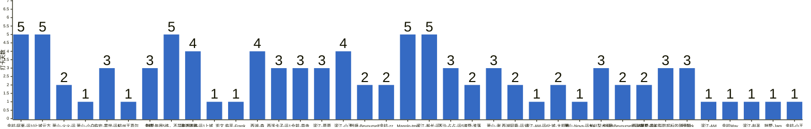

{
  "title": "杭州-健身-enjoy your life · 2026-10-12 至 2026-10-18",
  "date": "2026-10-12",
  "layout": "weekly",
  "group_id": "group-2",
  "record_dates": [
    "2026-10-12",
    "2026-10-13",
    "2026-10-14",
    "2026-10-15",
    "2026-10-16"
  ],
  "generated_by": "checkins-v1",
  "iso_year": 2026,
  "iso_week": 42,
  "date_summary": [
    "📅 周打卡：2026-10-12 至 2026-10-18（第42周）",
    "🏆 季度：2026年第4季度｜已过18天，剩余74天",
    "⏳ 年度：2026年｜已过291天（79.73%），剩余74天（20.27%）"
  ]
}

本期统计名单仅包含本周有有效打卡内容的参与者，打卡率以本期统计名单人数为分母。

## 1. 本周打卡概览 {#本周打卡概览}

<span id="打卡天数排行榜"></span>

**成员打卡天数**（按名单顺序展示，左右滑动查看全部成员，柱顶数字为本周打卡天数）



<span id="每日打卡率"></span>

**每日打卡率**

| 日期 | 已打卡 | 未打卡 | 打卡率 |
| --- | --- | --- | --- |
| 2026-10-12 | 20 | 17 | 54.1% |
| 2026-10-13 | 20 | 17 | 54.1% |
| 2026-10-14 | 17 | 20 | 45.9% |
| 2026-10-15 | 23 | 14 | 62.2% |
| 2026-10-16 | 14 | 23 | 37.8% |

## 2. 打卡内容明细 {#打卡内容明细}

| 名单编号 | 昵称 | 2026-10-12 | 2026-10-13 | 2026-10-14 | 2026-10-15 | 2026-10-16 |
| --- | --- | --- | --- | --- | --- | --- |
| 1 | 余杭-阿栗-运10 | 有氧 | 有氧<br>背2026/10/13 | 有氧<br>🗡<br>腹＋手臂 | 有氧<br>三头 | 背 |
| 2 | 上城元方 | 游泳<br>胸肩 | 游泳<br>练背 | 游泳<br>肩 | 游泳<br>胸 | 背 |
| 3 | 萧山-火火-运 | 4  胸 |  |  | 4  肩+有氧 |  |
| 4 | 萧山-小白 | 腿 |  |  |  |  |
| 5 | 临安-雾世-运5 | 胸肩二头 |  |  | 虐腹！ | 背 |
| 6 | 杭州王嘉尔 | 休息 |  |  |  |  |
| 7 | 拱墅 | 一度 背+腿 | 一度 背+腿 |  |  | 一度 背+腿 |
| 8 | 余杭-每周5练，不是每周五练 | 背2+臀1<br>爬坡30min | 臀腿2+肩1<br>登山机 | 背2+胸1+肩1 | 臀腿2+腹1 | 爬坡30min<br>骑行28km |
| 9 | 滨江阿豪-运1 | 腿40min<br>《人人都是产品经理》p1-p32<br>btrfs代码梳理两篇 | 胸40min<br>《人人都是产品经理》P32-P43 | 背20min+有氧20min<br>下班工作1h | 肩40min<br>学习1h |  |
| 10 | 上城&#95;凯文 | 腹肌➕背➕二头 |  |  |  |  |
| 11 | 临平-Frank. | 胸 |  |  |  |  |
| 12 | 西湖-森 | 背 | 胸肩 |  | 肩 | 筋膜刀 |
| 13 | 西溪卡子-运1 | 背 | 肩 |  | 臀腿 |  |
| 14 | 仓前-首寺 | 臀腿 | 胸 |  | 肩 |  |
| 15 | 滨江-慕慕 | 屁 | 🐻 | 背 |  |  |
| 16 | 滨江-小王 | 手臂 |  | 肩 | 背 | 胸 |
| 17 | 钱塘-Beyourself | 腿 | 肩 |  |  |  |
| 18 | 余杭-zz | 有氧 | 肩+手臂 |  |  |  |
| 19 | Manolo-tmg | chest | back | leg | 踢足球 | chest back |
| 20 | 滨江-船长-运5 | 胸二头 | 有氧 | 力量 | 有氧 | 肩腹 |
| 21 | 下沙-占占-运5 |  | 背 核心一小时 爬楼机35分钟 | 背 核心一小时 爬楼机三十五分钟 | 生理期 休五天 |  |
| 22 | 诸暨-淮落 |  | 🐻 |  | 背 |  |
| 23 | 萧山-谢 |  | 手臂 | 腿 | 胸 |  |
| 24 | 西湖阿鹿-运10 |  | 胸 |  | 背 |  |
| 25 | 滨江-AM-运6 |  | 背 |  |  |  |
| 26 | 上城-大肌霸 |  | 背 | 背 |  |  |
| 27 | 萧山-Nova-运3/4 |  | 肩膀+三头 |  |  |  |
| 28 | 长兴梨木-运3 |  |  | 肩胸 | 背 | 臀+拉伸 |
| 29 | 钱塘-Beyourself-运5 |  |  | 手臂 | 有氧 |  |
| 30 | 西湖薯片-运4 |  |  | 胸腹 |  | 腿 |
| 31 | 拱墅-内脏脂肪超标的彭于晏 |  |  | 背 | 腿➕背<br>有氧 | 拉伸 |
| 32 | 余杭-zk |  |  | 有氧40分钟 | 有氧50分钟 | 有氧50分钟 |
| 33 | 滨江-AM |  |  | 肩 腹 |  |  |
| 34 | 余杭May |  |  |  | 生理期休息 |  |
| 35 | 滨江-赵圣 |  |  |  | ，胸 |  |
| 36 | 拱墅-Jam |  |  |  | 有氧 |  |
| 37 | 余杭-小王 |  |  |  |  | 肩 |

## 3. 原始打卡内容（2026-10-12 至 2026-10-18） {#原始打卡内容2026-10-12-至-2026-10-18}

```text
#接龙
2026-10-12
生活就像一首歌，只有用心去唱，才能唱出最美的旋律！

1. 余杭-阿栗-运10 有氧
2. 上城元方 游泳
3. 萧山-火火-运 4  胸
4. 萧山-小白 腿
5. 临安-雾世-运5 胸肩二头
6. 杭州王嘉尔 休息
7. 拱墅 一度 背+腿
8. 上城元方 胸肩
9. 余杭-每周5练，不是每周五练 背2+臀1
10. 滨江阿豪-运1 
腿40min
《人人都是产品经理》p1-p32
btrfs代码梳理两篇
11. 上城_凯文 腹肌➕背➕二头
12. 临平-Frank. 胸
13. 西湖-森 背
14. 西溪卡子-运1 背
15. 仓前-首寺 臀腿
16. 上城-CC-运5-胸
17. 滨江-慕慕 屁
18. 滨江-小王 手臂
19. 余杭-每周5练，不是每周五练 爬坡30min
20. 钱塘-Beyourself 腿
21. 余杭-zz 有氧
22. Manolo-tmg chest
23. 滨江-船长-运5 胸二头

#接龙
2026-10-13
今天是世界保健日，规律作息，善待自己~健康才是长久的底气

1. 余杭-阿栗-运10 有氧
2. 上城元方 游泳
3. 滨江-船长-运5 有氧
4. 拱墅 一度 背+腿
5. 钱塘-Beyourself 肩
6. 余杭-阿栗-运10 背2026/10/13
7. 滨江阿豪-运1 
胸40min
《人人都是产品经理》P32-P43
8. 上城元方 练背
9. 余杭-每周5练，不是每周五练 臀腿2+肩1
10. 下沙-占占-运5    背 核心一小时 爬楼机35分钟
11. 滨江-慕慕 🐻
12. 诸暨-淮落 🐻
13. 西湖-森 胸肩
14. 西溪卡子-运1 肩
15. 余杭-每周5练，不是每周五练 登山机
16. 余杭-zz 肩+手臂
17. 萧山-谢 手臂
18. 仓前-首寺 胸
19. 西湖阿鹿-运10 胸
20. 滨江-AM-运6 背
21. 上城-大肌霸 背
22. 萧山-Nova-运3/4 肩膀+三头
23. Manolo-tmg back

#接龙
2026/10/14
既然在别人的世界里微不足道，不如在自己的世界闪闪发光。

1. 余杭-阿栗-运10 有氧
2. 长兴梨木-运3 肩胸
3. 钱塘-Beyourself-运5 手臂
4. 上城元方 游泳
5. 滨江-船长-运5 力量
6. 余杭-阿栗-运10 🗡
7. 西湖薯片-运4 胸腹
8. 余杭-每周5练，不是每周五练 背2+胸1+肩1
9. 上城元方 肩
10. 滨江阿豪-运1 
背20min+有氧20min
下班工作1h
11. 下沙-占占-运5  背 核心一小时 爬楼机三十五分钟
12. 拱墅-内脏脂肪超标的彭于晏 背
13. 滨江-慕慕 背
14. 余杭-阿栗-运10 腹＋手臂
15. 余杭-zk 有氧40分钟
16. 滨江-小王 肩
17. 萧山-谢 腿
18. 滨江-AM 肩 腹
19. 上城-大肌霸 背
20. Manolo-tmg leg


#接龙
2026/10/15
如果你的处境让你不知所措，那就去拼命学习，学习会让你永立不败之地

1. 余杭-阿栗-运10 有氧
2. 上城元方 游泳
3. 长兴梨木-运3 背
4. 钱塘-Beyourself-运5 有氧
5. 余杭-阿栗-运10 三头
6. 下沙-占占-运5  生理期 休五天
7. 拱墅-内脏脂肪超标的彭于晏 腿➕背
8. 上城元方 胸
9. 余杭-每周5练，不是每周五练 臀腿2+腹1
10. 临安-雾世-运5 虐腹！
11. 余杭May 生理期休息
12. 余杭-zk 有氧50分钟
13. 滨江-船长-运5 有氧
14. 萧山-火火-运 4  肩+有氧
15. 滨江-小王 背
16. 诸暨-淮落 背
17. 萧山-谢 胸
18. 拱墅-内脏脂肪超标的彭于晏 有氧
19. 西湖阿鹿-运10 背
20. 西湖-森 肩
21. 西溪卡子-运1 臀腿
22. 滨江-赵圣 ，胸
23. 仓前-首寺 肩
24. 拱墅-Jam 有氧
25. Manolo-tmg 踢足球
26. 滨江阿豪-运1 
肩40min
学习1h

#接龙
20261016
“手中有粮，心中不慌”。今天是世界粮食日，一粥一饭，当思来之不易。尊重每一滴汗水，珍惜每一粒粮食！

1. 余杭-阿栗-运10 背
2. 滨江-船长-运5 肩腹
3. 拱墅 一度 背+腿
4. 西湖薯片-运4 腿
5. 余杭-每周5练，不是每周五练 爬坡30min
6. 上城元方 背
7. 余杭-小王  肩
8. 长兴梨木-运3 臀+拉伸
9. 临安-雾世-运5 背
10. 拱墅-内脏脂肪超标的彭于晏 拉伸
11. 西湖-森 筋膜刀
12. 余杭-zk 有氧50分钟
13. 滨江-小王 胸
14. Manolo-tmg chest back
15. 余杭-每周5练，不是每周五练 骑行28km


```
