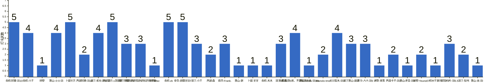

{
  "title": "杭州-健身-enjoy your life · 2026-10-19 至 2026-10-25",
  "date": "2026-10-19",
  "layout": "weekly",
  "group_id": "group-2",
  "record_dates": [
    "2026-10-19",
    "2026-10-20",
    "2026-10-21",
    "2026-10-22",
    "2026-10-23"
  ],
  "generated_by": "checkins-v1",
  "iso_year": 2026,
  "iso_week": 43,
  "date_summary": [
    "📅 周打卡：2026-10-19 至 2026-10-25（第43周）",
    "🏆 季度：2026年第4季度｜已过25天，剩余67天",
    "⏳ 年度：2026年｜已过298天（81.64%），剩余67天（18.36%）"
  ]
}

本期统计名单仅包含本周有有效打卡内容的参与者，打卡率以本期统计名单人数为分母。

## 1. 本周打卡概览 {#本周打卡概览}

<span id="打卡天数排行榜"></span>

**成员打卡天数**（按名单顺序展示，左右滑动查看全部成员，柱顶数字为本周打卡天数）



<span id="每日打卡率"></span>

**每日打卡率**

| 日期 | 10-19 周一 | 10-20 周二 | 10-21 周三 | 10-22 周四 | 10-23 周五 |
| --- | --- | --- | --- | --- | --- |
| 打卡人数/统计总人数（打卡率） | 23/34（67.6%） | 18/34（52.9%） | 22/34（64.7%） | 16/34（47.1%） | 12/34（35.3%） |

## 2. 打卡内容明细 {#打卡内容明细}

| 名单编号 | 昵称 | 2026-10-19 | 2026-10-20 | 2026-10-21 | 2026-10-22 | 2026-10-23 |
| --- | --- | --- | --- | --- | --- | --- |
| 1 | 余杭-阿栗-运10 | 有氧 | 休闲6km | 有氧 | 休闲6km | 腿 |
| 2 | 余杭-小王 | 性感背部 | 性感肩部 | 性感手臂➕翘臀 |  | 胸部 |
| 3 | 拱墅 | 一度 背+腿 |  |  |  |  |
| 4 | 萧山-火火-运 | 4 胸背+30min 有氧 | 4    腿+手臂+腹+有氧 | 4  肩+有氧 | 4 有氧 |  |
| 5 | 上城元方 | 椭圆仪<br>胸 | 游泳<br>背 | 爬楼<br>肩 | 游泳<br>胸 | 腿 |
| 6 | 西湖阿鹿-运10 | 骑20km<br>骑20公里 |  | 背 |  |  |
| 7 | 滨江-船长-运5 | 胸 |  | 无氧 | 有氧 | 力量 |
| 8 | 西湖薯片-x哥跟班 | 背+腹 | 胸腹 | 臂腹有氧 | 腿腹 | 肩腹 |
| 9 | 滨江阿豪-运1 | 胸40min<br>kernel-fs代码梳理4篇 | 背30min+有氧20min<br>kernel-fs代码梳理2篇 | 肩40min<br>kernel-fs文档2篇<br>改代码1.5h |  |  |
| 10 | 拱墅-内脏脂肪超标的彭于晏 | 背 | 有氧，背，🐻 | 有氧➕肩🐻 |  |  |
| 11 | 余杭May | 🐻 |  |  |  |  |
| 12 | 余杭-zk | 有氧50min | 有氧50分钟 | 60分钟有氧 | 有氧60分钟 | 有氧82分钟 |
| 13 | 金华-胡霸天运7 | 腘绳背后束中束腹 | 有氧 | 股四胸肩腹 | 腘绳臀背中后束 | 股四胸肩前中束腹加有氧 |
| 14 | 滨江-小王 | 肩 | 背 | 胸 |  |  |
| 15 | 西湖-森 | 胸 | 背+腹 |  |  |  |
| 16 | 临平-Frank. | 胸 |  | 手臂 | 胸 |  |
| 17 | 萧山-谢 | 腿 |  |  |  |  |
| 18 | 上城-天天 | 背，跑步4km |  |  |  |  |
| 19 | 余杭-木木 | X |  |  |  |  |
| 20 | 滨江-慕慕 | 屁 | 肩 |  | 🐻 |  |
| 21 | 余杭-每周5练，不是每周五练 | 舞蹈1.5h | 背2+胸1 | 背2腿1臀1 | 臀1背1肩1 |  |
| 22 | 萧山-Nova-运3/4 | 背，二头，核心 |  |  |  |  |
| 23 | Manolo-tmg | chest |  | leg |  |  |
| 24 | 长兴梨木-运3 |  | 臀 | 背核心 | 肩胸 | 哈他瑜伽 |
| 25 | 滨江萧山-飒飒 |  | 背 | 爬坡 | 臀腿 |  |
| 26 | 下沙-占占-运5 |  | 胸 二头 50分钟 爬楼机40分钟 |  | 背一小时 爬楼三十分钟 | 肩 复合一小时 爬楼三十分钟 |
| 27 | 诸暨-淮落 |  | 胸 |  |  |  |
| 28 | 西溪卡子-运1 |  | 背+有氧 | 有氧 |  |  |
| 29 | 萧山-老吴-运4 |  |  | 肩 |  |  |
| 30 | 拱墅-Yeung07 |  |  | 背 | 肩 |  |
| 31 | 杭州王嘉尔 |  |  | 休息 |  |  |
| 32 | 富阳柏岩−运5.5 |  |  | 胸+核心 | 上肢力训 | 腿 |
| 33 | 滨江-知书 |  |  |  | 腿 | 背 |
| 34 | 萧山-米-运6 |  |  |  |  | 游泳 |

## 3. 原始打卡内容（2026-10-19 至 2026-10-25） {#原始打卡内容2026-10-19-至-2026-10-25}

```text
#接龙
20261019
照顾好自己的健康和情绪，人生，你就赢了一大半了，其余的事情，人生自有安排。

1. 余杭-阿栗-运10 有氧
2. 余杭-小王  性感背部
3. 拱墅 一度 背+腿
4. 萧山-火火-运 4 胸背+30min 有氧
5. 上城元方 椭圆仪
6. 西湖阿鹿-运10 骑20km
7. 滨江-船长-运5 胸
8. 西湖薯片-x哥跟班 背+腹
9. 滨江阿豪-运1 
胸40min
kernel-fs代码梳理4篇
10. 拱墅-内脏脂肪超标的彭于晏 背
11. 余杭May 🐻
12. 上城元方 胸
13. 余杭-zk 有氧50min
14. 金华-胡霸天运7 腘绳背后束中束腹
15. 滨江-小王 肩
16. 西湖-森 胸
17. 临平-Frank. 胸
18. 萧山-谢 腿
19. 西湖阿鹿-运10 骑20公里
20. 上城-天天 背，跑步4km
21. 余杭-木木 X
22. 滨江-慕慕 屁
23. 余杭-每周5练，不是每周五练 舞蹈1.5h
24. 萧山-Nova-运3/4 背，二头，核心
25. Manolo-tmg chest


#接龙
20261020
岁月里所有的奔忙，都值得被时光犒赏！

1. 余杭-阿栗-运10 休闲6km
2. 西湖薯片-x哥跟班 胸腹
3. 上城元方 游泳
4. 滨江阿豪-运1 
背30min+有氧20min
kernel-fs代码梳理2篇
5. 萧山-火火-运 4    腿+手臂+腹+有氧
6. 长兴梨木-运3 臀
7. 余杭-小王   性感肩部
8. 滨江萧山-飒飒 背
9. 上城元方 背
10. 拱墅-内脏脂肪超标的彭于晏 有氧，背，🐻
11. 余杭-zk 有氧50分钟
12. 下沙-占占-运5  胸 二头 50分钟 爬楼机40分钟
13. 余杭-每周5练，不是每周五练 背2+胸1
14. 滨江-小王 背
15. 滨江-慕慕 肩
16. 西湖-森 背+腹
17. 诸暨-淮落 胸
18. 西溪卡子-运1 背+有氧
19. 金华-胡霸天运7 有氧

#接龙
20261021
世界的美好不在于千篇一律，百花齐放才是最美好的样子。

1. 余杭-阿栗-运10 有氧
2. 余杭-小王  性感手臂➕翘臀
3. 萧山-火火-运 4  肩+有氧
4. 滨江-船长-运5 无氧
5. 上城元方 爬楼
6. 滨江萧山-飒飒 爬坡
7. 滨江阿豪-运1 
肩40min
kernel-fs文档2篇
改代码1.5h
8. 萧山-老吴-运4   肩
9. 长兴梨木-运3 背核心
10. 余杭-每周5练，不是每周五练 背2腿1臀1
11. 西溪卡子-运1 有氧
12. 上城元方 肩
13. 滨江-小王 胸
14. 西湖薯片-x哥跟班 臂腹有氧
15. 拱墅-内脏脂肪超标的彭于晏 有氧➕肩🐻
16. 拱墅-Yeung07  背
17. 西湖阿鹿-运10 背
18. 余杭-zk 60分钟有氧
19. 杭州王嘉尔 休息
20. 金华-胡霸天运7 股四胸肩腹
21. Manolo-tmg leg
22. 富阳柏岩−运5.5 胸+核心
23. 临平-Frank. 手臂


#接龙
20261022
每一天的努力，都是为了让远方变得更近一些。

1. 余杭-阿栗-运10 休闲6km
2. 上城元方 游泳
3. 富阳柏岩−运5.5 上肢力训
4. 萧山-火火-运 4 有氧
5. 西湖薯片-x哥跟班 腿腹
6. 滨江-船长-运5 有氧
7. 长兴梨木-运3 肩胸
8. 余杭-每周5练，不是每周五练 臀1背1肩1
9. 上城元方 胸
10. 滨江萧山-飒飒 臀腿
11. 滨江-知书 腿
12. 下沙-占占-运5  背一小时 爬楼三十分钟
13. 余杭-zk 有氧60分钟
14. 金华-胡霸天运7 腘绳臀背中后束
15. 滨江-慕慕 🐻
16. 拱墅-Yeung07  肩
17. 临平-Frank. 胸

#接龙
20261023
今日霜降，是秋季最后一个节气，秋意已浓，勿忘添衣。愿你好“柿”成“霜”，喜从天降！

1. 余杭-阿栗-运10 腿
2. 长兴梨木-运3 哈他瑜伽
3. 余杭-小王  胸部
4. 西湖薯片-x哥跟班 肩腹
5. 滨江-船长-运5 力量
6. 余杭-zk 有氧82分钟
7. 富阳柏岩−运5.5 腿
8. 上城元方 腿
9. 滨江-知书 背
10. 下沙-占占-运5 肩 复合一小时 爬楼三十分钟
11. 金华-胡霸天运7 股四胸肩前中束腹加有氧
12. 萧山-米-运6 游泳
```
