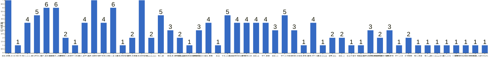

{
  "title": "杭州-健身-enjoy your life · 2026-10-26 至 2026-11-01",
  "date": "2026-10-26",
  "layout": "weekly",
  "group_id": "group-2",
  "record_dates": [
    "2026-10-26",
    "2026-10-27",
    "2026-10-28",
    "2026-10-29",
    "2026-10-30",
    "2026-10-31",
    "2026-11-01"
  ],
  "generated_by": "checkins-v1",
  "iso_year": 2026,
  "iso_week": 44,
  "date_summary": [
    "📅 周打卡：2026-10-26 至 2026-11-01（第44周）",
    "🏆 季度：2026年第4季度｜已过32天，剩余60天",
    "⏳ 年度：2026年｜已过305天（83.56%），剩余60天（16.44%）"
  ]
}

本期统计名单仅包含本周有有效打卡内容的参与者，打卡率以本期统计名单人数为分母。

## 1. 本周打卡概览 {#本周打卡概览}

<span id="打卡天数排行榜"></span>

**成员打卡天数**（按名单顺序展示，左右滑动查看全部成员，柱顶数字为本周打卡天数）



<span id="每日打卡率"></span>

**每日打卡率**

| 日期 | 10-26 周一 | 10-27 周二 | 10-28 周三 | 10-29 周四 | 10-30 周五 | 10-31 周六 | 11-01 周日 |
| --- | --- | --- | --- | --- | --- | --- | --- |
| 打卡人数/统计总人数（打卡率） | 22/51（43.1%） | 22/51（43.1%） | 23/51（45.1%） | 24/51（47.1%） | 26/51（51.0%） | 14/51（27.5%） | 16/51（31.4%） |

## 2. 打卡内容明细 {#打卡内容明细}

| 名单编号 | 昵称 | 2026-10-26 | 2026-10-27 | 2026-10-28 | 2026-10-29 | 2026-10-30 | 2026-10-31 | 2026-11-01 |
| --- | --- | --- | --- | --- | --- | --- | --- | --- |
| 1 | 余杭-阿栗-运10 | 有氧 | 有氧 | 休闲7km | 有氧 | 休闲6km | 有氧<br>卷腹 | 有氧 |
| 2 | 上城元方 | 椭圆仪<br>胸 |  |  |  |  |  |  |
| 3 | 萧山-火火-运 | 4 胸+有氧 | 4 背➕有氧 | 4 肩➕有氧 |  |  | 4 徒步 |  |
| 4 | 长兴梨木-运4 | 背 | 臀 | 瑜伽 |  | 肩胸 | 爬山1h |  |
| 5 | 滨江-船长-运5 | 力量训练 | 有氧 | 无氧 | 有氧 | 肩腹 |  | 有氧 |
| 6 | 西湖薯片-x哥跟班 | 背腹 | 胸腹三头 | 腿腹 | 肩腹 | 背三头 | 胸腹 |  |
| 7 | 滨江萧山-飒飒 | 背 |  | 腿 |  |  |  |  |
| 8 | 滨江-知书 | 🐻 |  |  |  |  |  |  |
| 9 | 萧山-老吴-运4 | 胸➕肱三头 | 背加二头 | 肩 |  | 臀腿 |  |  |
| 10 | 金华-胡霸天运7 | 有氧 | 腘绳臀背中后束加有氧 | 股四胸肩前中束加腹 | 腘绳臀中后束背 | 有氧 | 股四胸前中束加有氧 | 腘绳臀背中后束加有氧 |
| 11 | 滨江阿豪-运1 | 背+腹45min<br>kernel-btrfs 2h | 肩45min | 腿45min | 胸45min |  |  |  |
| 12 | 萧山-米-运6 | 🏊🏻‍♀️ | 💪🏻 | 💪🏻 | 💪🏻 | 🦵🏻 |  | 🦵🏻 |
| 13 | 西湖-慢就是快 | 筋膜刀60分钟 |  |  |  |  |  |  |
| 14 | 拱墅-伍肆叁 | 有氧40分钟+练背 |  |  |  | 有氧40分钟 |  |  |
| 15 | 上城-阿园老师 | 腿 | 下背 | 休息 | 休息 | 胸 | 上背 | 肩 |
| 16 | Manolo-tmg | chest |  |  |  |  |  | xiuxi |
| 17 | 萧山-谢 | 背 | 肩 | 腿 |  | 手臂💪 |  | 肩 |
| 18 | 西湖-森 | 胸 | 背 |  | 肩 |  |  |  |
| 19 | 拱墅-Yeung07 | 背 |  | 有氧 |  |  |  |  |
| 20 | 拱墅-内脏脂肪超标的彭于晏 | 西湖徒步 |  |  |  |  |  |  |
| 21 | 富阳柏岩−运5.5 | 肩 |  |  | 背 | 肩 |  |  |
| 22 | 余杭-潘潘 | 肩背 |  | 胸 |  | 有氧 | 肩背 |  |
| 23 | 杭州 |  | fufu 背 |  |  |  |  |  |
| 24 | 下沙-占占-运5 |  | 胸 核心一小时 爬楼45分钟 | 背 核心一小时 | 肩 核心50分钟 爬楼30分钟 | 臀腿 |  | 胸 核心一小时 爬楼30分钟 |
| 25 | 萧山采蘑菇的大老虎 |  | 臀腿 | 有氧爬坡 | 肩背 | 臀腿 |  |  |
| 26 | 滨江欧克-运5 |  | 卧推100下 | 臂屈伸200下 | 卧推120 | 胸 120 |  |  |
| 27 | 余杭-zk |  | 有氧60分钟 | 有氧60分钟 | 有氧60分钟 | 有氧60分钟 |  |  |
| 28 | 滨江-慕慕 |  | 屁 | 背 | 休息 | 屁 |  |  |
| 29 | 余杭-zz |  | 胸 |  | 背 |  |  | 肩手臂有氧 |
| 30 | 滨江-小王 |  | 胸 |  | 肩 | 背 | 胸 | 肩 |
| 31 | 西湖阿鹿-运10 |  | 胸 |  |  |  | 背 | 肩 |
| 32 | 上城-熊猫-运 |  | 5  腿 |  |  |  |  |  |
| 33 | 林然-滨江-5练 |  |  | 背 |  | 胸 | 肩 腿 | 背 |
| 34 | 临平-Frank. |  |  | 腿🦵 |  |  |  |  |
| 35 | 诸暨-AVa |  |  | 🐻➕爬坡➕跳绳 | 跳绳 |  |  |  |
| 36 | 余杭-cc |  |  | 腿 肩 |  |  |  | 背➕三头 |
| 37 | 杭州王嘉尔 |  |  |  | 有氧 |  |  |  |
| 38 | 萧山-小白 |  |  |  | 推日 |  |  |  |
| 39 | 余杭-每周5练，不是每周五练 |  |  |  | 背<br>舞蹈1h | 臀腿<br>舞蹈1h+骑行1h | 胸背腹 |  |
| 40 | 拱墅-开始戒糖的彭于晏d1 |  |  |  | 有氧 | 有氧 |  |  |
| 41 | 诸暨-淮落 |  |  |  | 🐻摸鱼 | 背 | 肩 |  |
| 42 | 滨江-小夭 |  |  |  | 背 |  |  |  |
| 43 | 长河鸭鸭 |  |  |  | 运3🐻 |  | -臀腿 |  |
| 44 | 萧山-煜祺 |  |  |  |  | 💪 |  |  |
| 45 | 萧山-an |  |  |  |  | 背 |  |  |
| 46 | 萧山-Nova-运3/4 |  |  |  |  | 胸，小臂，核心 |  |  |
| 47 | 萧山-小马 |  |  |  |  | 哑铃50分钟+深蹲150下 |  |  |
| 48 | 上城-军鸟 |  |  |  |  |  | 腿 |  |
| 49 | 拱墅-开始戒糖的彭于晏d0 |  |  |  |  |  |  | 有氧 |
| 50 | 凤起庆春-小徐 |  |  |  |  |  |  | 臀腿有氧 |
| 51 | 下沙VDV |  |  |  |  |  |  | 胸 |

## 3. 原始打卡内容（2026-10-26 至 2026-11-01） {#原始打卡内容2026-10-26-至-2026-11-01}

```text
#接龙
20261026
只要决心成功，失败就永远不会把你击垮。

1. 余杭-阿栗-运10 有氧
2. 上城元方 椭圆仪
3. 萧山-火火-运 4 胸+有氧
4. 长兴梨木-运4 背
5. 滨江-船长-运5 力量训练
6. 西湖薯片-x哥跟班 背腹
7. 滨江萧山-飒飒 背
8. 滨江-知书 🐻
9. 萧山-老吴-运4  胸➕肱三头
10. 金华-胡霸天运7 有氧
11. 滨江阿豪-运1 
背+腹45min
kernel-btrfs 2h
12. 上城元方 胸
13. 萧山-米-运6 🏊🏻‍♀️
14. 西湖-慢就是快 筋膜刀60分钟
15. 拱墅-伍肆叁 有氧40分钟+练背
16. 上城-阿园老师 腿
17. Manolo-tmg chest
18. 萧山-谢 背
19. 西湖-森 胸
20. 拱墅-Yeung07  背
21. 拱墅-内脏脂肪超标的彭于晏 西湖徒步
22. 富阳柏岩−运5.5 肩
23. 余杭-潘潘 肩背


#接龙
 20261027
今天是2026年第300天，三百个日夜沉淀美好，保持从容，不负每一段时光

1. 余杭-阿栗-运10 有氧
2. 萧山-火火-运 4 背➕有氧
3. 滨江-船长-运5 有氧
4. 杭州 fufu 背
5. 上城-阿园老师 下背
6. 长兴梨木-运4 臀
7. 西湖薯片-x哥跟班 胸腹三头
8. 滨江阿豪-运1 
肩45min
9. 金华-胡霸天运7 腘绳臀背中后束加有氧
10. 萧山-老吴-运4  背加二头
11. 下沙-占占-运5  胸 核心一小时 爬楼45分钟
12. 萧山采蘑菇的大老虎 臀腿
13. 滨江欧克-运5 卧推100下
14. 余杭-zk 有氧60分钟
15. 萧山-米-运6 💪🏻
16. 滨江-慕慕 屁
17. 余杭-zz 胸
18. 滨江-小王 胸
19. 西湖-森 背
20. 西湖阿鹿-运10 胸
21. 萧山-谢 肩
22. 上城-熊猫-运 5  腿


#接龙
20261028
决心走一条路的时候，就不要左顾右盼，风景再美也别留恋。

1. 余杭-阿栗-运10 休闲7km
2. 上城-阿园老师 休息
3. 滨江-船长-运5 无氧
4. 长河-鸭鸭运3
5. 金华-胡霸天运7 股四胸肩前中束加腹
6. 林然-滨江-5练  背
7. 长兴梨木-运4 瑜伽
8. 滨江欧克-运5 臂屈伸200下
9. 滨江萧山-飒飒 腿
10. 萧山-火火-运 4 肩➕有氧
11. 萧山-老吴-运4  肩
12. 下沙-占占-运5  背 核心一小时
13. 西湖薯片-x哥跟班 腿腹
14. 滨江阿豪-运1 
腿45min
15. 萧山采蘑菇的大老虎 有氧爬坡
16. 余杭-zk 有氧60分钟
17. 萧山-米-运6 💪🏻
18. 滨江-慕慕 背
19. 临平-Frank. 腿🦵
20. 余杭-潘潘 胸
21. 萧山-谢 腿
22. 拱墅-Yeung07  有氧
23. 诸暨-AVa 🐻➕爬坡➕跳绳
24. 余杭-cc 腿 肩

#接龙
20261029
要努力，但不要着急。繁花锦簇，硕果累累都需要过程。

1. 余杭-阿栗-运10 有氧
2. 杭州王嘉尔 有氧
3. 滨江-船长-运5 有氧
4. 上城-阿园老师 休息
5. 萧山-小白 推日
6. 金华-胡霸天运7 腘绳臀中后束背
7. 滨江-小王 肩
8. 滨江欧克-运5 卧推120
9. 滨江阿豪-运1 
胸45min
10. 萧山采蘑菇的大老虎 肩背
11. 余杭-每周5练，不是每周五练 背
12. 下沙-占占-运5  肩 核心50分钟 爬楼30分钟
13. 余杭-zk 有氧60分钟
14. 西湖薯片-x哥跟班 肩腹
15. 富阳柏岩−运5.5 背
16. 萧山-米-运6 💪🏻
17. 滨江-慕慕 休息
18. 余杭-zz 背
19. 拱墅-开始戒糖的彭于晏d1 有氧
20. 余杭-每周5练，不是每周五练 舞蹈1h
21. 诸暨-淮落 🐻摸鱼
22. 西湖-森 肩
23. 滨江-小夭 背
24. 长河鸭鸭 运3🐻
25. 诸暨-AVa 跳绳

#接龙
20261030
只有极致的拼搏，才能配得上极致的风景。

1. 余杭-阿栗-运10 休闲6km
2. 萧山-煜祺 💪
3. 滨江-船长-运5 肩腹
4. 长兴梨木-运4 肩胸
5. 富阳柏岩−运5.5 肩
6. 金华-胡霸天运7 有氧
7. 萧山-老吴-运4  臀腿
8. 余杭-每周5练，不是每周五练 臀腿
9. 萧山-谢 手臂💪
10. 萧山采蘑菇的大老虎 臀腿
11. 下沙-占占-运5  臀腿
12. 林然-滨江-5练  胸
13. 余杭-zk 有氧60分钟
14. 萧山-米-运6 🦵🏻
15. 西湖薯片-x哥跟班 背三头
16. 诸暨-淮落 背
17. 萧山-an 背
18. 滨江-小王 背
19. 萧山-Nova-运3/4 胸，小臂，核心
20. 滨江欧克-运5 胸 120
21. 滨江-慕慕 屁
22. 拱墅-伍肆叁 有氧40分钟
23. 上城-阿园老师 胸
24. 余杭-每周5练，不是每周五练 舞蹈1h+骑行1h
25. 余杭-潘潘 有氧
26. 拱墅-开始戒糖的彭于晏d1 有氧
27. 萧山-小马 哑铃50分钟+深蹲150下

#接龙
20261031
十月再见，过往不念，未来可期，好好生活，慢慢相遇，无论去哪沿途都是风景！

1. 余杭-阿栗-运10 有氧
2. 上城-阿园老师 上背
3. 长河鸭鸭 -臀腿
4. 萧山-火火-运 4 徒步
5. 长兴梨木-运4 爬山1h
6. 西湖薯片-x哥跟班 胸腹
7. 余杭-潘潘 肩背
8. 林然-滨江-5练  肩 腿
9. 余杭-每周5练，不是每周五练 胸背腹
10. 上城-军鸟 腿
11. 余杭-阿栗-运10 卷腹
12. 西湖阿鹿-运10 背
13. 金华-胡霸天运7 股四胸前中束加有氧
14. 滨江-小王 胸
15. 诸暨-淮落 肩

#接龙
20261101
人间十一月，一切都如意，今日无碍，明日无忧，便是最好的生活！

1. 余杭-阿栗-运10 有氧
2. 下沙-占占-运5  胸 核心一小时 爬楼30分钟
3. 萧山-米-运6 🦵🏻
4. 林然-滨江-5练  背
5. 拱墅-开始戒糖的彭于晏d0 有氧
6. 凤起庆春-小徐 臀腿有氧
7. 西湖阿鹿-运10 肩
8. 余杭-cc 背➕三头
9. 下沙VDV 胸
10. 余杭-zz 肩手臂有氧
11. 滨江-船长-运5 有氧
12. 金华-胡霸天运7 腘绳臀背中后束加有氧
13. Manolo-tmg xiuxi
14. 萧山-谢 肩
15. 上城-阿园老师 肩
16. 滨江-小王 肩
```
