{
  "title": "杭州-健身-enjoy your life · 2026-11-02 至 2026-11-08",
  "date": "2026-11-02",
  "layout": "weekly",
  "group_id": "group-2",
  "record_dates": [
    "2026-11-02",
    "2026-11-03",
    "2026-11-04",
    "2026-11-05",
    "2026-11-06",
    "2026-11-07",
    "2026-11-08"
  ],
  "generated_by": "checkins-v1",
  "iso_year": 2026,
  "iso_week": 45,
  "date_summary": [
    "📅 周打卡：2026-11-02 至 2026-11-08（第45周）",
    "🏆 季度：2026年第4季度｜已过39天，剩余53天",
    "⏳ 年度：2026年｜已过312天（85.48%），剩余53天（14.52%）"
  ]
}

本期统计名单仅包含本周有有效打卡内容的参与者，打卡率以本期统计名单人数为分母。

## 1. 本周打卡概览 {#本周打卡概览}

<span id="打卡天数排行榜"></span>

**成员打卡天数**（按名单顺序展示，左右滑动查看全部成员，柱顶数字为本周打卡天数）

```mermaid
---
config:
  xyChart:
    width: 4000
    height: 400
    showDataLabel: true
    showDataLabelOutsideBar: true
    xAxis:
      labelRotation: -55
      labelFontSize: 13
    yAxis:
      labelFontSize: 13
  themeVariables:
    xyChart:
      plotColorPalette: "#356AC3"
---
xychart-beta
    x-axis ["余杭-阿栗-运10", "滨江-船长-运5", "金华-胡霸天运7", "林然-滨江-5练", "萧山-火火-运", "萧山-煜祺", "长兴梨木-运4", "滨江欧克-运5", "滨江阿豪-运1", "拱墅-开始戒糖的彭于晏d0", "下沙-占占-运5", "富阳古琴−运5.5", "萧山-米-运6", "萧山-老吴-运4", "诸暨-淮落", "上城-熊猫-运", "上城-阿园老师", "余杭-妙妙", "余杭-zz", "余杭-cc", "余杭-潘潘", "余杭-五花肉-运5", "城西-氧气-运（4-5）", "西湖-森", "Manolo-tmg", "余杭-每周5练，不是每周五练", "浦沿-清水", "萧山-我爱吃火锅-运5", "西湖薯片-x哥跟班", "滨江-鸭鸭-运3️⃣", "上城-CC", "上城", "滨江-小王", "萧山-谢", "滨江-法师-运5", "滨江-慕慕", "西湖阿鹿-运10", "拱墅-nini", "凤起庆春-小徐", "滨江-小夭", "拱墅-减脂萌新", "余杭-zk", "萧山", "临平-啊歪-运1~4", "拱墅-开始戒糖的彭于晏d2", "下沙-柒月", "西湖-小泮", "ㅤ上城-阿伟-运6", "下沙-橙子", "西湖-南瓜5", "余杭-木木", "萧山-明明-运5", "上城-Lucas-运5", "拱墅-减脂萌新4-5", "上城-陌染新人-运5", "萧山-瑞", "萧山-小马", "上城-我是余美丽啊💚", "拱墅-陈皮", "拱墅-波涛"]
    y-axis "打卡天数" 0 --> 7
    bar [7, 7, 7, 3, 6, 2, 4, 7, 5, 2, 5, 2, 7, 4, 4, 1, 7, 5, 5, 2, 4, 1, 4, 2, 4, 4, 1, 4, 4, 1, 1, 4, 3, 4, 1, 3, 2, 5, 4, 1, 2, 4, 1, 1, 1, 2, 1, 2, 3, 2, 2, 4, 3, 3, 3, 2, 2, 1, 1, 1]
```



<span id="每日打卡率"></span>

**每日打卡率**

| 日期 | 11-02 周一 | 11-03 周二 | 11-04 周三 | 11-05 周四 | 11-06 周五 | 11-07 周六 | 11-08 周日 |
| --- | --- | --- | --- | --- | --- | --- | --- |
| 打卡人数/统计总人数（打卡率） | 28/60（46.7%） | 30/60（50.0%） | 23/60（38.3%） | 31/60（51.7%） | 29/60（48.3%） | 25/60（41.7%） | 24/60（40.0%） |

## 2. 打卡内容明细 {#打卡内容明细}

| 名单编号 | 昵称 | 2026-11-02 | 2026-11-03 | 2026-11-04 | 2026-11-05 | 2026-11-06 | 2026-11-07 | 2026-11-08 |
| --- | --- | --- | --- | --- | --- | --- | --- | --- |
| 1 | 余杭-阿栗-运10 | 有氧<br>熊熊熊🐻 | 背<br>肩 | 腹 | 有氧 | 有氧<br>熊＋腹 | 背<br>腹 | 有氧<br>肩＋腹 |
| 2 | 滨江-船长-运5 | 无氧 | 背 | 腿肩 | 有氧<br>力量 | 力量 | 背 | 臀腿 |
| 3 | 金华-胡霸天运7 | 股四胸肩前中束腹部加有氧<br>空腹有氧40min加腘绳肌臀背三头中后束➕有氧90min | 有氧加筋膜刀 | 空腹有氧40min后侧链全部➕90min有氧 | 空腹有氧40min股四胸肩中束二头腹部加90min有氧 | 空腹有氧40min后侧链➕有氧90min | 有氧90min | 股四前侧链有氧 |
| 4 | 林然-滨江-5练 | 胸 |  |  |  |  | 胸 | 肩 |
| 5 | 萧山-火火-运 | 4 胸➕有氧 | 4 培训 | 4 背 | 4 肩 | 4 腿 |  | 4 腿+有氧 |
| 6 | 萧山-煜祺 | 胸 | 背 |  |  |  |  |  |
| 7 | 长兴梨木-运4 | 背 | 爬山1小时 |  | 臀腿 | 肩 |  |  |
| 8 | 滨江欧克-运5 | 胸140 | 歇息 | 胸120 | 摸鱼<br>臂屈伸 | 摸🐟 | 手臂 | 🚄 |
| 9 | 滨江阿豪-运1 | 肩45min | 腿+拉伸50min | 胸45min<br>学习3h |  | 肩45min |  | md分析25min+25min+25min+90min<br>md+lvm 联动3h |
| 10 | 拱墅-开始戒糖的彭于晏d0 | 背 | 跑步 |  |  |  |  |  |
| 11 | 下沙-占占-运5 | 背 核心 一小时 爬楼20分钟 | 肩 核心一小时 爬楼30分钟 | 心肺一小时 | 臀腿 核心一小时 |  |  | 背 核心一小时 爬楼25分 |
| 12 | 富阳古琴−运5.5 | 爬山4公里 |  | 腿 |  |  |  |  |
| 13 | 萧山-米-运6 | 💪🏻 | 🦵🏻 | 🦵🏻 | 🏊🏻‍♀️ | 🏊🏻‍♀️ | 🏊🏻‍♀️ | 🏊🏻‍♀️ |
| 14 | 萧山-老吴-运4 | 胸+三头  骑行40分钟 | 背加二头 |  | 肩➕腹 | 爬楼机1小时 |  |  |
| 15 | 诸暨-淮落 | 手臂 |  |  | 胸 | 背 | 手臂 |  |
| 16 | 上城-熊猫-运 | 5 背 |  |  |  |  |  |  |
| 17 | 上城-阿园老师 | 手臂 | 休息 | 下背 | 休息 | 休息 | 休息 | 继续休息酌一下 |
| 18 | 余杭-妙妙 | 室内跑步1h | 室内跑步1h+拉伸30min | 室内跑步1h+拉伸30min |  |  | 室内跑步1h | 室内跑步1h |
| 19 | 余杭-zz | 背 |  | 胸+有氧 |  | 肩+手臂+有氧 | 背+有氧 | 有氧 45min |
| 20 | 余杭-cc | 肩 腿 |  |  |  | 肩 腿 |  |  |
| 21 | 余杭-潘潘 | 胸 | 有氧 | 有氧 |  |  | 肩背 |  |
| 22 | 余杭-五花肉-运5 | 俯卧撑 |  |  |  |  |  |  |
| 23 | 城西-氧气-运（4-5） | 游泳1km+练背4组 | 有氧50min |  | 楼梯机30min+网球1h+练1h肩 | 跑马家坞 |  |  |
| 24 | 西湖-森 | 背 | 胸 |  |  |  |  |  |
| 25 | Manolo-tmg | push |  | pull |  | chest back |  | arms shoulder |
| 26 | 余杭-每周5练，不是每周五练 | 臀背 |  |  | 胸1背1腿1 | 背2臀1 |  | 游泳2km |
| 27 | 浦沿-清水 | 腿 |  |  |  |  |  |  |
| 28 | 萧山-我爱吃火锅-运5 | 肩背 |  | 肩背 | 臀腿椭圆机 | 臀腿 |  |  |
| 29 | 西湖薯片-x哥跟班 |  | 腿 | 肩腹 | 胸背腹 | 休息 |  |  |
| 30 | 滨江-鸭鸭-运3️⃣ |  | 🐻 |  |  |  |  |  |
| 31 | 上城-CC |  | 背➕手臂 |  |  |  |  |  |
| 32 | 上城 |  | 星期天 背 | 星期天 腿 | 星期天 胸 |  | 星期天 睡觉 |  |
| 33 | 滨江-小王 |  | 背 |  | 肩 |  |  | 肩 |
| 34 | 萧山-谢 |  | 腿 |  | 背 | 肩 | 手臂 |  |
| 35 | 滨江-法师-运5 |  | 腿 |  |  |  |  |  |
| 36 | 滨江-慕慕 |  | 肩 | 屁 | 背（摸鱼版） |  |  |  |
| 37 | 西湖阿鹿-运10 |  | 腿 |  |  |  | 卧推64 |  |
| 38 | 拱墅-nini |  | 背 | 肩 | 腿 |  | 背 | 肩 |
| 39 | 凤起庆春-小徐 |  | 休息 | 嗓子 |  | 背 |  | 🐻 |
| 40 | 滨江-小夭 |  | 臀腿 |  |  |  |  |  |
| 41 | 拱墅-减脂萌新 |  | 肩 |  | 有氧骑行 |  |  |  |
| 42 | 余杭-zk |  |  | 有氧1小时 | 有氧1小时 | 有氧66分钟 | 有氧100分钟 |  |
| 43 | 萧山 |  |  | 瑞 背 |  |  |  |  |
| 44 | 临平-啊歪-运1~4 |  |  | 手臂胸 |  |  |  |  |
| 45 | 拱墅-开始戒糖的彭于晏d2 |  |  |  | 跑步 |  |  |  |
| 46 | 下沙-柒月 |  |  |  | 臀腿 |  | 背 |  |
| 47 | 西湖-小泮 |  |  |  | 背 二头 |  |  |  |
| 48 | ㅤ上城-阿伟-运6 |  |  |  | 胸 | 背 |  |  |
| 49 | 下沙-橙子 |  |  |  | 10（云水、东站 tmg）  肩➕腹➕爬楼 | 10（云水、东站 tmg）  背 | 10（云水、东站 tmg） 胸 |  |
| 50 | 西湖-南瓜5 |  |  |  | 肩+40分钟椭圆机 |  |  | 背+椭圆机30min |
| 51 | 余杭-木木 |  |  |  | 背+有氧 |  |  | 🐻 |
| 52 | 萧山-明明-运5 |  |  |  | 肩 | 背 | 休息日 | 腿 |
| 53 | 上城-Lucas-运5 |  |  |  | 背 | 腿 | 腿 |  |
| 54 | 拱墅-减脂萌新4-5 |  |  |  |  | 臀腿➕40mins骑行 | 休息日 | 背 |
| 55 | 上城-陌染新人-运5 |  |  |  |  | 力量 | 下肢＋背 | 力量 |
| 56 | 萧山-瑞 |  |  |  |  | 肩 | 胸 |  |
| 57 | 萧山-小马 |  |  |  |  | 10公里跑步 | 6公里跑步 |  |
| 58 | 上城-我是余美丽啊💚 |  |  |  |  |  | 背➕一组🐻 |  |
| 59 | 拱墅-陈皮 |  |  |  |  |  |  | 🦵 |
| 60 | 拱墅-波涛 |  |  |  |  |  |  | 力量 |

## 3. 原始打卡内容（2026-11-02 至 2026-11-08） {#原始打卡内容2026-11-02-至-2026-11-08}

```text
#接龙
2026-11-02
有梦想才有远方，今天也要元气满满。

1. 余杭-阿栗-运10 有氧
2. 滨江-船长-运5 无氧
3. 金华-胡霸天运7 股四胸肩前中束腹部加有氧
4. 林然-滨江-5练  胸
5. 萧山-火火-运 4 胸➕有氧
6. 萧山-煜祺 胸
7. 长兴梨木-运4 背
8. 滨江欧克-运5 胸140
9. 滨江阿豪-运1 
肩45min
10. 拱墅-开始戒糖的彭于晏d0 背
11. 下沙-占占-运5  背 核心 一小时 爬楼20分钟
12. 富阳古琴−运5.5 爬山4公里
13. 萧山-米-运6 💪🏻
14. 萧山-老吴-运4  胸+三头  骑行40分钟
15. 余杭-阿栗-运10 熊熊熊🐻
16. 滨江-鸭鸭-运3背
17. 诸暨-淮落 手臂
18. 上城-熊猫-运 5 背
19. 上城-阿园老师 手臂
20. 余杭-妙妙 室内跑步1h
21. 余杭-zz 背
22. 余杭-cc 肩 腿
23. 余杭-潘潘 胸
24. 余杭-五花肉-运5 俯卧撑
25. 城西-氧气-运（4-5）  游泳1km+练背4组
26. 西湖-森 背
27. Manolo-tmg push
28. 余杭-每周5练，不是每周五练 臀背
29. 金华-胡霸天运7 空腹有氧40min加腘绳肌臀背三头中后束➕有氧90min
30. 浦沿-清水 腿
31. 萧山-我爱吃火锅-运5 肩背

#接龙
2026-11-03
花会沿路盛开，你以后的路也是~

1. 余杭-阿栗-运10 背
2. 滨江-船长-运5 背
3. 滨江欧克-运5 歇息
4. 萧山-煜祺 背
5. 金华-胡霸天运7 有氧加筋膜刀
6. 西湖薯片-x哥跟班 腿
7. 滨江-鸭鸭-运3️⃣ 🐻
8. 萧山-老吴-运4  背加二头
9. 上城-CC 背➕手臂
10. 滨江阿豪-运1 
腿+拉伸50min
11. 长兴梨木-运4 爬山1小时
12. 上城 星期天 背
13. 下沙-占占-运5  肩 核心一小时 爬楼30分钟
14. 拱墅-开始戒糖的彭于晏d0 跑步
15. 萧山-米-运6 🦵🏻
16. 滨江-小王 背
17. 萧山-谢 腿
18. 滨江-法师-运5 腿
19. 余杭-妙妙 室内跑步1h+拉伸30min
20. 西湖-森 胸
21. 城西-氧气-运（4-5） 有氧50min
22. 滨江-慕慕 肩
23. 上城-阿园老师 休息
24. 西湖阿鹿-运10 腿
25. 拱墅-nini 背
26. 凤起庆春-小徐 休息
27. 余杭-阿栗-运10 肩
28. 萧山-火火-运 4 培训
29. 滨江-小夭 臀腿
30. 余杭-潘潘 有氧
31. 拱墅-减脂萌新 肩

#接龙
2026-11-04
不是顶峰才有最美的风景，你走的每一步都是绝佳风景！

1. 余杭-阿栗-运10 腹
2. 萧山-火火-运 4 背
3. 滨江-船长-运5 腿肩
4. 富阳古琴−运5.5 腿
5. 萧山-米-运6 🦵🏻
6. 西湖薯片-x哥跟班 肩腹
7. 滨江阿豪-运1 
胸45min
学习3h
8. 萧山-我爱吃火锅-运5 肩背
9. 下沙-占占-运5  心肺一小时
10. 余杭-zk 有氧1小时
11. 萧山 瑞 背
12. 上城 星期天 腿
13. 上城-阿园老师 下背
14. 临平-啊歪-运1~4  手臂胸
15. 凤起庆春-小徐 嗓子
16. 余杭-潘潘 有氧
17. 滨江-慕慕 屁
18. 金华-胡霸天运7 空腹有氧40min后侧链全部➕90min有氧
19. Manolo-tmg pull
20. 滨江欧克-运5 胸120
21. 余杭-zz 胸+有氧
22. 拱墅-nini 肩
23. 余杭-妙妙 室内跑步1h+拉伸30min

#接龙
20261105
只有把握住今天，才会有更辉煌的明天。

1. 余杭-阿栗-运10 有氧
2. 拱墅-开始戒糖的彭于晏d2 跑步
3. 拱墅-减脂萌新 有氧骑行
4. 金华-胡霸天运7  空腹有氧40min股四胸肩中束二头腹部加90min有氧
5. 滨江欧克-运5 摸鱼
6. 滨江-船长-运5 有氧
7. 西湖薯片-x哥跟班 胸背腹
8. 长兴梨木-运4 臀腿
9. 萧山-老吴-运4  肩➕腹
10. 余杭-每周5练，不是每周五练 胸1背1腿1
11. 萧山-我爱吃火锅-运5 臀腿椭圆机
12. 下沙-柒月 臀腿
13. 上城 星期天 胸
14. 下沙-占占-运5  臀腿 核心一小时
15. 余杭-zk 有氧1小时
16. 滨江欧克-运5 臂屈伸
17. 萧山-火火-运 4 肩
18. 滨江-慕慕 背（摸鱼版）
19. 西湖-小泮 背 二头
20. 诸暨-淮落 胸
21. 拱墅-nini 腿
22. ㅤ上城-阿伟-运6 胸
23. 上城-阿园老师 休息
24. 滨江-小王 肩
25. 下沙-橙子 10（云水、东站 tmg）  肩➕腹➕爬楼
26. 萧山-谢 背
27. 西湖-南瓜5 肩+40分钟椭圆机
28. 余杭-木木 背+有氧
29. 萧山-明明-运5  肩
30. 上城-Lucas-运5 背
31. 城西-氧气-运（4-5） 楼梯机30min+网球1h+练1h肩
32. 上城-余美丽
33. 萧山-米-运6 🏊🏻‍♀️
34. 滨江-船长-运5 力量


#接龙
20261106
金秋十月，一念秋风起，一念花辞树，愿心有归途，安暖幸福~

1. 余杭-阿栗-运10 有氧
2. 金华-胡霸天运7 空腹有氧40min后侧链➕有氧90min
3. 拱墅-减脂萌新4-5 臀腿➕40mins骑行
4. 滨江欧克-运5 摸🐟
5. 萧山-米-运6 🏊🏻‍♀️
6. 萧山-火火-运 4 腿
7. 滨江-船长-运5 力量
8. 长兴梨木-运4 肩
9. 萧山-明明-运5 背
10. 萧山-老吴-运4  爬楼机1小时
11. 余杭-每周5练，不是每周五练 背2臀1
12. 余杭-zk 有氧66分钟
13. 上城-陌染新人-运5  力量
14. 萧山-我爱吃火锅-运5 臀腿
15. 余杭-阿栗-运10 熊＋腹
16. 诸暨-淮落 背
17. 上城-阿园老师 休息
18. 萧山-瑞 肩
19. 余杭-zz 肩+手臂+有氧
20. 余杭-cc 肩 腿
21. 城西-氧气-运（4-5） 跑马家坞
22. ㅤ上城-阿伟-运6 背
23. 滨江阿豪-运1 
肩45min
24. 西湖薯片-x哥跟班 休息
25. 上城-Lucas-运5 腿
26. 萧山-谢 肩
27. 下沙-橙子 10（云水、东站 tmg）  背
28. 萧山-小马 10公里跑步
29. 凤起庆春-小徐 背
30. Manolo-tmg chest back


#接龙
20261107
今日立冬，人间至此秋色尽，愿君安暖迎新冬。接下来，平安喜乐，顺遂无忧！

1. 余杭-阿栗-运10 背
2. 萧山-瑞 胸
3. 余杭-潘潘 肩背
4. 滨江-船长-运5 背
5. 拱墅-减脂萌新4-5 休息日
6. 上城 星期天 睡觉
7. 萧山-明明-运5  休息日
8. 金华-胡霸天运7 有氧90min
9. 滨江欧克-运5 手臂
10. 林然-滨江-5练  胸
11. 余杭-zz 背+有氧
12. 上城-我是余美丽啊💚 背➕一组🐻
13. 西湖阿鹿-运10 卧推64
14. 余杭-阿栗-运10 腹
15. 上城-阿园老师 休息
16. 下沙-橙子 10（云水、东站 tmg） 胸
17. 萧山-米-运6 🏊🏻‍♀️
18. 下沙-柒月 背
19. 余杭-妙妙 室内跑步1h
20. 上城-陌染新人-运5  下肢＋背
21. 萧山-小马 6公里跑步
22. 拱墅-nini 背
23. 上城-Lucas-运5 腿
24. 诸暨-淮落 手臂
25. 余杭-zk 有氧100分钟
26. 萧山-谢 手臂


#接龙
20261108
好运是个副产品，只有当你不带任何私心杂念，单纯地去做事情时，它才会降临。

1. 余杭-阿栗-运10 有氧
2. 金华-胡霸天运7 股四前侧链有氧
3. 萧山-火火-运 4 腿+有氧
4. 滨江-船长-运5 臀腿
5. 萧山-米-运6 🏊🏻‍♀️
6. 余杭-阿栗-运10 肩＋腹
7. 滨江-小王 肩
8. 林然-滨江-5练  肩
9. 拱墅-减脂萌新4-5 背
10. 滨江欧克-运5 🚄
11. 凤起庆春-小徐 🐻
12. 上城-阿园老师 继续休息酌一下
13. 余杭-zz 有氧 45min
14. 拱墅-nini 肩
15. 拱墅-陈皮 🦵
16. 滨江阿豪-运1 
md分析25min+25min+25min+90min
md+lvm 联动3h
17. 西湖-南瓜5 背+椭圆机30min
18. 余杭-每周5练，不是每周五练 游泳2km
19. Manolo-tmg arms shoulder
20. 上城-陌染新人-运5  力量
21. 下沙-占占-运5 背 核心一小时 爬楼25分
22. 萧山-谢🐻
23. 萧山-明明-运5 腿
24. 余杭-木木 🐻
25. 拱墅-波涛 力量
26. 余杭-妙妙 室内跑步1h


```
