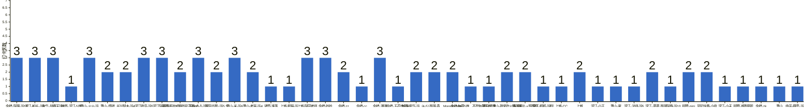

{
  "title": "杭州-健身-enjoy your life · 2026-11-02 至 2026-11-08",
  "date": "2026-11-02",
  "layout": "weekly",
  "group_id": "group-2",
  "record_dates": [
    "2026-11-02",
    "2026-11-03",
    "2026-11-04"
  ],
  "generated_by": "checkins-v1",
  "iso_year": 2026,
  "iso_week": 45,
  "date_summary": [
    "📅 周打卡：2026-11-02 至 2026-11-08（第45周）",
    "🏆 季度：2026年第4季度｜已过39天，剩余53天",
    "⏳ 年度：2026年｜已过312天（85.48%），剩余53天（14.52%）"
  ]
}

本期统计名单仅包含本周有有效打卡内容的参与者，打卡率以本期统计名单人数为分母。

## 1. 本周打卡概览 {#本周打卡概览}

<span id="打卡天数排行榜"></span>

**成员打卡天数**（按名单顺序展示，左右滑动查看全部成员，柱顶数字为本周打卡天数）



<span id="每日打卡率"></span>

**每日打卡率**

| 日期 | 11-02 周一 | 11-03 周二 | 11-04 周三 |
| --- | --- | --- | --- |
| 打卡人数/统计总人数（打卡率） | 28/44（63.6%） | 30/44（68.2%） | 23/44（52.3%） |

## 2. 打卡内容明细 {#打卡内容明细}

| 名单编号 | 昵称 | 2026-11-02 | 2026-11-03 | 2026-11-04 |
| --- | --- | --- | --- | --- |
| 1 | 余杭-阿栗-运10 | 有氧<br>熊熊熊🐻 | 背<br>肩 | 腹 |
| 2 | 滨江-船长-运5 | 无氧 | 背 | 腿肩 |
| 3 | 金华-胡霸天运7 | 股四胸肩前中束腹部加有氧<br>空腹有氧40min加腘绳肌臀背三头中后束➕有氧90min | 有氧加筋膜刀 | 空腹有氧40min后侧链全部➕90min有氧 |
| 4 | 林然-滨江-5练 | 胸 |  |  |
| 5 | 萧山-火火-运 | 4 胸➕有氧 | 4 培训 | 4 背 |
| 6 | 萧山-煜祺 | 胸 | 背 |  |
| 7 | 长兴梨木-运4 | 背 | 爬山1小时 |  |
| 8 | 滨江欧克-运5 | 胸140 | 歇息 | 胸120 |
| 9 | 滨江阿豪-运1 | 肩45min | 腿+拉伸50min | 胸45min<br>学习3h |
| 10 | 拱墅-开始戒糖的彭于晏d0 | 背 | 跑步 |  |
| 11 | 下沙-占占-运5 | 背 核心 一小时 爬楼20分钟 | 肩 核心一小时 爬楼30分钟 | 心肺一小时 |
| 12 | 富阳古琴−运5.5 | 爬山4公里 |  | 腿 |
| 13 | 萧山-米-运6 | 💪🏻 | 🦵🏻 | 🦵🏻 |
| 14 | 萧山-老吴-运4 | 胸+三头  骑行40分钟 | 背加二头 |  |
| 15 | 诸暨-淮落 | 手臂 |  |  |
| 16 | 上城-熊猫-运 | 5 背 |  |  |
| 17 | 上城-阿园老师 | 手臂 | 休息 | 下背 |
| 18 | 余杭-妙妙 | 室内跑步1h | 室内跑步1h+拉伸30min | 室内跑步1h+拉伸30min |
| 19 | 余杭-zz | 背 |  | 胸+有氧 |
| 20 | 余杭-cc | 肩 腿 |  |  |
| 21 | 余杭-潘潘 | 胸 | 有氧 | 有氧 |
| 22 | 余杭-五花肉-运5 | 俯卧撑 |  |  |
| 23 | 城西-氧气-运（4-5） | 游泳1km+练背4组 | 有氧50min |  |
| 24 | 西湖-森 | 背 | 胸 |  |
| 25 | Manolo-tmg | push |  | pull |
| 26 | 余杭-每周5练，不是每周五练 | 臀背 |  |  |
| 27 | 浦沿-清水 | 腿 |  |  |
| 28 | 萧山-我爱吃火锅-运5 | 肩背 |  | 肩背 |
| 29 | 西湖薯片-x哥跟班 |  | 腿 | 肩腹 |
| 30 | 滨江-鸭鸭-运3️⃣ |  | 🐻 |  |
| 31 | 上城-CC |  | 背➕手臂 |  |
| 32 | 上城 |  | 星期天 背 | 星期天 腿 |
| 33 | 滨江-小王 |  | 背 |  |
| 34 | 萧山-谢 |  | 腿 |  |
| 35 | 滨江-法师-运5 |  | 腿 |  |
| 36 | 滨江-慕慕 |  | 肩 | 屁 |
| 37 | 西湖阿鹿-运10 |  | 腿 |  |
| 38 | 拱墅-nini |  | 背 | 肩 |
| 39 | 凤起庆春-小徐 |  | 休息 | 嗓子 |
| 40 | 滨江-小夭 |  | 臀腿 |  |
| 41 | 拱墅-减脂萌新 |  | 肩 |  |
| 42 | 余杭-zk |  |  | 有氧1小时 |
| 43 | 萧山 |  |  | 瑞 背 |
| 44 | 临平-啊歪-运1~4 |  |  | 手臂胸 |

## 3. 原始打卡内容（2026-11-02 至 2026-11-08） {#原始打卡内容2026-11-02-至-2026-11-08}

```text
#接龙
2026-11-02
有梦想才有远方，今天也要元气满满。

1. 余杭-阿栗-运10 有氧
2. 滨江-船长-运5 无氧
3. 金华-胡霸天运7 股四胸肩前中束腹部加有氧
4. 林然-滨江-5练  胸
5. 萧山-火火-运 4 胸➕有氧
6. 萧山-煜祺 胸
7. 长兴梨木-运4 背
8. 滨江欧克-运5 胸140
9. 滨江阿豪-运1 
肩45min
10. 拱墅-开始戒糖的彭于晏d0 背
11. 下沙-占占-运5  背 核心 一小时 爬楼20分钟
12. 富阳古琴−运5.5 爬山4公里
13. 萧山-米-运6 💪🏻
14. 萧山-老吴-运4  胸+三头  骑行40分钟
15. 余杭-阿栗-运10 熊熊熊🐻
16. 滨江-鸭鸭-运3背
17. 诸暨-淮落 手臂
18. 上城-熊猫-运 5 背
19. 上城-阿园老师 手臂
20. 余杭-妙妙 室内跑步1h
21. 余杭-zz 背
22. 余杭-cc 肩 腿
23. 余杭-潘潘 胸
24. 余杭-五花肉-运5 俯卧撑
25. 城西-氧气-运（4-5）  游泳1km+练背4组
26. 西湖-森 背
27. Manolo-tmg push
28. 余杭-每周5练，不是每周五练 臀背
29. 金华-胡霸天运7 空腹有氧40min加腘绳肌臀背三头中后束➕有氧90min
30. 浦沿-清水 腿
31. 萧山-我爱吃火锅-运5 肩背

#接龙
2026-11-03
花会沿路盛开，你以后的路也是~

1. 余杭-阿栗-运10 背
2. 滨江-船长-运5 背
3. 滨江欧克-运5 歇息
4. 萧山-煜祺 背
5. 金华-胡霸天运7 有氧加筋膜刀
6. 西湖薯片-x哥跟班 腿
7. 滨江-鸭鸭-运3️⃣ 🐻
8. 萧山-老吴-运4  背加二头
9. 上城-CC 背➕手臂
10. 滨江阿豪-运1 
腿+拉伸50min
11. 长兴梨木-运4 爬山1小时
12. 上城 星期天 背
13. 下沙-占占-运5  肩 核心一小时 爬楼30分钟
14. 拱墅-开始戒糖的彭于晏d0 跑步
15. 萧山-米-运6 🦵🏻
16. 滨江-小王 背
17. 萧山-谢 腿
18. 滨江-法师-运5 腿
19. 余杭-妙妙 室内跑步1h+拉伸30min
20. 西湖-森 胸
21. 城西-氧气-运（4-5） 有氧50min
22. 滨江-慕慕 肩
23. 上城-阿园老师 休息
24. 西湖阿鹿-运10 腿
25. 拱墅-nini 背
26. 凤起庆春-小徐 休息
27. 余杭-阿栗-运10 肩
28. 萧山-火火-运 4 培训
29. 滨江-小夭 臀腿
30. 余杭-潘潘 有氧
31. 拱墅-减脂萌新 肩

#接龙
2026-11-04
不是顶峰才有最美的风景，你走的每一步都是绝佳风景！

1. 余杭-阿栗-运10 腹
2. 萧山-火火-运 4 背
3. 滨江-船长-运5 腿肩
4. 富阳古琴−运5.5 腿
5. 萧山-米-运6 🦵🏻
6. 西湖薯片-x哥跟班 肩腹
7. 滨江阿豪-运1 
胸45min
学习3h
8. 萧山-我爱吃火锅-运5 肩背
9. 下沙-占占-运5  心肺一小时
10. 余杭-zk 有氧1小时
11. 萧山 瑞 背
12. 上城 星期天 腿
13. 上城-阿园老师 下背
14. 临平-啊歪-运1~4  手臂胸
15. 凤起庆春-小徐 嗓子
16. 余杭-潘潘 有氧
17. 滨江-慕慕 屁
18. 金华-胡霸天运7 空腹有氧40min后侧链全部➕90min有氧
19. Manolo-tmg pull
20. 滨江欧克-运5 胸120
21. 余杭-zz 胸+有氧
22. 拱墅-nini 肩
23. 余杭-妙妙 室内跑步1h+拉伸30min

```
