{
  "title": "杭州-健身-enjoy your life · 2026-11-09 至 2026-11-15",
  "date": "2026-11-09",
  "layout": "weekly",
  "group_id": "group-2",
  "record_dates": [
    "2026-11-09",
    "2026-11-10",
    "2026-11-11",
    "2026-11-12",
    "2026-11-13",
    "2026-11-14",
    "2026-11-15"
  ],
  "generated_by": "checkins-v1",
  "iso_year": 2026,
  "iso_week": 46,
  "date_summary": [
    "📅 周打卡：2026-11-09 至 2026-11-15（第46周）",
    "🏆 季度：2026年第4季度｜已过46天，剩余46天",
    "⏳ 年度：2026年｜已过319天（87.40%），剩余46天（12.60%）"
  ]
}

本期统计名单仅包含本周有有效打卡内容的参与者，打卡率以本期统计名单人数为分母。

## 1. 本周打卡概览 {#本周打卡概览}

<span id="打卡天数排行榜"></span>

**成员打卡天数**（按名单顺序展示，左右滑动查看全部成员，柱顶数字为本周打卡天数）

```mermaid
---
config:
  xyChart:
    width: 4384
    height: 400
    showDataLabel: true
    showDataLabelOutsideBar: true
    xAxis:
      labelRotation: -55
      labelFontSize: 13
    yAxis:
      labelFontSize: 13
  themeVariables:
    xyChart:
      plotColorPalette: "#356AC3"
---
xychart-beta
    x-axis ["余杭-阿栗-运10", "金华-胡霸天运7", "萧山-火火-运", "滨江-船长-运5", "滨江欧克-运5", "长兴梨木-运4", "滨江阿豪-运1", "萧山-老吴-运4", "余杭-每周5练，不是每周五练", "滨江-知书", "余杭-妙妙", "滨江-鸭鸭-运3️⃣", "萧山-我爱吃火锅-运5", "上城", "拱墅-减脂萌新4-5", "下沙-占占-运5", "萧山-米-运6", "余杭-zk", "西湖阿鹿-运10", "萧山-小白", "上城-阿园老师", "西溪卡子-运3", "临平-Frank.", "滨江-慕慕", "下沙-橙子", "Manolo-tmg", "萧山威少-运7", "拱墅-波涛", "滨江-小夭", "良渚–转眼🥕", "拱墅-开始戒糖的彭于晏d2", "下沙-柒月", "西湖—林哥", "临平_桀", "萧山-谢", "滨江-小王", "萧山-明明-运1", "诸暨-淮落", "余杭-zz", "上城-Lucas-运5", "上城-陌染新人-运5", "余杭-假面骑士大王", "萧山-瑞", "浦沿-清水", "林然-滨江-5练", "城西-氧气-运（4-5）", "余杭-潘潘", "良渚-远(复健版)", "拱墅-开始戒糖的彭于晏d3", "拱墅---西瓜", "近江-迢启-运5", "余杭-木木", "诸暨-AVa", "上城-我是余美丽啊💚", "萧山-明明-运2", "拱墅-nini", "九堡-小白", "拱墅-牛来", "余杭-小王", "拱墅-开始戒糖的彭于晏d1", "西湖-树叶", "拱墅-陈皮", "萧山-明明-运4", "萧山-小马", "西湖-长岛", "萧山-阿军-运"]
    y-axis "打卡天数" 0 --> 7
    bar [7, 7, 6, 6, 7, 5, 6, 4, 7, 2, 4, 3, 4, 6, 7, 4, 7, 4, 4, 2, 4, 5, 1, 4, 6, 3, 3, 1, 1, 2, 2, 2, 1, 1, 3, 1, 1, 4, 3, 3, 2, 6, 2, 1, 3, 3, 1, 4, 2, 1, 1, 1, 2, 3, 1, 2, 1, 1, 1, 1, 1, 1, 1, 1, 1, 1]
```



<span id="每日打卡率"></span>

**每日打卡率**

| 日期 | 11-09 周一 | 11-10 周二 | 11-11 周三 | 11-12 周四 | 11-13 周五 | 11-14 周六 | 11-15 周日 |
| --- | --- | --- | --- | --- | --- | --- | --- |
| 打卡人数/统计总人数（打卡率） | 30/66（45.5%） | 34/66（51.5%） | 37/66（56.1%） | 31/66（47.0%） | 19/66（28.8%） | 28/66（42.4%） | 19/66（28.8%） |

## 2. 打卡内容明细 {#打卡内容明细}

| 名单编号 | 昵称 | 2026-11-09 | 2026-11-10 | 2026-11-11 | 2026-11-12 | 2026-11-13 | 2026-11-14 | 2026-11-15 |
| --- | --- | --- | --- | --- | --- | --- | --- | --- |
| 1 | 余杭-阿栗-运10 | 熊熊🐻<br>卷腹<br>休闲11km | 背 | 🗡 | 腿＋三头<br>卷腹<br>快走17km | 二头＋熊 | 休闲7km | 休闲8km |
| 2 | 金华-胡霸天运7 | 后侧链加有氧 | 前侧加有氧 | 有氧 | 后侧加有氧 | 前侧加有氧 | 后侧加有氧 | 有氧 |
| 3 | 萧山-火火-运 | 4 胸➕有氧 | 4 背 | 4 肩+有氧 | 4 腿+有氧 | 4 休息一天 | 4 跑个步吧 |  |
| 4 | 滨江-船长-运5 | 核心 | 胸手臂 | 背 | 腿肩 |  | 胸手 | 背 |
| 5 | 滨江欧克-运5 | 休息 | 睡觉<br>深蹲100 | 🗡🗡🗡🗡🗡🗡🗡🗡🗡 | 🦵 | 休5天 | 培训 | 🛏 |
| 6 | 长兴梨木-运4 | 背 | 臀 | 徒步5公里 | 肩 | 瑜伽 |  |  |
| 7 | 滨江阿豪-运1 | 腿45min<br>md+lvm+fs 1.5h | 胸40min+卷腹<br>syno技术栈分析4h |  | 肩45min | 腿+卷腹50min | 胸 1h<br>Talk 1h | for-my-work 12h |
| 8 | 萧山-老吴-运4 | 胸加三头 | 背加二头 |  | 肩加腹 | 腿+臀+小腿 |  |  |
| 9 | 余杭-每周5练，不是每周五练 | 臀腿 | 背 | 背1胸1臀1 | 爬坡40min | 腿背 | 舞蹈1h | 骑行38km+舞蹈1h |
| 10 | 滨江-知书 | 胸 |  | 背 |  |  |  |  |
| 11 | 余杭-妙妙 | 羽毛球2h |  | 羽毛球3h | 羽毛球训练1h |  |  | 户外步行2h |
| 12 | 滨江-鸭鸭-运3️⃣ | 背 |  |  |  | 有氧 | 核心 |  |
| 13 | 萧山-我爱吃火锅-运5 | 肩背+高强度间歇 | 臀腿 | hiit+臀腿 | 肩背 |  |  |  |
| 14 | 上城 | 星期天 睡觉<br>星期天 硬拉 | 星期天 肩腹 | 星期天 背 | 星期天 腿 | 星期天 睡觉 | 星期天 休息 |  |
| 15 | 拱墅-减脂萌新4-5 | 睡觉+1 | 背➕骑车有氧40分钟 | 肩 | 1小时有氧 | 臀腿 | 休息日 | 有氧60km |
| 16 | 下沙-占占-运5 | 肩 核心 一小时 | 臀腿 核心 一小时 |  | 核心 胸 一小时 | 生理期休5天 |  |  |
| 17 | 萧山-米-运6 | 🏊🏻‍♀️ | 🏊🏻‍♀️ | 🏊🏻‍♀️ | 💪🏻+🏊🏻‍♀️ | 💪🏻+🏊🏻‍♀️ | 💪🏻+🦵🏻+🏊🏻‍♀️ | 🦵🏻+🏊🏻‍♀️ |
| 18 | 余杭-zk | 有氧1小时 |  | 有氧68分钟 | 有氧70分钟 |  | 有氧90分钟 |  |
| 19 | 西湖阿鹿-运10 | 🚂 | 背 |  | 肩 |  | 胸 |  |
| 20 | 萧山-小白 | 推日卡 | 拉日 |  |  |  |  |  |
| 21 | 上城-阿园老师 | 胸 | 背 | 背 | 肩 |  |  |  |
| 22 | 西溪卡子-运3 | 背 | 游泳 | 有氧 | 游泳 |  | 有氧 |  |
| 23 | 临平-Frank. | 胸 |  |  |  |  |  |  |
| 24 | 滨江-慕慕 | 屁 |  | 背 | 肩 |  | 休闲2h |  |
| 25 | 下沙-橙子 | 10（云水、东站 tmg） 肩背<br>10（云水、东站 tmg） 爬楼 30 分钟 | 10（云水、东站 tmg） 学习一小时 | 10（云水、东站 tmg） 间歇有氧 40 分钟<br>10（云水、东站 tmg） 肩 手臂 背<br>10（云水、东站 tmg） 学习一小时 | 10（云水、东站 tmg） 爬楼 40 分钟<br>10（云水、东站 tmg） 中束➕腹➕腿<br>10（云水、东站 tmg） 学习 30 分钟 |  | 10（云水、东站 tmg） 爬楼俯卧撑 30 分钟<br>10（云水、东站 tmg） 背➕二头➕腿 | 10（云水、东站 tmg） 徒步 3 小时<br>10（云水、东站 tmg） 学习 1 小时 |
| 26 | Manolo-tmg | push |  |  |  |  | shoukder arms | legs |
| 27 | 萧山威少-运7 | 腿＋责群主N次 | 胸腹＋练群主 |  |  |  | 拿下群主了，今天背三大项 |  |
| 28 | 拱墅-波涛 | 有氧 |  |  |  |  |  |  |
| 29 | 滨江-小夭 | 肩背 |  |  |  |  |  |  |
| 30 | 良渚–转眼🥕 | 胸卡 |  |  |  |  | 胸 |  |
| 31 | 拱墅-开始戒糖的彭于晏d2 |  | 腿➕背<br>有氧➕背 | 有氧 |  |  |  |  |
| 32 | 下沙-柒月 |  | 肩 |  |  | 生理期 |  |  |
| 33 | 西湖—林哥 |  | 运5 背胸肩臂腿+卷腹 |  |  |  |  |  |
| 34 | 临平&#95;桀 |  | 有氧，胸 |  |  |  |  |  |
| 35 | 萧山-谢 |  | 背 | 肩 |  |  |  | 背 |
| 36 | 滨江-小王 |  | 背 |  |  |  |  |  |
| 37 | 萧山-明明-运1 |  | 背 |  |  |  |  |  |
| 38 | 诸暨-淮落 |  | 肩 | 背 | 🐻 |  | 三头划水 |  |
| 39 | 余杭-zz |  | 背 |  | 胸 |  |  | 肩+有氧 |
| 40 | 上城-Lucas-运5 |  | 腹+有氧 | 休息 | 臀 |  |  |  |
| 41 | 上城-陌染新人-运5 |  | 上肢背 | 臀 |  |  |  |  |
| 42 | 余杭-假面骑士大王 |  | 胸 三头 | 背 | 肩 | 休一天 | 胸 | 背 |
| 43 | 萧山-瑞 |  | 肩 |  |  |  | 肩 |  |
| 44 | 浦沿-清水 |  | 练腿到低血糖 |  |  |  |  |  |
| 45 | 林然-滨江-5练 |  |  | 胸 |  | 肩 | 背 |  |
| 46 | 城西-氧气-运（4-5） |  |  | 有氧 | 有氧+背 |  | 练腿+爬楼35min |  |
| 47 | 余杭-潘潘 |  |  | 肩背 |  |  |  |  |
| 48 | 良渚-远(复健版) |  |  | 🐻 | 背 |  | 休息day | 肩 |
| 49 | 拱墅-开始戒糖的彭于晏d3 |  |  | 溜达鸡 | 有氧➕🐻 |  |  |  |
| 50 | 拱墅---西瓜 |  |  | 肩 |  |  |  |  |
| 51 | 近江-迢启-运5 |  |  | 背 |  |  |  |  |
| 52 | 余杭-木木 |  |  | 🐻 |  |  |  |  |
| 53 | 诸暨-AVa |  |  | 跳绳 |  |  |  | 腹加跳绳 |
| 54 | 上城-我是余美丽啊💚 |  |  | 臀腿 |  | 背 |  | 手臂 |
| 55 | 萧山-明明-运2 |  |  | 单车课 |  |  |  |  |
| 56 | 拱墅-nini |  |  | 臀腿 | 背 |  |  |  |
| 57 | 九堡-小白 |  |  | 胸 |  |  |  |  |
| 58 | 拱墅-牛来 |  |  |  | 腿+有氧 |  |  |  |
| 59 | 余杭-小王 |  |  |  | 小王练背咯 |  |  |  |
| 60 | 拱墅-开始戒糖的彭于晏d1 |  |  |  |  | 骑 |  |  |
| 61 | 西湖-树叶 |  |  |  |  | 胸 |  |  |
| 62 | 拱墅-陈皮 |  |  |  |  |  | 打麻将🀄️ |  |
| 63 | 萧山-明明-运4 |  |  |  |  |  | 腿 |  |
| 64 | 萧山-小马 |  |  |  |  |  | 6公里跑步+40分钟哑铃 |  |
| 65 | 西湖-长岛 |  |  |  |  |  |  | 肩背+有氧 |
| 66 | 萧山-阿军-运 |  |  |  |  |  |  | 4 腿+背 |

## 3. 原始打卡内容（2026-11-09 至 2026-11-15） {#原始打卡内容2026-11-09-至-2026-11-15}

```text
#接龙
20261109
生活中的幸运会以独特的方式走向你的面前。

1. 余杭-阿栗-运10 熊熊🐻
2. 金华-胡霸天运7 后侧链加有氧
3. 萧山-火火-运 4 胸➕有氧
4. 滨江-船长-运5 核心
5. 滨江欧克-运5 休息
6. 长兴梨木-运4 背
7. 滨江阿豪-运1 
腿45min
md+lvm+fs 1.5h
8. 萧山-老吴-运4  胸加三头
9. 余杭-每周5练，不是每周五练 臀腿
10. 滨江-知书 胸
11. 余杭-妙妙 羽毛球2h
12. 滨江-鸭鸭-运3️⃣ 背
13. 萧山-我爱吃火锅-运5 肩背+高强度间歇
14. 上城 星期天 睡觉
15. 拱墅-减脂萌新4-5 睡觉+1
16. 下沙-占占-运5  肩 核心 一小时
17. 萧山-米-运6 🏊🏻‍♀️
18. 余杭-zk 有氧1小时
19. 余杭-阿栗-运10 卷腹
20. 余杭-阿栗-运10 休闲11km
21. 西湖阿鹿-运10 🚂
22. 萧山-小白 推日卡
23. 上城-阿园老师 胸
24. 西溪卡子-运3 背
25. 临平-Frank. 胸
26. 上城 星期天 硬拉
27. 滨江-慕慕 屁
28. 下沙-橙子 10（云水、东站 tmg） 肩背
29. 萧山-明明-休息
30. Manolo-tmg push
31. 萧山威少-运7 腿＋责群主N次
32. 下沙-橙子 10（云水、东站 tmg） 爬楼 30 分钟
33. 拱墅-波涛 有氧
34. 滨江-小夭 肩背
35. 良渚–转眼🥕 胸卡


#接龙
20261110
人的一生中有两个生日，一个是自己诞生的日子，一个是真正理解自己的日子。

1. 余杭-阿栗-运10 背
2. 金华-胡霸天运7 前侧加有氧
3. 拱墅-开始戒糖的彭于晏d2 腿➕背
4. 滨江欧克-运5 睡觉
5. 拱墅-减脂萌新4-5 背➕骑车有氧40分钟
6. 滨江-船长-运5 胸手臂
7. 萧山-火火-运 4 背
8. 萧山-小白 拉日
9. 长兴梨木-运4 臀
10. 余杭-每周5练，不是每周五练 背
11. 滨江阿豪-运1 
胸40min+卷腹 
syno技术栈分析4h
12. 下沙-柒月 肩
13. 西湖—林哥  运5 背胸肩臂腿+卷腹
14. 萧山-我爱吃火锅-运5 臀腿
15. 下沙-占占-运5  臀腿 核心 一小时
16. 萧山-米-运6 🏊🏻‍♀️
17. 临平_桀 有氧，胸
18. 萧山-老吴-运4  背加二头
19. 萧山-谢 背
20. 滨江-小王 背
21. 萧山-明明-运1 背
22. 上城-阿园老师 背
23. 拱墅-开始戒糖的彭于晏d2 有氧➕背
24. 西溪卡子-运3 游泳
25. 诸暨-淮落 肩
26. 西湖阿鹿-运10 背
27. 余杭-zz 背
28. 上城-Lucas-运5 腹+有氧
29. 下沙-橙子 10（云水、东站 tmg） 学习一小时
30. 滨江欧克-运5 深蹲100
31. 上城-陌染新人-运5  上肢背
32. 萧山威少-运7 胸腹＋练群主
33. 余杭-假面骑士大王 胸 三头
34. 萧山-瑞 肩
35. 上城 星期天 肩腹
36. 浦沿-清水 练腿到低血糖


#接龙
20261111
今天是2026年最后50天，愿心有所向，行有所达，一切都值得期待！

1. 余杭-阿栗-运10 🗡
2. 长兴梨木-运4 徒步5公里
3. 拱墅-开始戒糖的彭于晏d2 有氧
4. 萧山-火火-运 4 肩+有氧
5. 拱墅-减脂萌新4-5 肩
6. 滨江-船长-运5 背
7. 下沙-橙子 10（云水、东站 tmg） 间歇有氧 40 分钟
8. 下沙-橙子 10（云水、东站 tmg） 肩 手臂 背
9. 余杭-每周5练，不是每周五练 背1胸1臀1
10. 萧山-我爱吃火锅-运5 hiit+臀腿
11. 上城 星期天 背
12. 余杭-zk 有氧68分钟
13. 滨江欧克-运5 🗡🗡🗡🗡🗡🗡🗡🗡🗡
14. 萧山-米-运6 🏊🏻‍♀️
15. 西溪卡子-运3 有氧
16. 林然-滨江-5练  胸
17. 滨江-慕慕 背
18. 金华-胡霸天运7 有氧
19. 城西-氧气-运（4-5） 有氧
20. 余杭-潘潘 肩背
21. 上城-Lucas-运5 休息
22. 良渚-远(复健版) 🐻
23. 拱墅-开始戒糖的彭于晏d3 溜达鸡
24. 萧山-谢 肩
25. 上城-阿园老师 背
26. 拱墅---西瓜 肩
27. 近江-迢启-运5 背
28. 余杭-木木 🐻
29. 滨江-知书 背
30. 诸暨-AVa 跳绳
31. 余杭-妙妙 羽毛球3h
32. 上城-我是余美丽啊💚 臀腿
33. 萧山-明明-运2 单车课
34. 拱墅-nini 臀腿
35. 诸暨-淮落 背
36. 九堡-小白 胸
37. 上城-陌染新人-运5  臀
38. 下沙-橙子 10（云水、东站 tmg） 学习一小时
39. 余杭-假面骑士大王 背

#接龙
20261112
新的一周要记得爱自己哦~爱自己是终生浪漫的开始。

1. 余杭-阿栗-运10 腿＋三头
2. 拱墅-开始戒糖的彭于晏d3 有氧➕🐻
3. 滨江-船长-运5 腿肩
4. 拱墅-减脂萌新4-5 1小时有氧
5. 下沙-橙子 10（云水、东站 tmg） 爬楼 40 分钟
6. 上城 星期天 腿
7. 萧山-火火-运 4 腿+有氧
8. 金华-胡霸天运7 后侧加有氧
9. 拱墅-牛来 腿+有氧
10. 长兴梨木-运4 肩
11. 下沙-橙子 10（云水、东站 tmg） 中束➕腹➕腿
12. 余杭-小王 小王练背咯
13. 余杭-每周5练，不是每周五练 爬坡40min
14. 滨江阿豪-运1 
肩45min
15. 萧山-我爱吃火锅-运5 肩背
16. 下沙-占占-运5  核心 胸 一小时
17. 余杭-zk 有氧70分钟
18. 萧山-老吴-运4  肩加腹
19. 滨江欧克-运5 🦵
20. 萧山-米-运6 💪🏻+🏊🏻‍♀️
21. 西溪卡子-运3 游泳
22. 上城-阿园老师 肩
23. 诸暨-淮落 🐻
24. 滨江-慕慕 肩
25. 良渚-远(复健版) 背
26. 余杭-妙妙 羽毛球训练1h
27. 余杭-假面骑士大王 肩
28. 余杭-阿栗-运10 卷腹
29. 余杭-阿栗-运10 快走17km
30. 西湖阿鹿-运10 肩
31. 城西-氧气-运（4-5） 有氧+背
32. 余杭-zz 胸
33. 上城-Lucas-运5 臀
34. 下沙-橙子 10（云水、东站 tmg） 学习 30 分钟
35. 拱墅-nini 背


#接龙
 20261113
先去尝试你最想做的东西，不用考虑太多，竭尽全力去试。

1. 余杭-阿栗-运10 二头＋熊
2. 拱墅-减脂萌新4-5 臀腿
3. 拱墅-开始戒糖的彭于晏d1 骑
4. 滨江-鸭鸭-运3️⃣ 有氧
5. 下沙-占占-运5  生理期休5天
6. 西湖-树叶 胸
7. 下沙-柒月 生理期
8. 滨江欧克-运5 休5天
9. 余杭-假面骑士大王 休一天
10. 萧山-火火-运 4 休息一天
11. 萧山-米-运6 💪🏻+🏊🏻‍♀️
12. 滨江阿豪-运1 
腿+卷腹50min
13. 萧山-老吴-运4  腿+臀+小腿
14. 长兴梨木-运4 瑜伽
15. 上城-我是余美丽啊💚 背
16. 金华-胡霸天运7 前侧加有氧
17. 余杭-每周5练，不是每周五练 腿背
18. 林然-滨江-5练 肩
19. 上城 星期天 睡觉


#接龙
20261114
不要站在原地去问意义，你要走起来才知道方向。

1. 余杭-阿栗-运10 休闲7km
2. 拱墅-减脂萌新4-5 休息日
3. 萧山-火火-运 4 跑个步吧
4. 林然-滨江-5练  背
5. 上城 星期天 休息
6. 滨江-鸭鸭-运3️⃣ 核心
7. 滨江欧克-运5 培训
8. 滨江-船长-运5 胸手
9. 下沙-橙子 10（云水、东站 tmg） 爬楼俯卧撑 30 分钟
10. 萧山-米-运6 💪🏻+🦵🏻+🏊🏻‍♀️
11. 金华-胡霸天运7 后侧加有氧
12. 良渚–转眼🥕  胸
13. 拱墅-陈皮 打麻将🀄️
14. 城西-氧气-运（4-5） 练腿+爬楼35min
15. 萧山-明明-运4 腿
16. 滨江-慕慕 休闲2h
17. 西溪卡子-运3 有氧
18. 下沙-橙子 10（云水、东站 tmg） 背➕二头➕腿
19. 余杭-每周5练，不是每周五练 舞蹈1h
20. 良渚-远(复健版) 休息day
21. 余杭-假面骑士大王 胸
22. 滨江阿豪-运1 
胸 1h
Talk 1h
23. 萧山-小马 6公里跑步+40分钟哑铃
24. 西湖阿鹿-运10 胸
25. 诸暨-淮落 三头划水
26. 萧山威少-运7 拿下群主了，今天背三大项
27. 余杭-zk 有氧90分钟
28. Manolo-tmg shoukder arms
29. 萧山-瑞 肩

#接龙
20261115
前路漫漫，当克己，当慎独，磨棱角，褪优越，沉下心！

1. 余杭-阿栗-运10 休闲8km
2. 滨江-船长-运5 背
3. 萧山-米-运6 🦵🏻+🏊🏻‍♀️
4. 金华-胡霸天运7 有氧
5. 上城-我是余美丽啊💚 手臂
6. 余杭-假面骑士大王 背
7. 拱墅-减脂萌新4-5 有氧60km
8. 诸暨-AVa 腹加跳绳
9. 下沙-橙子 10（云水、东站 tmg） 徒步 3 小时
10. 余杭-zz 肩+有氧
11. 余杭-每周5练，不是每周五练 骑行38km+舞蹈1h
12. 萧山-谢 背
13. 良渚-远(复健版) 肩
14. 西湖-长岛 肩背+有氧
15. 滨江欧克-运5 🛏
16. 下沙-橙子 10（云水、东站 tmg） 学习 1 小时
17. 萧山-阿军-运 4 腿+背
18. 余杭-妙妙 户外步行2h
19. 滨江阿豪-运1 
for-my-work 12h
20. Manolo-tmg legs


```
