{
  "title": "杭州-健身-enjoy your life · 2026-11-16 至 2026-11-22",
  "date": "2026-11-16",
  "layout": "weekly",
  "group_id": "group-2",
  "record_dates": [
    "2026-11-16",
    "2026-11-17",
    "2026-11-18",
    "2026-11-19",
    "2026-11-20",
    "2026-11-21",
    "2026-11-22"
  ],
  "generated_by": "checkins-v1",
  "iso_year": 2026,
  "iso_week": 47,
  "date_summary": [
    "📅 周打卡：2026-11-16 至 2026-11-22（第47周）",
    "🏆 季度：2026年第4季度｜已过53天，剩余39天",
    "⏳ 年度：2026年｜已过326天（89.32%），剩余39天（10.68%）"
  ],
  "rest_aware": true
}

本期统计名单包含本周提交打卡或休息记录的参与者，打卡率以本期统计名单人数为分母。

## 1. 本周打卡概览 {#本周打卡概览}

<span id="打卡天数排行榜"></span>

**成员打卡天数**（按名单顺序展示，左右滑动查看全部成员，柱顶数字为本周打卡天数）

```mermaid
---
config:
  xyChart:
    width: 4448
    height: 400
    showDataLabel: true
    showDataLabelOutsideBar: true
    xAxis:
      labelRotation: -55
      labelFontSize: 13
    yAxis:
      labelFontSize: 13
  themeVariables:
    xyChart:
      plotColorPalette: "#356AC3"
---
xychart-beta
    x-axis ["余杭-阿栗-运10", "金华-胡霸天运7", "拱墅-减脂萌新4-5", "滨江欧克-运5", "下沙-橙子", "西湖-树叶", "西溪卡子-运3", "长兴梨木-运4", "拱墅-开始戒糖的彭于晏d1", "西湖薯片-x哥跟班", "萧山-老吴-运4", "余杭-每周5练，不是每周五练", "滨江阿豪-运1", "上城-阿园老师", "萧山-米", "余杭-zk", "诸暨-AVa", "诸暨-淮落", "滨江—墨殇", "余杭-妙妙", "萧山-小马", "滨江-慕慕", "城西-氧气-运（4-5）", "拱墅-nini", "下沙-柒月", "林然-滨江-5练", "良渚-远(复健版)", "萧山-我爱吃火锅-运5", "拱墅---西瓜", "滨江-船长-运5", "滨江-鸭鸭-运3️⃣", "上城", "拱墅-伍肆叁", "转塘~Mu", "九堡-小白-运3", "滨江-知书", "萧山-火火-运", "拱墅-波涛", "上城-Lucas-运5", "拱墅-Wally", "西湖阿鹿-运10", "萧山-明明-运1", "余杭-zz", "老九", "萧山-阿军-运", "萧山-明明-运2", "下沙-占占-运5", "Manolo-tmg", "下沙_杨成_周5", "下沙-橙子-运10", "滨江欧克-运5，爱看腿", "萧山-小白", "上城-我是余美丽啊💚", "萧山-老九-运6", "良渚–转眼🥕", "余杭-明迪-运4🎾", "西湖-慢就是快", "拱墅-开始戒糖的彭于晏d3", "西湖慈禧-运6", "上城-陌染新人-运5", "萧山-瑞", "萧山威少-运7", "余杭-假面骑士大王", "萧山-明明-运3", "拱墅-开始戒糖的彭于晏d4", "凤起庆春-小徐", "西湖-长岛"]
    y-axis "打卡天数" 0 --> 7
    bar [7, 6, 5, 3, 3, 2, 3, 4, 3, 4, 3, 5, 5, 1, 7, 6, 3, 4, 1, 3, 3, 4, 3, 1, 3, 2, 3, 4, 4, 2, 1, 2, 1, 4, 1, 1, 4, 2, 2, 5, 4, 1, 5, 1, 2, 1, 4, 4, 1, 4, 3, 1, 1, 4, 2, 3, 2, 1, 1, 1, 3, 2, 2, 1, 1, 2, 1]
```



<span id="每日打卡率"></span>

**每日打卡率**

| 日期 | 11-16 周一 | 11-17 周二 | 11-18 周三 | 11-19 周四 | 11-20 周五 | 11-21 周六 | 11-22 周日 |
| --- | --- | --- | --- | --- | --- | --- | --- |
| 打卡人数/统计总人数（打卡率） | 29/67（43.3%） | 32/67（47.8%） | 28/67（41.8%） | 32/67（47.8%） | 31/67（46.3%） | 16/67（23.9%） | 20/67（29.9%） |

## 2. 打卡内容明细 {#打卡内容明细}

| 名单编号 | 昵称 | 2026-11-16 | 2026-11-17 | 2026-11-18 | 2026-11-19 | 2026-11-20 | 2026-11-21 | 2026-11-22 |
| --- | --- | --- | --- | --- | --- | --- | --- | --- |
| 1 | 余杭-阿栗-运10 | 熊熊熊 | 背背背<br>休闲8km | 煎饼 | 有氧<br>腿＋爬山 | 有氧<br>手臂＋卷腹 | 有氧 | 休闲6km |
| 2 | 金华-胡霸天运7 | 前侧➕有氧 | 后侧加有氧 | 前侧加有氧 | 有氧 | 后侧加有氧 |  | 后侧加有氧 |
| 3 | 拱墅-减脂萌新4-5 | 背➕有氧 | 肩 | 头疼休1 | 推胸➕有氧80mins | 臀腿 | <del style="color:#808080;text-decoration-color:#d32f2f">休息日</del> |  |
| 4 | 滨江欧克-运5 | 🛏 | 🛏 | 🛏 |  |  |  |  |
| 5 | 下沙-橙子 | 10（云水、东站 tmg） 空腹爬楼 30 分钟 | 10（云水、东站 tmg） 背 | 10（云水、东站 tmg） 早爬楼 30 分钟，中午肩➕腹 |  |  |  |  |
| 6 | 西湖-树叶 | 肩 |  | 休 |  |  |  |  |
| 7 | 西溪卡子-运3 | 游泳 |  | 臀腿 | 背 |  |  |  |
| 8 | 长兴梨木-运4 | 背 | 臀 |  | 肩 | 有氧➕拉伸课 |  |  |
| 9 | 拱墅-开始戒糖的彭于晏d1 | 骑行15km |  | 快走 |  |  |  | 爬山 |
| 10 | 西湖薯片-x哥跟班 | 肩腹 | 腿腹 | 胸+三头 | 背腹 |  |  |  |
| 11 | 萧山-老吴-运4 | 胸三头 |  |  | 肩➕腹 |  |  | 臀，腿，小腿 |
| 12 | 余杭-每周5练，不是每周五练 | 背+胸<br>舞蹈1h | 舞蹈1.5h |  |  | 臀腿背 | 骑行36km | 舞蹈1.5h |
| 13 | 滨江阿豪-运1 | 撸铁-胸45min<br>for-my-work 2.5h | 撸铁-背45min | 肩40min | 阿豪-运3学2有事请艾特我<br>腿50min |  | 晒被子收拾衣服+洗过冬衣服+work 1h+补觉 |  |
| 14 | 上城-阿园老师 | 胸 |  |  |  |  |  |  |
| 15 | 萧山-米 | 💪🏻+🏊🏻‍♀️ | 💪🏻+🏊🏻‍♀️ | 🦵🏻+🏊🏻‍♀️ | 器械普拉提+🏊🏻‍♀️ | 🦵🏻+🏊🏻‍♀️ | 🏊🏻‍♀️ | 🏊🏻‍♀️ |
| 16 | 余杭-zk | 有氧66分钟 | 有氧66分钟 | 有氧72分钟 | 有氧66分钟 | 爬坡66分钟 | <del style="color:#808080;text-decoration-color:#d32f2f">休息</del> | 户外步行56分钟 |
| 17 | 诸暨-AVa | 背➕跳绳 |  | 🐻➕跳绳 | 腹➕跳绳 |  |  |  |
| 18 | 诸暨-淮落 | 胸摸鱼 | 背背背 |  | 肩 | 手臂 |  |  |
| 19 | 滨江—墨殇 | 肩膀 |  |  |  |  |  |  |
| 20 | 余杭-妙妙 | 室内跑步1h |  | 羽毛球3h | 室内跑步1h |  |  |  |
| 21 | 萧山-小马 | 哑铃45分钟+深蹲300下 |  | 15公里跑步+哑铃45分钟 |  | 深蹲提踵 |  |  |
| 22 | 滨江-慕慕 | 背 | 屁 |  | 背 |  | 🛏️ |  |
| 23 | 城西-氧气-运（4-5） | 爬坡40min | 爬坡40min+练背1h | 跑西湖10公里 |  |  |  |  |
| 24 | 拱墅-nini | 腿 |  |  |  |  |  |  |
| 25 | 下沙-柒月 | 背 |  | 臀腿 |  | 背 |  |  |
| 26 | 林然-滨江-5练 | 肩腿 |  |  |  | 胸 |  |  |
| 27 | 良渚-远(复健版) | 背 |  |  |  | 背 |  | 🦵 |
| 28 | 萧山-我爱吃火锅-运5 | 肩背+hiit | 臀腿 |  | 背 | 臀腿 |  |  |
| 29 | 拱墅---西瓜 | 胸 | 背 | 肩 |  |  |  | 肩 |
| 30 | 滨江-船长-运5 |  | 胸手 | 背 |  |  |  |  |
| 31 | 滨江-鸭鸭-运3️⃣ |  | 背 |  |  |  |  |  |
| 32 | 上城 |  | 星期天 肩背 | 星期天 胸 |  |  |  |  |
| 33 | 拱墅-伍肆叁 |  | 运7 有氧45min+练胸日 |  |  |  |  |  |
| 34 | 转塘~Mu |  | 臀腿 | 爬坡40分钟 | 跑步5㎞ |  | 爱心线 |  |
| 35 | 九堡-小白-运3 |  | 胸 |  |  |  |  |  |
| 36 | 滨江-知书 |  | 肩 |  |  |  |  |  |
| 37 | 萧山-火火-运 |  | 4 胸 | 4 腿 | 4 肩 | 4 逛街 |  |  |
| 38 | 拱墅-波涛 |  | 腹 |  |  |  |  | 腹部 |
| 39 | 上城-Lucas-运5 |  | 背 |  | 臀 |  |  |  |
| 40 | 拱墅-Wally |  | 肩、肱三头 | 胸 | 背 | 肩 |  | 腿 |
| 41 | 西湖阿鹿-运10 |  | 背 |  | 肩 |  | 🎪深蹲 | 🐻 |
| 42 | 萧山-明明-运1 |  | 胸/有氧舞蹈/羽毛球 |  |  |  |  |  |
| 43 | 余杭-zz |  | 背，有氧 | 羽毛球 2 小时 | 肩+手臂 | 胸 | 肩+有氧 |  |
| 44 | 老九 |  | 背二头 |  |  |  |  |  |
| 45 | 萧山-阿军-运 |  | 4 腹 |  | 4 背 |  |  |  |
| 46 | 萧山-明明-运2 |  |  | 背 |  |  |  |  |
| 47 | 下沙-占占-运5 |  |  | 胸 一小时 | 背 | 肩 核心 一小时 | 臀腿一小时 |  |
| 48 | Manolo-tmg |  |  | back muscle<br>有氧运动：5公里跑 | legs | chest back | shoulder arms | <del style="color:#808080;text-decoration-color:#d32f2f">休息</del> |
| 49 | 下沙&#95;杨成&#95;周5 |  |  | ：慢跑1小时 |  |  |  |  |
| 50 | 下沙-橙子-运10 |  |  |  | 爬楼 20 分钟➕60 个俯卧撑<br>晚爬楼 60 分钟 | 扔子 | 凌晨夜爬太子尖看日出 | 背➕二头➕腹➕30 分钟爬楼 |
| 51 | 滨江欧克-运5，爱看腿 |  |  |  | 🛏 | 🚄 |  | 🛏 |
| 52 | 萧山-小白 |  |  |  | 蹲 |  |  |  |
| 53 | 上城-我是余美丽啊💚 |  |  |  | 背 |  |  |  |
| 54 | 萧山-老九-运6 |  |  |  | 肩 | 背 | 胸 | 肩腹腿 |
| 55 | 良渚–转眼🥕 |  |  |  | 背 | 肩 |  |  |
| 56 | 余杭-明迪-运4🎾 |  |  |  | 腿🦵 | 🎾2h<br>背 |  | 🐻 |
| 57 | 西湖-慢就是快 |  |  |  | 练仍子 | 练仍子 |  |  |
| 58 | 拱墅-开始戒糖的彭于晏d3 |  |  |  |  | 背 |  |  |
| 59 | 西湖慈禧-运6 |  |  |  |  | 背75min 坡30min |  |  |
| 60 | 上城-陌染新人-运5 |  |  |  |  | 背 胸 |  |  |
| 61 | 萧山-瑞 |  |  |  |  | 胸 | 背 | 肩 |
| 62 | 萧山威少-运7 |  |  |  |  | 恋群主 | 练背背 |  |
| 63 | 余杭-假面骑士大王 |  |  |  |  | 背 |  | JIAN |
| 64 | 萧山-明明-运3 |  |  |  |  | 腿 |  |  |
| 65 | 拱墅-开始戒糖的彭于晏d4 |  |  |  |  |  | 溜达鸡 |  |
| 66 | 凤起庆春-小徐 |  |  |  |  |  | 背 | 扔 |
| 67 | 西湖-长岛 |  |  |  |  |  |  | 肩背 |

## 3. 原始打卡内容（2026-11-16 至 2026-11-22） {#原始打卡内容2026-11-16-至-2026-11-22}

```text
#接龙
20261116
今天是国际宽容日，常怀宽容之心，常修宽容之德，常思宽容之益，常予宽容之爱~

1. 余杭-阿栗-运10 熊熊熊
2. 金华-胡霸天运7 前侧➕有氧
3. 拱墅-减脂萌新4-5 背➕有氧
4. 滨江欧克-运5 🛏
5. 下沙-橙子 10（云水、东站 tmg） 空腹爬楼 30 分钟
6. 西湖-树叶 肩
7. 西溪卡子-运3 游泳
8. 长兴梨木-运4 背
9. 拱墅-开始戒糖的彭于晏d1 骑行15km
10. 西湖薯片-x哥跟班 肩腹
11. 萧山-老吴-运4  胸三头
12. 余杭-每周5练，不是每周五练 背+胸
13. 滨江阿豪-运1 
撸铁-胸45min
for-my-work 2.5h
14. 上城-阿园老师 胸
15. 萧山-米 💪🏻+🏊🏻‍♀️
16. 余杭-zk 有氧66分钟
17. 诸暨-AVa 背➕跳绳
18. 诸暨-淮落 胸摸鱼
19. 滨江—墨殇 肩膀
20. 余杭-妙妙 室内跑步1h
21. 萧山-小马 哑铃45分钟+深蹲300下
22. 滨江-慕慕 背
23. 城西-氧气-运（4-5） 爬坡40min
24. 拱墅-nini 腿
25. 下沙-柒月 背
26. 林然-滨江-5练  肩腿
27. 良渚-远(复健版) 背
28. 余杭-每周5练，不是每周五练 舞蹈1h
29. 萧山-我爱吃火锅-运5 肩背+hiit
30. 拱墅---西瓜   胸


#接龙
20261117
尽量地成长，尽量地经历，让人生美好一点，真的很简单。

1. 余杭-阿栗-运10 背背背
2. 滨江-船长-运5 胸手
3. 拱墅-减脂萌新4-5 肩
4. 滨江-鸭鸭-运3️⃣ 背
5. 上城 星期天 肩背
6. 西湖薯片-x哥跟班 腿腹
7. 余杭-阿栗-运10 休闲8km
8. 滨江欧克-运5 🛏
9. 拱墅-伍肆叁 运7 有氧45min+练胸日
10. 转塘~Mu 臀腿
11. 长兴梨木-运4 臀
12. 金华-胡霸天运7 后侧加有氧
13. 九堡-小白-运3 胸
14. 滨江阿豪-运1 
撸铁-背45min
15. 萧山-我爱吃火锅-运5 臀腿
16. 滨江-知书 肩
17. 萧山-米 💪🏻+🏊🏻‍♀️
18. 余杭-zk 有氧66分钟
19. 萧山-火火-运 4 胸
20. 诸暨-淮落 背背背
21. 城西-氧气-运（4-5） 爬坡40min+练背1h
22. 下沙-橙子 10（云水、东站 tmg） 背
23. 拱墅-波涛 腹
24. 上城-Lucas-运5 背
25. 余杭-每周5练，不是每周五练 舞蹈1.5h
26. 拱墅-Wally 肩、肱三头
27. 西湖阿鹿-运10 背
28. 滨江-慕慕 屁
29. 萧山-明明-运1  胸/有氧舞蹈/羽毛球
30. 余杭-zz 背，有氧
31. 老九  背二头
32. 拱墅---西瓜 背
33. 萧山-阿军-运 4 腹


#接龙
20261118
今天是11月18日，谐音是要要要发，愿大家都能：好运常在，发财被爱，有钱有闲，有趣有盼~

1. 余杭-阿栗-运10 煎饼
2. 滨江-船长-运5 背
3. 滨江欧克-运5 🛏
4. 萧山-火火-运 4 腿
5. 西湖-树叶  休
6. 西湖薯片-x哥跟班 胸+三头
7. 上城 星期天 胸
8. 萧山-明明-运2  背
9. 拱墅-减脂萌新4-5 头疼休1
10. 金华-胡霸天运7 前侧加有氧
11. 转塘~Mu 爬坡40分钟
12. 萧山-米 🦵🏻+🏊🏻‍♀️
13. 西溪卡子-运3 臀腿
14. 滨江阿豪-运1 
肩40min
15. 下沙-橙子 10（云水、东站 tmg） 早爬楼 30 分钟，中午肩➕腹
16. 下沙-占占-运5 胸 一小时
17. 余杭-zk 有氧72分钟
18. 诸暨-AVa 🐻➕跳绳
19. 下沙-柒月 臀腿
20. 萧山-小马 15公里跑步+哑铃45分钟
21. 余杭-zz 羽毛球 2 小时
22. Manolo-tmg back muscle
23. 拱墅-开始戒糖的彭于晏d1 快走
24. 拱墅-Wally 胸
25. 城西-氧气-运（4-5） 跑西湖10公里
26. 拱墅---西瓜 肩
27. Manolo-tmg 有氧运动：5公里跑
28. 下沙_杨成_周5 ：慢跑1小时
29. 余杭-妙妙 羽毛球3h

#接龙
20261119
脚下的每一步都是具体的、唯一的，走好脚下这一步，其实就是走好了人生这条路。

1. 余杭-阿栗-运10 有氧
2. 拱墅-减脂萌新4-5 推胸➕有氧80mins
3. 萧山-火火-运 4 肩
4. 下沙-橙子-运10 爬楼 20 分钟➕60 个俯卧撑
5. 长兴梨木-运4 肩
6. 西湖薯片-x哥跟班 背腹
7. 余杭-zk 有氧66分钟
8. 萧山-我爱吃火锅-运5 背
9. 金华-胡霸天运7 有氧
10. 滨江欧克-运5，爱看腿  🛏
11. 萧山-小白 蹲
12. 萧山-米 器械普拉提+🏊🏻‍♀️
13. 滨江-慕慕 背
14. 西溪卡子-运3  背
15. 转塘~Mu 跑步5㎞
16. 下沙-占占-运5  背
17. 拱墅-Wally 背
18. 上城-我是余美丽啊💚 背
19. 余杭-妙妙 室内跑步1h
20. 余杭-zz 肩+手臂
21. 滨江阿豪-运1 
阿豪-运3学2有事请艾特我 
腿50min
22. 萧山-老九-运6 肩
23. 上城-Lucas-运5 臀
24. 诸暨-淮落 肩
25. 西湖阿鹿-运10 肩
26. 余杭-阿栗-运10 腿＋爬山
27. 良渚–转眼🥕  背
28. 余杭-明迪-运4🎾 腿🦵
29. 诸暨-AVa 腹➕跳绳
30. 萧山-老吴-运4  肩➕腹
31. Manolo-tmg legs
32. 萧山-阿军-运 4 背
33. 下沙-橙子-运10 晚爬楼 60 分钟
34. 西湖-慢就是快 练仍子


#接龙
20261120
往前走就对了，直到向往的风景，变成走过的地方。

1. 余杭-阿栗-运10 有氧
2. 拱墅-减脂萌新4-5 臀腿
3. 滨江欧克-运5，爱看腿 🚄
4. 余杭-明迪-运4🎾 🎾2h
5. 下沙-占占-运5  肩 核心 一小时
6. 拱墅-开始戒糖的彭于晏d3 背
7. 萧山-火火-运 4 逛街
8. 萧山-我爱吃火锅-运5 臀腿
9. 余杭-zk 爬坡66分钟
10. 长兴梨木-运4 有氧➕拉伸课
11. 余杭-阿栗-运10 手臂＋卷腹
12. 余杭-明迪-运4🎾 背
13. 萧山-老九-运6 背
14. 余杭-zz 胸
15. 西湖慈禧-运6 背75min 坡30min
16. 上城-陌染新人-运5  背 胸
17. 拱墅-Wally 肩
18. 金华-胡霸天运7 后侧加有氧
19. 萧山-瑞 胸
20. 萧山-米 🦵🏻+🏊🏻‍♀️
21. 良渚–转眼🥕  肩
22. 诸暨-淮落 手臂
23. 萧山威少-运7 恋群主
24. 余杭-假面骑士大王 背
25. 萧山-明明-运3 腿
26. 林然-滨江-5练  胸
27. 下沙-柒月 背
28. 萧山-小马 深蹲提踵
29. 下沙-橙子-运10 扔子
30. Manolo-tmg chest back
31. 西湖-慢就是快 练仍子
32. 良渚-远(复健版) 背
33. 余杭-每周5练，不是每周五练 臀腿背

#接龙
20261121
今天是世界问候日，一个微笑，一句问候，是寒冷冬日里的温暖，更是对世界的善意和爱，向想念的人发出一声问候吧~

1. 余杭-阿栗-运10 有氧
2. 拱墅-减脂萌新4-5 休息日
3. 下沙-占占-运5  臀腿一小时
4. 转塘~Mu 爱心线
5. 萧山-老九-运6 胸
6. 滨江-慕慕 🛏️
7. 拱墅-开始戒糖的彭于晏d4 溜达鸡
8. 滨江欧克-运5，爱看腿🚗
9. Manolo-tmg shoulder arms
10. 凤起庆春-小徐 背
11. 余杭-zk 休息
12. 西湖阿鹿-运10 🎪深蹲
13. 萧山-瑞 背
14. 滨江阿豪-运1 
晒被子收拾衣服+洗过冬衣服+work 1h+补觉
15. 萧山威少-运7 练背背
16. 余杭-每周5练，不是每周五练 骑行36km
17. 萧山-米 🏊🏻‍♀️
18. 下沙-橙子-运10 凌晨夜爬太子尖看日出
19. 余杭-zz 肩+有氧


#接龙
20261122
小雪到，冬始俏。愿你寒冬有暖，喜乐平安，好运连连！

1. 余杭-阿栗-运10 休闲6km
2. 余杭-假面骑士大王 JIAN
3. 拱墅-开始戒糖的彭于晏d1 爬山
4. 西湖-长岛 肩背
5. 萧山-老吴-运4  臀，腿，小腿
6. 萧山-米 🏊🏻‍♀️
7. 滨江欧克-运5，爱看腿 🛏
8. 萧山-瑞 肩
9. 金华-胡霸天运7 后侧加有氧
10. 西湖阿鹿-运10 🐻
11. 萧山-老九-运6 肩腹腿
12. 余杭-zk 户外步行56分钟
13. 凤起庆春-小徐 扔
14. 下沙-橙子-运10 背➕二头➕腹➕30 分钟爬楼
15. 拱墅-Wally 腿
16. 余杭-每周5练，不是每周五练 舞蹈1.5h
17. 余杭-明迪-运4🎾 🐻
18. 拱墅-波涛 腹部
19. 拱墅---西瓜 肩
20. 良渚-远(复健版) 🦵
21. Manolo-tmg 休息


```
